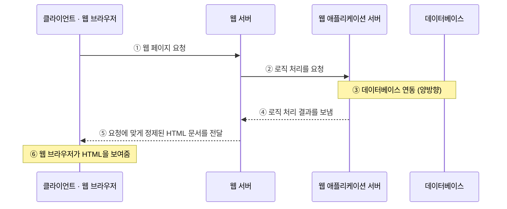
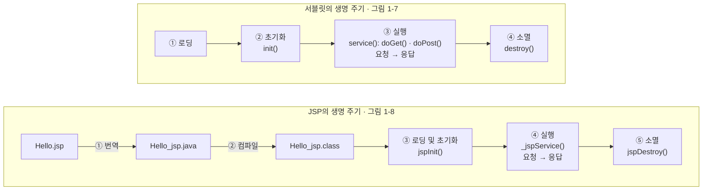

# 📘 2주차 — JSP 기초 지식 (웹 프로그래밍의 이해)

> [!NOTE]
> **📚 출처** — 『쉽게 배우는 JSP 웹 프로그래밍(2판)』 Chapter 01 기반 강의자료 (슬라이드 57장)
> **표기 규칙** — 본문 = 강의자료 내용 · `💡 보충` = 강의자료 밖 추가 설명(공식 문서로 검증) · `💻 환경` = Mac·IntelliJ·Tomcat 11 실습 시 참고

## 🎯 학습 목표
- 웹의 개념과 동작 원리를 이해합니다.
- 서블릿과 JSP의 개념, 특징, 동작 과정을 이해합니다.
- JSP 프로그래밍에 필요한 개발 환경을 구축합니다.
- 동적 웹 프로젝트를 생성하여 간단한 프로그램을 실행합니다.
- 북마켓 프로젝트를 생성합니다.

## 🗺️ 목차
1. 웹과 JSP 프로그래밍의 이해
2. JSP 개발 환경 구축
3. [북마켓] 프로젝트 생성하기

---

## 1️⃣ 웹과 JSP 프로그래밍의 이해
*슬라이드 p.6–19*

### 1. 인터넷과 웹의 개요
- **인터넷**(Internet): 컴퓨터가 서로 연결되어 **TCP/IP**라는 통신 프로토콜을 이용하여 정보를 주고받는 전 세계의 컴퓨터 네트워크
- **웹**(Web): 인터넷에 연결된 컴퓨터들을 통해 사람들이 정보를 공유할 수 있는 정보 공간
  - **월드 와이드 웹**(world wide web, WWW)의 줄임말
  - 그림 1-1(인터넷과 웹): 인터넷 안에 이메일(E-Mail), **웹(WWW)**, 파일 송수신(FTP), 텔넷(Telnet) 등의 서비스가 들어 있음 → 웹은 인터넷 서비스 중 하나
- **웹의 동작 원리**: 웹은 기본적으로 **클라이언트/서버 방식**으로 동작 (그림 1-2)
  - (a) 서버와 클라이언트: 하나의 서버에 여러 클라이언트가 연결됨
  - (b) 요청 및 응답 과정: 클라이언트가 서버에 **요청** → 서버가 클라이언트에 **응답**
- **가장 널리 쓰이는 웹 서버**: 아파치(Apache), 톰캣(Tomcat), IIS(Internet Information Server)

### 2. 정적 웹 페이지와 동적 웹 페이지

| 구분 | 정적 웹 페이지 | 동적 웹 페이지 |
|---|---|---|
| 의미 | 컴퓨터에 저장된 텍스트 파일을 그대로 보는 것 | 저장된 내용을 다른 변수로 가공 처리하여 보는 것 |
| 예 | HTML(HyperText Markup Language) | PHP(Personal Home Page), ASP(Active Server Page), JSP |

**정적 웹 페이지의 동작 방식** (그림 1-3)
1. 클라이언트(웹 브라우저)가 웹 페이지 요청
2. 웹 서버가 `*.html` 파일 검색 (웹 서버에 미리 준비된 파일)
3. 이미 준비된 HTML 문서를 그대로 전달
4. 웹 브라우저가 HTML 문서를 보여줌

**동적 웹 페이지의 동작 방식** (그림 1-4) — 웹 서버 뒤에 **웹 애플리케이션 서버**와 **데이터베이스**가 추가됨



### 3. 서블릿과 JSP
- **웹 프로그래밍 언어**
  - **클라이언트 측 실행 언어**와 **서버 측 실행 언어**로 구분
  - 자바를 기반으로 하는 JSP는 **서버 측** 웹 프로그래밍 언어 중 하나

> [!TIP]
> **💡 보충 — 클라이언트 측 코드 vs 서버 측 코드 (MDN)**
> - 클라이언트 측 코드: HTML·CSS·JavaScript로 작성되어 **웹 브라우저 안에서** 실행, 주로 렌더링된 페이지의 모양과 동작을 개선함
> - 서버 측 코드: 요청에 응답해 **어떤 콘텐츠를 돌려줄지** 결정, 여러 언어로 작성 가능(PHP, Python, Ruby, C#, Node.js 등) → JSP도 여기에 속함
> - 정적 사이트 = 요청할 때마다 서버가 같은 고정 콘텐츠를 반환 / 동적 사이트 = 응답 콘텐츠의 일부를 필요할 때 동적으로 생성

- **서블릿**(Servlet)
  - 자바를 사용하여 웹 페이지를 동적으로 생성하는 서버 측 웹 프로그래밍
  - 웹 서버의 성능을 향상하기 위해 사용되는 자바 클래스의 일종
  - JSP가 HTML 문서 안에 Java 코드를 포함하고 있는 반면, 서블릿은 **자바 코드 안에 HTML을 포함**함
- **서블릿의 특징**: ① 이식 가능함 ② 효율적이고 확장 가능함 ③ 견고함

> [!NOTE]
> **📌 NOTE — CGI**
> CGI(Common Gateway Interface) 기술을 통해 웹 서버는 외부 프로그램을 호출하고 HTTP 요청 정보를 외부 프로그램에 전달하여 요청을 처리할 수 있음. CGI 기술의 문제점:
> - 클라이언트 수가 증가하면 응답을 보내는 데 더 많은 시간이 걸림
> - 각 요청에 대해 프로세스를 시작하고 웹 서버는 시작 프로세스로 제한됨
> - 플랫폼 의존 언어를 사용함(예: C, C++, perl 등)

- **JSP**(Java Server Pages/Jakarta Server Pages)
  - 자바 언어를 기반으로 하는 **스크립트 언어**
  - HTML 내에 자바 코드를 삽입하여 웹 서버에서 동적으로 웹 페이지를 생성하여 웹 브라우저에 전달하는 **서버측 스크립트 언어**
- **JSP의 특징**: ① 서블릿 기술의 확장 ② 유지 관리가 용이함 ③ 빠른 개발이 가능함 ④ 개발하면 코드 길이를 줄일 수 있음

> [!NOTE]
> **📌 NOTE — 서블릿과 JSP의 차이**
>
> | 서블릿 | JSP |
> |---|---|
> | 자바 코드 안에 HTML 태그를 삽입한다. | HTML 코드 안에 자바 코드를 삽입한다. |
> | HTML 태그를 문자열("")로 처리해야 한다. | 자바 코드를 `<% %>` 태그 안에 처리해야 한다. |
> | 자바 코드 수정 시 다시 컴파일하고 배포해야 한다. | 키워드가 태그화 되어 서블릿에 비해 배우기 쉽다. |

### 4. 서블릿과 JSP의 동작 과정

| 단계 | 서블릿 (그림 1-5) | JSP (그림 1-6) |
|---|---|---|
| ❶ | 클라이언트(웹 브라우저) → **HTTP 요청** | 클라이언트 → **JSP 요청** (`Hello.jsp`) |
| ❷ | **배포 서술자** `web.xml` | **번역**: JSP 페이지 `Hello.jsp` → 서블릿 프로그램 `Hello_jsp.java` |
| ❸ | **서블릿 클래스** `Hello.class` | **컴파일**: `Hello_jsp.java` → 서블릿 클래스 `Hello_jsp.class` |
| ❹ | **HTTP 응답**: 가공된 HTML 문서 | **JSP 서블릿 실행 응답**: 가공된 HTML 문서 |
| 처리하는 곳 | 웹 서버의 **서블릿 컨테이너** | 웹 서버의 **JSP 컨테이너** |

- 서블릿: 서블릿 컨테이너 안에서 ❷ 배포 서술자(`web.xml`) → ❸ 서블릿 클래스(`Hello.class`) 순으로 처리된 결과가 HTTP 응답으로 돌아감
- JSP: JSP 페이지가 서블릿 프로그램(`.java`)으로 **번역**되고 서블릿 클래스(`.class`)로 **컴파일**된 뒤 실행되어 응답함 → JSP도 결국 서블릿으로 실행됨

> [!NOTE]
> **📌 NOTE — 서블릿과 JSP의 차이** *(p.17 — 제목은 슬라이드 표기 그대로, 내용은 서버 용어 정리)*
> - **웹 서버**(Web Server): HTTP 프로토콜을 이용하여 클라이언트(웹 브라우저)의 요청을 받아 HTML이나 오브젝트를 전송함. 클라이언트의 요청 중 웹 서버 자체적으로 처리할 수 없는 것은 컨테이너처럼 처리할 수 있는 곳으로 넘겨 처리하기도 함
> - **웹 컨테이너**(Web Container): JSP와 서블릿을 실행할 수 있는 프로그램으로 **서블릿 컨테이너**라고도 함. 웹 서버에서 JSP를 요청하면 톰캣에서는 JSP 파일을 서블릿으로 변환하여 컴파일을 수행하고, 서블릿의 수행 결과를 웹 서버에 전달함
> - **웹 애플리케이션 서버**(Web Application Server): 웹에서 사용하는 컴포넌트를 올려놓고 사용하는 서버

### 5. 서블릿과 JSP 생명 주기



- **서블릿**(그림 1-7): ❶ 로딩 → ❷ 초기화 `init()` → ❸ 실행 `service()`: `doGet()` `doPost()` (요청 → 응답) → ❹ 소멸 `destroy()`
- **JSP**(그림 1-8): `Hello.jsp` → ❶ 번역 → `Hello_jsp.java` → ❷ 컴파일 → `Hello_jsp.class` → ❸ 로딩 및 초기화 `jspInit()` → ❹ 실행 `_jspService()` (요청 → 응답) → ❺ 소멸 `jspDestroy()`
- 비교: JSP는 서블릿의 생명 주기 앞에 **번역·컴파일** 단계가 붙고, 메소드 이름이 `jspInit()`·`_jspService()`·`jspDestroy()`로 대응됨

> [!TIP]
> **💡 보충 — 생명 주기 메소드는 언제·몇 번 호출되나 (Servlet API · Jakarta Pages 명세 · Tomcat 문서)**
> - `init()`: 컨테이너가 서블릿 객체를 만든 뒤 **정확히 한 번** 호출, 성공적으로 끝나야 요청을 받을 수 있음 / `service()`: 클라이언트 요청마다 처리 / `destroy()`: 서비스에서 내릴 때 호출되어 자원(메모리·파일 핸들·스레드 등)을 정리
> - `HttpServlet`의 `service()`는 HTTP 요청을 `doGet()`·`doPost()` 등 `doXxx()` 메소드로 분배함 → 보통 `service()`는 그대로 두고 `doGet()`/`doPost()`를 재정의
> - JSP는 번역되어 서블릿 클래스(JSP page implementation class)가 됨. 번역은 배포 후 ~ 해당 페이지 요청을 처리하기 전 사이 언제든 일어날 수 있고, `jspInit()`은 첫 요청이 전달되기 **전에** 한 번 호출됨
> - Tomcat의 JSP 엔진 **Jasper**는 번역·컴파일 결과를 웹 애플리케이션의 **work 디렉터리**에 만들고(생성 클래스 기본 패키지 `org.apache.jsp`), 개발 모드(`development`, 기본값 `true`)에서는 JSP 수정 여부를 검사해 다시 컴파일함

---

## 2️⃣ JSP 개발 환경 구축
*슬라이드 p.21–49*

### 1. 자바 설치하고 환경 설정하기
- **JSP 개발 환경 도구**: 자바 개발환경 = **JDK** / 웹서버 = **톰캣** / 통합 개발 환경 = **이클립스**

**표 1-1 JSP 개발 환경 도구**

| 요소 | 프로그램명 | 설명 |
|---|---|---|
| 자바 개발 환경 | JDK | JSP는 HTML 코드 내에 자바 코드를 작성하기 때문에 자바 개발 도구인 JDK가 반드시 설치되어 있어야 한다. |
| 웹 서버 | 톰캣 | 웹 프로그래밍 언어로 작성된 웹 페이지가 실행되어 웹 브라우저에 나타나도록 하기 위해 웹 컨테이너를 설치해야 한다. JSP 웹 컨테이너로 자주 사용되는 것 중에서 가장 유명한 것은 톰캣이다. 톰캣은 오픈소스 프로젝트로서 무료로 누구나 사용할 수 있다. |
| 통합 개발 환경 | 이클립스 | JSP 코드를 작성한 후 이를 컴파일하여 오류를 검사하고 실행 결과를 확인할 수 있는 통합 개발 환경(IDE)으로 개발자들에게 가장 인기 있는 이클립스를 선택하여 설치한다. |

- **자바 개발 키트**: JDK(Java Development Kit) / **자바 실행 환경**: JRE(Java Runtime Environment)
- 그림 1-9 JDK와 JRE의 관계 — **JDK ⊃ JRE ⊃ JVM** (안쪽으로 포함)

| 구성 | 포함 요소 |
|---|---|
| JDK | 컴파일러, 디버거, 애플릿뷰어 등 (+ JRE) |
| JRE | 클래스 로더, 자바 API, 실행 시간 라이브러리 등 (+ JVM) |
| JVM | JIT, 자바 인터프리터 등 |

### 🧪 [예제 1-1] JDK 설치하기
1. **오라클 사이트에 접속**: `http://www.oracle.com/kr/java` → [리소스] → [Java 다운로드] 클릭
2. **JDK SE 개발 키트 선택**: Java Downloads 화면의 Java SE 개발 키트에서 **Java 20** 선택(화면: *JDK Development Kit 20.0.1 downloads*) → 플랫폼 탭 [Windows] → [x64 Installer] 파일 다운로드 (`jdk-20_windows-x64_bin.exe`, 159.95 MB)
3. **자바 설치**: 설치 마법사 [Next >] → [Next] → 완료 화면(*Java(TM) SE Development Kit 20.0.1 (64-bit) Successfully Installed*)에서 [Close]
4. **설치 위치 확인**: `C:\Program Files\Java\jdk-20`

> [!WARNING]
> **🔍 검증 — JDK 20은 단기 지원(non-LTS) 버전**
> Oracle Java SE 지원 로드맵상 JDK 20은 non-LTS(Premier Support 2023년 9월 종료)이고, 2023년 9월에 나온 **JDK 21이 LTS**임(슬라이드 캡처에도 "JDK 20 will receive updates ... until September 2023 when it will be superseded by JDK 21" 문구가 보임). 실습 환경의 JDK 21은 LTS이며 Tomcat 11의 요구 사항(Java 17 이상)도 충족함.

> [!NOTE]
> **💻 환경 — Mac · IntelliJ · Tomcat 11**
> - 설치 위치 확인 단계 대신 터미널에서 `java -version`으로 설치 여부·버전 확인 (Tomcat 11은 Java 17 이상이면 동작)
> - 설치 위치는 설치 방식에 따라 다름: `.dmg`/`.pkg` 설치 → `/Library/Java/JavaVirtualMachines/<JDK>.jdk/Contents/Home` (예: Azul Zulu 21 → `zulu-21.jdk`, Oracle JDK 21 → `jdk-21.jdk`) / **mise** 같은 런타임 버전 관리자로 설치 → 그 도구가 관리하는 폴더(mise는 `installs/java` 아래)

### 🧪 [예제 1-2] 자바 환경 변수 설정하기
1. **[환경 변수] 대화상자 열기**: 파일 탐색기에서 ❶ [내 PC] 우클릭 → ❷ [속성] → ❸ [고급 시스템 설정] → [시스템 속성] 창 [고급] 탭의 ❹ [환경 변수]
2. **자바 환경 변수 설정**
   - 시스템 변수 [새로 만들기] → 변수 이름 `JAVA_HOME`, 변수 값 `C:\Program Files\Java\jdk-20` → [확인]
   - 시스템 변수 `Path` 선택 → [편집] → [환경 변수 편집] 창에서 [새로 만들기] → `%JAVA_HOME%` 추가 → [확인] → [확인]
3. **설정한 환경 변수 확인** (슬라이드 번호는 '2.'로 중복 표기): [명령 프롬프트] 창에 `javac -version` 입력 → `javac 20.0.1` 출력

```text
C:\Users\user>javac -version
javac 20.0.1
```

- 슬라이드 본문에는 `javac –version`처럼 하이픈 대신 긴 대시(–)가 찍혀 있음 → 복사하지 말고 캡처 화면대로 하이픈 `-version`으로 입력

> [!WARNING]
> **🔍 검증 — Path에는 보통 `%JAVA_HOME%\bin`을 추가**
> p.28 캡처의 Path 항목은 `%JAVA_HOME%`까지만 보임(뒤쪽이 ⑦ 번호 표시에 가려졌을 수 있음 — 판독 불확실). `javac` 등 JDK 실행 파일은 JDK의 `bin` 폴더에 있으므로(Oracle 설치 가이드) Path에는 `%JAVA_HOME%\bin` 형태로 넣어야 함. Azul 설치 문서도 `<설치 폴더>/bin`을 PATH에 추가하도록 안내함.

> [!NOTE]
> **💻 환경 — Mac · IntelliJ · Tomcat 11**
> - macOS에는 [환경 변수] 대화상자가 없음 → `.dmg`/`.pkg`로 설치한 JDK라면 기본 셸 zsh(macOS 10.15부터)가 대화형 셸마다 읽는 `~/.zshrc`에 `export JAVA_HOME=$(/usr/libexec/java_home -v 21)` 추가 → 새 터미널에서 `echo $JAVA_HOME`, `javac -version` 확인
> - 이 경우 `/usr/bin/java` 등 `/usr/bin`의 Java 명령이 설치된 최신 JDK를 찾아 쓰므로(Oracle FAQ) Windows처럼 Path에 JDK 경로를 추가하지 않아도 `javac` 실행 가능
> - **mise**로 Java를 관리한다면 mise가 활성화된 셸에서 `JAVA_HOME`을 선택된 JDK로 자동 설정함 → `.zshrc`에 따로 고정하지 않음 (shims만 쓰는 구성에서는 `java` 프로세스만 이 값을 봄. 또 `/usr/libexec/java_home`은 mise가 설치한 JDK를 찾지 못함)
> - IntelliJ에서는 JDK를 **프로젝트 SDK**(File | Project Structure | Project Settings | Project)로 지정하고, Tomcat 실행 구성의 JRE도 기본값이 프로젝트 JDK → JAVA_HOME은 주로 터미널에서 Tomcat 스크립트(`startup.sh`)를 직접 쓸 때 필요(Tomcat 스크립트는 `JAVA_HOME` 또는 `JRE_HOME` 필수)

### 2. 웹 서버와 통합 개발 환경 설치하기
- **웹 서버 — 톰캣**
  - 아파치 소프트웨어재단에서 개발한 웹 애플리케이션 서버
  - 자바로 만들어진 웹 페이지를 구동하기 위한 엔진
- **통합 개발 환경 — 이클립스**
  - 자바 통합 개발 환경(IDE) 중 가장 많이 사용되는 개발 도구
  - 자바를 기반으로 애플리케이션을 개발하기 위해 이클립스를 사용

### 🧪 [예제 1-3] 톰캣 설치하기
1. **아파치 사이트에 접속 및 다운로드**: `http://tomcat.apache.org` → 왼쪽 Download 메뉴의 [Tomcat 10] → `10.1.9`의 Binary Distributions → Core: [64-bit Windows zip] 다운로드
2. **압축 해제·이동**: `apache-tomcat-10.1.9-windows-x64.zip`의 압축을 풀고 하위에 있는 `apache-tomcat-10.1.9` 폴더를 C 드라이브로 옮김 → `C:\apache-tomcat-10.1.9`

> [!NOTE]
> **💻 환경 — Mac · IntelliJ · Tomcat 11**
> - Tomcat 11 다운로드 페이지의 Binary Distributions → **Core**에서 `tar.gz`(또는 `zip`)를 받음 (`Windows zip`·`Windows Service Installer`는 Windows용)
> - 압축을 풀어 `apache-tomcat-[버전]` 폴더째 원하는 위치에 둠 → 이 폴더(`CATALINA_HOME`)를 IntelliJ에 등록함([예제 1-5] 대응)
> - Tomcat 11은 Java 17 이상 필요 → JDK 21 사용 가능. IntelliJ 없이 단독 실행할 때는 `bin/startup.sh` 실행 후 `http://localhost:8080/` 접속
> - p.31 캡처에는 'Tomcat 11 (alpha)'로 표시돼 있지만, 현재 Tomcat 11.0.x는 Stable(운영 환경용) 버전임

> [!NOTE]
> **📌 NOTE — 톰캣 버전에 따른 주의 사항**
> - **톰캣 9버전 이하를 사용하는 경우**: 기존 자바EE의 API 패키지명은 `javax.*`을 그대로 사용하면 되고, 기존 제공되는 자바 라이브러리(`*.jar`)도 그대로 사용하면 됨
> - **톰캣 10버전 이상을 사용하는 경우**: 기존 자바EE의 변경된 자카르타EE의 API 패키지명은 `Jakarta.*`을 사용하므로 기존의 API 패키지명 `javax.*`을 `Jakarta.*`로 변경해야 하고, 기존에 제공되는 자바 라이브러리(`*.jar`)를 마이그레이션하여 사용해야 함
> - 이 책에서는 톰캣 10버전을 사용하며 이전 자바 라이브러리를 마이그레이션하는 방법은 7장에서 살펴봄. 또한 톰캣 9버전을 사용하는 사용자를 위해 기존 버전의 라이브러리도 제공함(자바 라이브러리를 마이그레이션 전, 후 파일 모두 제공)

> [!WARNING]
> **🔍 검증 — 패키지명은 소문자 `jakarta.*`**
> 슬라이드의 `Jakarta.*`는 표기 오류로, 실제 패키지명은 소문자 `jakarta.*`(예: `jakarta.servlet`)임. Tomcat 10 마이그레이션 가이드: Tomcat 9.0.x → 10.0.x 사이에 명세 API의 자바 패키지가 `javax...`에서 `jakarta...`로 바뀌어 웹 애플리케이션을 새 API로 다시 컴파일해야 함. 기존 Java EE 8 애플리케이션은 **Apache Tomcat migration tool for Jakarta EE**로 변환할 수 있음.

> [!TIP]
> **💡 보충 — 톰캣 버전별 명세·Java 요구 사항** (Apache Tomcat "Which Version" 표 기준)
>
> | Tomcat | Servlet | JSP(Pages) | 필요 Java | API 패키지 |
> |---|---|---|---|---|
> | 9.0.x | 4.0 | 2.3 | 8 이상 | `javax.*` (Java EE를 지원하는 마지막 버전) |
> | 10.1.x (슬라이드) | 6.0 | 3.1 | 11 이상 | `jakarta.*` |
> | 11.0.x (실습 환경) | 6.1 | 4.0 | 17 이상 | `jakarta.*` |
>
> JSP 명세의 현재 공식 이름은 **Jakarta Pages**(구 JavaServer Pages)이며, 3.0·3.1까지는 Jakarta Server Pages, 4.0(Jakarta EE 11)부터 Jakarta Pages로 표기됨.

### 🧪 [예제 1-4] 이클립스 다운로드하고 설치하기
1. **이클립스 사이트에 접속**: `http://www.eclipse.org/downloads/` → *Get Eclipse IDE 2023-03* 아래 [Download Packages]
2. **이클립스 설치 파일 다운로드**: **Eclipse IDE for Enterprise Java and Web Developers**의 [Windows x86_64] → [Download] (`eclipse-jee-2023-03-R-win32-x86_64.zip`)
3. **설치 완료하고 실행**: 압축을 푼 `C:\eclipse` 폴더의 `eclipse` 실행 파일 실행
4. **이클립스 작업 공간 설정**: Eclipse Launcher의 Workspace에 사용자 폴더 아래 `eclipse-workspace` 지정(화면: `C:\Users\YKH\eclipse-workspace`) → [Launch]
5. **이클립스 실행 화면**: Welcome 탭(Eclipse IDE for Enterprise Java and Web Developers)을 닫으면 Project Explorer·Outline·Markers/Servers 탭 등이 있는 작업 화면이 나타남

> [!NOTE]
> **💻 환경 — Mac · IntelliJ · Tomcat 11**
> 이클립스 대신 **IntelliJ IDEA Ultimate** 사용 — Jakarta EE·Tomcat 개발에 필요한 **Tomcat and TomEE**, **Jakarta EE Platform** 플러그인이 Ultimate에 기본 번들·활성화되어 있어 추가 설치가 필요 없음(Ultimate 구독 없이는 Jakarta EE 지원이 제한됨).

### 🧪 [예제 1-5] 이클립스와 톰캣 서버 연동하기
1. **Servers 프로젝트 생성**: [File] → [New] → [Other...]
2. **웹 서버 유형 설정**: Select a wizard에서 [Server] → [Server] → [Next >] → Define a New Server에서 Apache → **Tomcat v10.1 Server** 선택 (Server's host name `localhost`, Server name `Tomcat v10.1 Server at localhost`) → [Next >]
3. **웹 서버 위치와 JRE 설정**: Name `Apache Tomcat v10.1`, Tomcat installation directory `C:\apache-tomcat-10.1.9`([Browse...]로 지정), JRE `Workbench default JRE` → [Finish]
4. **연동 확인**
   - Project Explorer에 `Servers` 프로젝트 생성 → `Tomcat v10.1 Server at localhost-config` 아래 `catalina.policy`, `catalina.properties`, `context.xml`, `server.xml`, `tomcat-users.xml`, `web.xml`
   - [Servers] 탭에 `Tomcat v10.1 Server at localhost`(정지 상태) 표시
   - Preferences → Server → Runtime Environments에 `Apache Tomcat v10.1`(Type: Apache Tomcat v10.1) 등록 확인

> [!NOTE]
> **💻 환경 — Mac · IntelliJ · Tomcat 11**
> - Settings(`Windows: Ctrl+Alt+S / Mac: ⌘,`) → **Build, Execution, Deployment | Application Servers** → `+` → Tomcat Server → **Tomcat Home**에 압축을 푼 Tomcat 11 폴더 지정(이름·버전은 자동 인식)
> - Tomcat 실행 구성의 Application server 옆 [Configure...]로도 같은 Application Servers 창을 열 수 있음

### 3. JSP 애플리케이션 만들고 실행하기
- **프로젝트 만들고 실행하기** (그림 1-10 JSP 애플리케이션 개발 과정): **프로젝트 생성하기 → JSP 페이지 작성하기 → 프로젝트 실행하기**
- **동적 웹 프로젝트의 구조** (그림 1-11)

```text
src
└── main
    └── webapp
        ├── WEB-INF
        │   ├── classes      ← class 파일
        │   ├── lib          ← jar 같은 라이브러리 파일
        │   └── web.xml
        ├── JSP 파일
        └── 정적 리소스 (html, 이미지, css ...)
```

### 🧪 [예제 1-6] 프로젝트 만들고 실행하기
**[프로젝트 생성하기]**
1. **동적 웹 프로젝트 생성**: [File] → [New] → [Dynamic Web Project]
2. **프로젝트 이름 설정**: Project name `JSPBook` (Location 기본값 `C:\Users\user\eclipse-workspace\JSPBook`), Target runtime `Apache Tomcat v10.1`, Dynamic web module version `5.0` → [Finish]
   - 생성된 구조: `JSPBook` 아래 Deployment Descriptor: JSPBook, JAX-WS Web Services, Java Resources, `build`, `src/main/java`, `src/main/webapp/META-INF`, `src/main/webapp/WEB-INF/lib`, `src/main/webapp/WEB-INF/web.xml`
3. **프로젝트 구성 설정**: 프로젝트 속성(Properties for JSPBook) → [Project Facets]에서 Dynamic Web Module `5.0`, Java `17`, JavaScript `1.0` 체크 확인 → 오른쪽 [Runtimes] 탭에서 `Apache Tomcat v10.1` 체크 → [Apply and Close]

**[JSP 페이지 작성하기]**

4. **JSP 파일 생성**: `JSPBook` 우클릭 → [New] → [File] → 상위 폴더 `JSPBook/src/main/webapp`, File name `hello.jsp` → [Finish]
5. **JSP 파일 작성**

📄 `JSPBook/src/main/webapp/hello.jsp`
```jsp
<html>
<head>
<title>Welcome</title>
</head>
<body>
    <h1>Hello JSP!!</h1>
    Hello! Java Server Pages.
</body>
</html>
```

**[프로젝트 실행하기]**

6. **톰캣 서버에 등록**: [Servers] 탭의 `Tomcat v10.1 Server at localhost` 우클릭 → [Add and Remove...] → Available의 `JSPBook` 선택 → [Add >] → [Finish] → Servers 탭에 `JSPBook`이 붙음(`[Stopped, Republish]`) → Servers 탭의 서버 시작 버튼 클릭
7. **실행 결과 확인**: 툴바 실행 버튼의 [Run As] → [1 Run on Server] → Run On Server 창에서 'Choose an existing server' → `localhost` > `Tomcat v10.1 Server at localhost` → [Finish] → 서버 재시작 확인 창에서 'Restart server' → [OK]

- **실행 결과**: 이클립스 내장 브라우저에 `http://localhost:8080/JSPBook/hello.jsp` → 큰 제목 **Hello JSP!!**, 그 아래 `Hello! Java Server Pages.` (탭 제목 `Welcome`)
- **코드 포인트**: ① 코드는 HTML 태그뿐이지만 `webapp` 폴더에 `.jsp` 파일로 만들어 JSP 페이지로 실행함 ② 실행 URL = `http://localhost:8080` + `/JSPBook`(프로젝트명) + `/hello.jsp`(`webapp` 기준 파일 경로)

> [!NOTE]
> **💻 환경 — Mac · IntelliJ · Tomcat 11** (프로젝트 생성 · JSP 작성)
> - File | New | Project → **Jakarta EE** → 이름 `JSPBook`, 템플릿 **Web application**, 빌드 도구 Maven, JDK 21 → [Next] → Version **Jakarta EE 11**(Tomcat 11과 호환), Dependencies에 Servlet → [Create]
> - 샘플로 `index.jsp`와 `HelloServlet`이 생성됨. Maven 표준 디렉터리 구조에서 웹 애플리케이션 소스 폴더는 `src/main/webapp` → 그림 1-11과 같은 위치에 JSP를 둠
> - Project 창에서 `src/main/webapp` 우클릭 → New | File → `hello.jsp` 생성 후 위 코드 입력

> [!NOTE]
> **💻 환경 — Mac · IntelliJ · Tomcat 11** (실행 — 이클립스의 Add and Remove + Run on Server에 해당)
> - Run | Edit Configurations → `+` → Tomcat Server → **Local** → Server 탭 Application server에 Tomcat 11 선택 (JRE 기본값 = 프로젝트 JDK)
> - **Deployment** 탭 `+` → Artifact → `JSPBook:war exploded` 추가 → **Application context**(컨텍스트 루트)를 `/JSPBook`으로 지정 — JetBrains 튜토리얼 URL(`…/JakartaEEHelloWorld_war_exploded/`)처럼 기본 경로가 프로젝트명과 다를 수 있음
> - 툴바에서 이 실행 구성을 선택하고 실행(`Windows: Shift+F10 / Mac: ⌃R`) → `http://localhost:8080/JSPBook/hello.jsp`

---

## 3️⃣ [북마켓] 프로젝트 생성하기
*슬라이드 p.51–56*

- **프로젝트 실행 결과** (그림 1-12 북마켓 프로젝트의 실행): 주소 `localhost:8080/BookMarket/welcome.jsp`, 탭 제목 `Welcome`, 큰 제목 **Welcome to Book Shopping Mall**, 그 아래 작은 제목 **Welcome to Web Market!**

### 🧪 [예제 1-7] 북마켓 프로젝트 만들기
- [예제 1-6]과 같은 방법으로 **BookMarket** 프로젝트를 만들고 실행함

**[프로젝트 생성하기]**
1. **동적 웹 프로젝트 생성**: [File] → [New] → [Dynamic Web Project]
2. **프로젝트 이름 설정**: Project name `BookMarket` (Location `C:\Users\user\eclipse-workspace\BookMarket`), Target runtime `Apache Tomcat v10.1`, Dynamic web module version `6.0`, Configuration `Default Configuration for Apache Tomcat v10.1` → [Finish]

**[JSP 페이지 작성하기]**

3. **JSP 파일 생성**: Create New File 창에서 상위 폴더 `BookMarket/src/main/webapp` 선택, File name `welcome.jsp` → [Finish]
4. **JSP 페이지 코드 작성**

📄 `BookMarket/src/main/webapp/welcome.jsp`
```jsp
<html>
<head>
<title>Welcome</title>
</head>
<body>
    <h1>Welcome to Book Shopping Mall</h1>
    <h3>Welcome to Web Market!</h3>
</body>
</html>
```

**[프로젝트 실행하기]**

5. **톰캣 서버에 등록**: [Add and Remove...] → Available의 `BookMarket` 선택 → [Add >] → Configured에 `BookMarket`, `JSPBook` 두 개가 있는지 확인 → [Finish]
6. **실행 결과 확인**: `welcome.jsp`를 연 상태에서 툴바 실행 버튼의 [Run As] → [1 Run on Server] → Servers 탭에 `Tomcat v10.1 Server at localhost [Started, Restart]`, 그 아래 `JSPBook [Synchronized]`, `BookMarket [Synchronized]`

- **실행 결과**: `localhost:8080/BookMarket/welcome.jsp` — 탭 제목 `Welcome`(`<title>`), `<h1>` **Welcome to Book Shopping Mall**, `<h3>` **Welcome to Web Market!** (그림 1-12)
- **코드 포인트**: ① `<title>` 내용은 브라우저 탭 제목, `<h1>`·`<h3>`은 크기가 다른 제목으로 표시됨 ② 하나의 톰캣 서버에 `JSPBook`·`BookMarket`이 함께 등록되어 URL의 `/JSPBook`, `/BookMarket` 경로로 구분됨

> [!WARNING]
> **🔍 검증 — 슬라이드 사이의 설정값·캡처 차이**
> - Dynamic web module version이 JSPBook(p.44·45)은 `5.0`, BookMarket(p.52)은 `6.0`으로 다름 — p.49 Run On Server 창 설명에 따르면 Apache Tomcat v10.1은 'Jakarta EE 9 and 10 Web modules'를 지원하므로 둘 다 실행 가능
> - p.52 오른쪽 Project Explorer 캡처는 `BookMarket`이 아니라 `JSPBook` 트리임(예제 1-6 화면 재사용으로 보임). BookMarket의 실제 구조(`src/main/java`, `src/main/webapp`)는 p.53 캡처에서 확인 가능

> [!NOTE]
> **💻 환경 — Mac · IntelliJ · Tomcat 11**
> - [예제 1-6]과 같이 Jakarta EE 프로젝트 `BookMarket`(Web application, Jakarta EE 11) 생성 → `src/main/webapp`에 `welcome.jsp` 작성
> - Tomcat 실행 구성 Deployment 탭에 `BookMarket:war exploded` 추가, Application context `/BookMarket` → 실행 후 `http://localhost:8080/BookMarket/welcome.jsp`

---

## 🧠 핵심 요약
- **인터넷** = TCP/IP로 정보를 주고받는 전 세계 컴퓨터 네트워크 / **웹(WWW)** = 그 위의 정보 공유 공간, **클라이언트/서버**(요청 → 응답) 방식으로 동작
- **정적 웹 페이지**(HTML) = 저장된 파일 그대로 전달 / **동적 웹 페이지**(PHP·ASP·JSP) = 웹 서버 → 웹 애플리케이션 서버(로직·DB 연동) → 정제된 HTML 전달
- **서블릿** = 자바 코드 안에 HTML(문자열 `""`), 수정 시 재컴파일·배포 / **JSP** = HTML 안에 자바 코드(`<% %>`), 서블릿 기술의 확장
- **CGI 문제점**: 클라이언트 증가 시 응답 지연, 요청마다 프로세스 시작, 플랫폼 의존 언어(C, C++, perl)
- **동작 과정**: 서블릿 = HTTP 요청 → 배포 서술자(`web.xml`) → 서블릿 클래스 → HTTP 응답 / JSP = 요청 → **번역**(`Hello_jsp.java`) → **컴파일**(`Hello_jsp.class`) → 실행 → 가공된 HTML 응답

| 생명 주기 | 서블릿 | JSP |
|---|---|---|
| 사전 단계 | ❶ 로딩 | ❶ 번역 → ❷ 컴파일 |
| 초기화 | ❷ `init()` | ❸ 로딩 및 초기화 `jspInit()` |
| 실행(요청 → 응답) | ❸ `service()`: `doGet()` `doPost()` | ❹ `_jspService()` |
| 소멸 | ❹ `destroy()` | ❺ `jspDestroy()` |

- **용어**: 웹 서버(HTTP 요청 → HTML·오브젝트 전송) / 웹 컨테이너 = 서블릿 컨테이너(JSP·서블릿 실행, 톰캣) / 웹 애플리케이션 서버(웹 컴포넌트를 올려놓고 사용)
- **개발 환경**(슬라이드): JDK 20 + 환경 변수 `JAVA_HOME` / 톰캣 10.1.9(`C:\apache-tomcat-10.1.9`) / Eclipse IDE 2023-03 for Enterprise Java and Web Developers — JDK ⊃ JRE ⊃ JVM
- **톰캣 9 이하** = `javax.*` / **톰캣 10 이상** = 자카르타 EE 패키지(`jakarta.*`) + 기존 jar 마이그레이션
- **동적 웹 프로젝트**: `src/main/webapp`에 JSP·정적 리소스, `WEB-INF`에 `classes`·`lib`·`web.xml`
- **실행 URL**: `http://localhost:8080/JSPBook/hello.jsp`, `http://localhost:8080/BookMarket/welcome.jsp`

## ✍️ 시험 대비 체크포인트
- **Q.** 인터넷과 웹의 차이는? → **A.** 인터넷은 TCP/IP 통신 프로토콜로 정보를 주고받는 전 세계 컴퓨터 네트워크, 웹(world wide web)은 인터넷에 연결된 컴퓨터들을 통해 정보를 공유하는 정보 공간(이메일·FTP·텔넷과 함께 인터넷 서비스 중 하나)
- **Q.** 웹의 동작 방식과 가장 널리 쓰이는 웹 서버 3가지는? → **A.** 클라이언트/서버 방식(요청·응답) / 아파치(Apache), 톰캣(Tomcat), IIS
- **Q.** 정적 웹 페이지와 동적 웹 페이지의 차이와 예는? → **A.** 정적 = 저장된 텍스트 파일을 그대로 보는 것(HTML) / 동적 = 저장된 내용을 다른 변수로 가공 처리하여 보는 것(PHP, ASP, JSP)
- **Q.** 동적 웹 페이지 동작 방식에서 웹 서버의 요청을 받아 로직을 처리하고 데이터베이스와 연동하는 것은? → **A.** 웹 애플리케이션 서버 (② 로직 처리 요청 → ③ DB 연동 → ④ 처리 결과 → ⑤ 정제된 HTML 전달)
- **Q.** CGI 기술의 문제점 3가지는? → **A.** 클라이언트 수 증가 시 응답 시간 증가 / 요청마다 프로세스를 시작(웹 서버는 시작 프로세스로 제한) / 플랫폼 의존 언어 사용(C, C++, perl 등)
- **Q.** 서블릿의 특징 3가지와 JSP의 특징 4가지는? → **A.** 서블릿: 이식 가능, 효율적이고 확장 가능, 견고함 / JSP: 서블릿 기술의 확장, 유지 관리 용이, 빠른 개발 가능, 코드 길이 단축
- **Q.** 서블릿과 JSP의 코드 작성 방식 차이 3가지는? → **A.** 서블릿: 자바 코드 안에 HTML 삽입, HTML을 문자열("")로 처리, 수정 시 재컴파일·배포 / JSP: HTML 안에 자바 코드 삽입, 자바 코드를 `<% %>` 태그 안에 작성, 키워드가 태그화되어 배우기 쉬움
- **Q.** `Hello.jsp` 요청 시 JSP 컨테이너의 처리 과정은? → **A.** ❶ JSP 요청 → ❷ 번역(`Hello_jsp.java`) → ❸ 컴파일(`Hello_jsp.class`) → ❹ JSP 서블릿 실행 후 가공된 HTML 문서로 응답
- **Q.** 서블릿 동작 과정(그림 1-5)에서 `web.xml`을 무엇이라 부르나? → **A.** 배포 서술자 (배포 서술자 `web.xml` → 서블릿 클래스 `Hello.class`, 서블릿 컨테이너에서 처리)
- **Q.** 서블릿 생명 주기의 단계와 메소드는? → **A.** 로딩 → 초기화 `init()` → 실행 `service()`(`doGet()`/`doPost()`) → 소멸 `destroy()`
- **Q.** JSP 생명 주기의 단계와 메소드는? → **A.** 번역 → 컴파일 → 로딩 및 초기화 `jspInit()` → 실행 `_jspService()` → 소멸 `jspDestroy()`
- **Q.** 웹 컨테이너란? → **A.** JSP와 서블릿을 실행할 수 있는 프로그램(= 서블릿 컨테이너). 톰캣은 JSP 파일을 서블릿으로 변환·컴파일하고 서블릿 수행 결과를 웹 서버에 전달
- **Q.** JSP 개발 환경 도구 3가지와 JDK·JRE·JVM의 관계는? → **A.** JDK·톰캣·이클립스 / JDK(컴파일러·디버거·애플릿뷰어 등) ⊃ JRE(클래스 로더·자바 API·실행 시간 라이브러리 등) ⊃ JVM(JIT·자바 인터프리터 등)
- **Q.** 톰캣 9 이하와 10 이상에서 API 패키지명은? → **A.** 9 이하 `javax.*`(기존 jar 그대로) / 10 이상 자카르타 EE 패키지(`jakarta.*`)로 변경, 기존 jar는 마이그레이션 필요
- **Q.** 동적 웹 프로젝트에서 class 파일, jar 라이브러리, `web.xml`, JSP 파일의 위치는? → **A.** `src/main/webapp/WEB-INF/classes`, `WEB-INF/lib`, `WEB-INF/web.xml` / JSP 파일·정적 리소스는 `src/main/webapp` 아래

## 🔗 참고 자료
- [Oracle — Java SE Support Roadmap](https://www.oracle.com/java/technologies/java-se-support-roadmap.html) — JDK 20 non-LTS, JDK 21 LTS 확인
- [Oracle — JDK 21 Installation Guide: macOS](https://docs.oracle.com/en/java/javase/21/install/installation-jdk-macos.html) — macOS 설치 경로, `/usr/libexec/java_home`으로 JAVA_HOME 지정, `/usr/bin/java` 동작
- [Oracle — JDK 21 Installation Guide: Windows](https://docs.oracle.com/en/java/javase/21/install/installation-jdk-microsoft-windows-platforms.html) — 기본 설치 경로, 실행 파일이 JDK `bin` 폴더에 있음
- [Azul — Install Azul Zulu on macOS](https://docs.azul.com/core/install/macos) — Zulu 21 DMG 설치 경로, PATH에 `bin` 추가 안내
- [mise — Java](https://mise.jdx.dev/lang/java.html) — mise의 `JAVA_HOME` 설정 방식, macOS `/usr/libexec/java_home` 관련 주의
- [Apple — Use zsh as the default shell on Mac](https://support.apple.com/en-us/102360) — macOS 10.15부터 기본 셸 zsh
- [zsh — Startup/Shutdown Files](https://zsh.sourceforge.io/Intro/intro_3.html) — `.zshrc`는 대화형 셸에서 읽힘
- [Apache Tomcat — Which Version Do I Want?](https://tomcat.apache.org/whichversion.html) — 버전별 Servlet/JSP 명세·Java 요구 사항, 11.0.x Stable
- [Apache Tomcat — Migration Guide: Tomcat 10](https://tomcat.apache.org/migration-10.html) — `javax` → `jakarta` 패키지 변경, Jakarta EE 마이그레이션 도구
- [Apache Tomcat 11 — RUNNING.txt](https://tomcat.apache.org/tomcat-11.0-doc/RUNNING.txt) — Java 17 이상, 설치(압축 해제)·`JAVA_HOME`/`JRE_HOME`·`startup.sh`·`http://localhost:8080/`
- [Apache Tomcat 11 — Download](https://tomcat.apache.org/download-11.cgi) — Core 배포 형식(zip, tar.gz, Windows zip, Windows Service Installer)
- [Apache Tomcat 11 — Jasper 2 JSP Engine How To](https://tomcat.apache.org/tomcat-11.0-doc/jasper-howto.html) — `scratchdir`(work 디렉터리), `development`, `org.apache.jsp`
- [Apache Tomcat 11 — Servlet API: `Servlet`](https://tomcat.apache.org/tomcat-11.0-doc/servletapi/jakarta/servlet/Servlet.html) · [`HttpServlet`](https://tomcat.apache.org/tomcat-11.0-doc/servletapi/jakarta/servlet/http/HttpServlet.html) — 생명 주기 메소드 호출 순서·횟수, `doXxx()` 분배
- [Jakarta EE — Jakarta Pages](https://jakarta.ee/specifications/pages/) · [Jakarta Server Pages 3.1 명세](https://jakarta.ee/specifications/pages/3.1/jakarta-server-pages-spec-3.1) — 명칭 변화, 번역 시점, `jspInit()` 호출 시점
- [Apache Maven — Standard Directory Layout](https://maven.apache.org/guides/introduction/introduction-to-the-standard-directory-layout.html) — `src/main/webapp` = 웹 애플리케이션 소스
- [MDN — Introduction to the server side](https://developer.mozilla.org/en-US/docs/Learn_web_development/Extensions/Server-side/First_steps/Introduction) — 클라이언트/서버 측 코드, 정적·동적 사이트
- [JetBrains — Tutorial: Your first Jakarta EE application](https://www.jetbrains.com/help/idea/2026.1/creating-and-running-your-first-jakarta-ee-application.html) — Jakarta EE 프로젝트 생성(Web application, Jakarta EE 11 ↔ Tomcat 11), Application Servers 등록, 실행 구성·아티팩트, 번들 플러그인
- [JetBrains — Run/Debug configuration: Tomcat Server](https://www.jetbrains.com/help/idea/2026.1/run-debug-configuration-tomcat-server.html) — JRE 기본값, Deployment 탭·Application context, Configure 버튼
- [JetBrains — Application Servers](https://www.jetbrains.com/help/idea/application-servers-settings.html) — `<Server> Home` = 서버 설치 폴더
- [JetBrains — SDKs](https://www.jetbrains.com/help/idea/sdk.html) — 프로젝트 SDK 설정 경로
- [JetBrains — Add items to your project](https://www.jetbrains.com/help/idea/2026.2/add-items-to-project.html) — New | File
- [JetBrains — Predefined macOS keymap](https://www.jetbrains.com/help/idea/reference-keymap-mac-default.html) · [Windows keymap](https://www.jetbrains.com/help/idea/reference-keymap-win-default.html) — Settings, 실행 단축키
