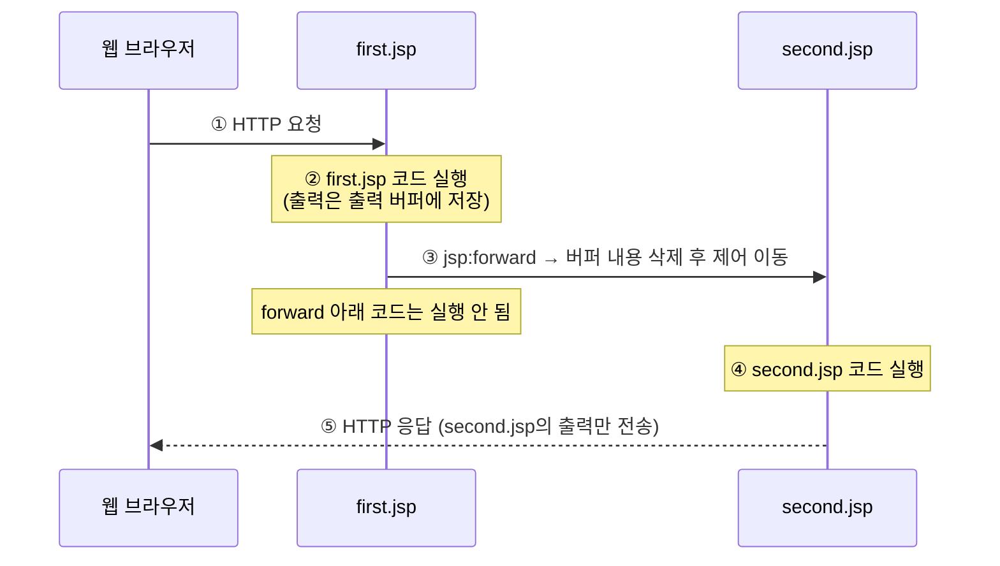
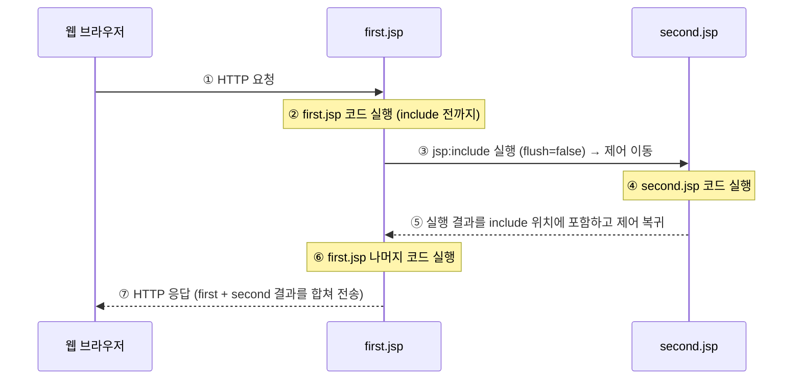

# 📘 5주차 — 액션 태그

> [!NOTE]
> **📚 출처** — 『쉽게 배우는 JSP 웹 프로그래밍(2판)』 Chapter 04 기반 강의자료 (슬라이드 60장)
> **표기 규칙** — 본문 = 강의자료 내용 · `💡 보충` = 강의자료 밖 추가 설명(공식 문서로 검증) · `💻 환경` = Mac·IntelliJ·Tomcat 11 실습 시 참고

## 🎯 학습 목표
- 액션 태그의 개념과 특징을 이해합니다.
- 액션 태그 구성 요소의 사용법을 익힙니다.
- 액션 태그를 이용하여 북마켓의 도서 목록을 출력합니다.

## 🗺️ 목차
1. 액션 태그의 개요
2. forward 액션 태그
3. include 액션 태그
4. param 액션 태그
5. 자바빈즈 액션 태그
6. [북마켓] 도서 목록 표시하기

---

## 1️⃣ 액션 태그의 개요
*슬라이드 p.6–7*

- **액션 태그**(action tag): 서버나 클라이언트에게 **어떤 행동을 하도록 명령**하는 태그
- 하는 일
  - JSP 페이지에서 **페이지와 페이지 사이 제어**
  - 다른 페이지의 **실행 결과 내용을 현재 페이지에 포함**
  - **자바빈즈**(JavaBeans) 등의 다양한 기능 제공
- **XML 형식** `<jsp: … />` 사용

### 📌 액션 태그의 종류 (표 4-1)

| 액션 태그 | 형식 | 설명 |
|---|---|---|
| `forward` | `<jsp:forward … />` | 다른 페이지로의 이동과 같은 페이지 흐름을 제어한다. |
| `include` | `<jsp:include … />` | 외부 페이지의 내용을 포함하거나 페이지를 모듈화한다. |
| `useBean` | `<jsp:useBean … />` | JSP 페이지에 자바빈즈를 설정한다. |
| `setProperty` | `<jsp:setProperty … />` | 자바빈즈의 프로퍼티 값을 설정한다. |
| `getProperty` | `<jsp:getProperty … />` | 자바빈즈의 프로퍼티 값을 얻어온다. |
| `param` | `<jsp:param … />` | `<jsp:forward>`, `<jsp:include>`, `<jsp:plugin>` 태그에 인자를 추가한다. |
| `plugin` | `<jsp:plugin … />` | 웹 브라우저에 자바 애플릿을 실행한다. 자바 플러그인에 대한 OBJECT 또는 EMBED 태그를 만드는 브라우저별 코드를 생성한다. |
| `element` | `<jsp:element … />` | 동적 XML 요소를 설정한다. |
| `attribute` | `<jsp:attribute … />` | 동적으로 정의된 XML 요소의 속성을 설정한다. |
| `body` | `<jsp:body … />` | 동적으로 정의된 XML 요소의 몸체를 설정한다. |
| `text` | `<jsp:text … />` | JSP 페이지 및 문서에서 템플릿 텍스트를 작성한다. |

- 이번 주에 직접 다루는 것: `forward`, `include`, `param`, 자바빈즈용 `useBean`·`setProperty`·`getProperty`

> [!WARNING]
> **🔍 검증 — `jsp:plugin`은 Tomcat 11(Jakarta Pages 4.0)에서 쓸 수 없음**
> - `jsp:plugin`과 관련 액션은 Jakarta Pages **3.1**(Jakarta EE 10 · Tomcat 10.1)에서 deprecated → Pages **4.0**(Jakarta EE 11 · Tomcat 11)에서 **제거**됨. 사유: 관련 HTML 요소를 주요 브라우저가 더 이상 지원하지 않음
> - 따라서 표의 `plugin` 행과 `param` 설명 중 `<jsp:plugin>` 부분은 구버전 기준 정보. 나머지(`forward`·`include`·`useBean`·`setProperty`·`getProperty`·`param`·`element`·`attribute`·`body`·`text`)는 Pages 4.0 스펙의 표준 액션 목록에 그대로 있음
> - 근거: Jakarta Pages 3.1·4.0 스펙 페이지(변경 이력), Tomcat 버전별 스펙 표 — 맨 아래 🔗 참고 자료

---

## 2️⃣ forward 액션 태그
*슬라이드 p.9–12*

- **forward 액션 태그**: 현재 JSP 페이지에서 **다른 페이지로 이동**하는 태그
- JSP 컨테이너가 현재 JSP 페이지에서 forward 액션 태그를 만나면
  1. 그 전까지 **출력 버퍼에 저장되어 있던 내용을 모두 삭제**함
  2. forward 액션 태그에 설정된 페이지로 **프로그램의 제어가 이동**됨

### 📌 구문
```jsp
<jsp:forward page="파일명" />
또는
<jsp:forward page="파일명">    </jsp:forward>
```
- `/>`(또는 `</jsp:forward>`)처럼 **반드시 끝나는 태그가 있어야 함**
- **page 속성 값**
  - 현재 JSP 페이지에서 이동할 페이지의 외부 파일명
  - 외부 파일이 현재 JSP 페이지와 **같은 디렉터리**에 있으면 **파일명만** 설정하고, 그렇지 않으면 **전체 URL(또는 상대 경로)**을 설정해야 함

> [!TIP]
> **💡 보충 — `page` 경로는 어떻게 해석되나 (Jakarta Pages 4.0 스펙)**
> - `/`로 시작 → **웹 애플리케이션(컨텍스트) 루트 기준** 경로 · `/` 없이 시작 → **현재 JSP 페이지 기준** 상대 경로
> - forward·include의 대상은 **현재 페이지와 같은 컨텍스트(웹 애플리케이션) 안의 자원**(정적 자원·JSP·서블릿)이고, 경로는 URL의 path 부분만 다룸(`http://호스트` 같은 scheme·authority 부분은 해당 없음)
> - 예: `ch04/forward.jsp` 안의 `page="forward_date.jsp"`는 `page="/ch04/forward_date.jsp"`와 같은 파일을 가리킴

### forward 액션 태그 사용 예
📄 `first.jsp`
```jsp
<%@ page contentType="text/html; charset=utf-8" %>
<html>
<head>
<title>Action Tag</title>
</head>
<body>
    <h3>이 파일은 first.jsp입니다.</h3>
    <jsp:forward page="second.jsp" />
    <p> ===first.jsp의 페이지=====
</body>
</html>
```
📄 `second.jsp`
```jsp
<%@ page contentType="text/html; charset=utf-8" %>
<html>
<head>
<title>Action Tag</title>
</head>
<body>
    <h3>이 파일은 second.jsp입니다.</h3>
    Today is : <%=new java.util.Date() %>
</body>
</html>
```
- **실행 결과**: `이 파일은 second.jsp입니다.` / `Today is : Tue Aug 22 17:54:07 KST 2023`
  - first.jsp의 `<h3>이 파일은 first.jsp입니다.</h3>`와 `===first.jsp의 페이지=====`는 **출력되지 않음** (버퍼 삭제 + 제어 이동)

### forward 액션 태그의 페이지 흐름 처리 과정 (그림 4-1)

1. 웹 브라우저가 first.jsp에 **HTTP 요청**
2. first.jsp 코드 실행
3. `<jsp:forward page="second.jsp">`를 만나 **second.jsp로 제어 이동**
4. second.jsp 코드 실행
5. **second.jsp가** 웹 브라우저에 HTTP 응답 (first.jsp로 돌아가지 않음)

### 🧪 [예제 4-1] forward 액션 태그로 현재 날짜와 시각을 출력하는 페이지로 이동하기
📄 `JSPBook/src/main/webapp/ch04/forward.jsp`
```jsp
<%@ page contentType="text/html; charset=utf-8" %>
<html>
<head>
<title>Action Tag</title>
</head>
<body>
    <h2>forward 액션 태그</h2>
    <jsp:forward page="forward_date.jsp" />
    <p> -------------------------------
</body>
</html>
```
📄 `JSPBook/src/main/webapp/ch04/forward_date.jsp`
```jsp
<%@ page contentType="text/html; charset=utf-8" %>
<html>
<head>
<title>Action Tag</title>
</head>
<body>
    <p> 오늘의 날짜 및 시간
    <p> <%=(new java.util.Date()).toLocaleString() %>
</body>
</html>
```
- **실행 결과**: 주소창은 `/ch04/forward.jsp` 그대로인데 화면에는 forward_date.jsp의 내용만 출력 — `오늘의 날짜 및 시각` / `2023. 8. 22. 오후 5:57:06` (캡처의 '시각'과 코드의 '시간' 표기가 다름, 의미 차이 없음)
- **코드 포인트**: ① forward.jsp 8행에서 그 전까지의 출력(`<h2>forward 액션 태그</h2>`)이 버퍼에서 삭제되고 forward_date.jsp로 제어 이동 ② 9행 `<p> ----`는 실행되지 않음 ③ 이동은 서버 안에서 일어나므로 브라우저 주소는 처음 요청한 forward.jsp로 남음

> [!TIP]
> **💡 보충 — forward와 출력 버퍼: 이미 flush됐다면? (Jakarta Pages 4.0 스펙)**
> - forward는 현재 페이지의 실행을 사실상 끝냄 → forward 아래 코드는 실행되지 않음
> - 출력이 버퍼링 중이면 forward 직전에 버퍼를 비우고(clear) 이동함 → 슬라이드의 "버퍼 내용 삭제"
> - 버퍼가 **이미 flush된 뒤**(예: 앞에서 `<jsp:include … flush="true" />` 실행)에 forward하면 `IllegalStateException` 발생 — 이미 브라우저로 내보낸 출력은 지울 수 없음

---

## 3️⃣ include 액션 태그
*슬라이드 p.14–18*

- **include 액션 태그**: 현재 JSP 페이지의 **특정 영역에 외부 파일의 내용을 포함**하는 태그
  - 현재 JSP 페이지에 포함할 수 있는 외부 파일: **HTML, JSP, 서블릿 페이지 등**

### 📌 구문
```jsp
<jsp:include page="파일명" flush="false" />
```
- **page 속성 값**
  - 현재 JSP 페이지 내에 포함할 내용을 가진 외부 파일명
  - 외부 파일이 현재 JSP 페이지와 같은 디렉터리에 있으면 파일명만 설정하고, 그렇지 않으면 전체 URL(또는 상대 경로)을 설정해야 함
- **flush 속성 값**
  - 설정한 외부 파일로 제어가 이동할 때 현재 JSP 페이지가 지금까지 출력 버퍼에 저장한 결과를 처리함 (**기본 값: `false`**)
  - `true`로 설정하면 외부 파일로 제어가 이동할 때 현재 JSP 페이지가 지금까지 출력 버퍼에 저장된 내용을 **웹 브라우저에 출력하고 출력 버퍼를 비움**

### include 액션 태그 사용 예
📄 `first.jsp`
```jsp
<%@ page contentType="text/html; charset=utf-8" %>
<html>
<head>
<title>Action Tag</title>
</head>
<body>
    <h3>이 파일은 first.jsp입니다.</h3>
    <jsp:include page="second.jsp" flush="false" />
    <p>Jakarta Server Page</p>
</body>
</html>
```
📄 `second.jsp`
```jsp
<%@ page contentType="text/html; charset=utf-8" %>
<html>
<head>
<title>Action Tag</title>
</head>
<body>
    <h3>이 파일은 second.jsp입니다.</h3>
    Today is : <%=new java.util.Date() %>
</body>
</html>
```
- **실행 결과**: `이 파일은 first.jsp입니다.` / `이 파일은 second.jsp입니다.` / `Today is : Thu Sep 07 10:51:39 KST 2023` / `Jakarta Server Page`
  - forward와 달리 include **앞의 출력도, 뒤의 출력도 모두 남음** — second.jsp 결과가 include 위치에 끼워짐

### include 액션 태그의 처리 과정 (그림 4-2)

1. 웹 브라우저가 first.jsp에 **HTTP 요청**
2. first.jsp 코드 실행
3. `<jsp:include page="second.jsp" flush="false">`에서 **second.jsp로 제어 이동**
4. second.jsp 코드 실행
5. 실행이 끝나면 **first.jsp로 제어가 돌아옴**
6. first.jsp의 나머지 코드 실행
7. **first.jsp가** 웹 브라우저에 HTTP 응답

### include 액션 태그와 include 디렉티브 태그의 차이

| 구분 | include 액션 태그 | include 디렉티브 태그 |
|---|---|---|
| 처리 시간 | 요청 시 자원을 포함한다. | 번역 시 자원을 포함한다. |
| 기능 | 별도의 파일로 요청 처리 흐름을 이동한다. | 현재 페이지에 삽입한다. |
| 데이터 전달 방법 | request 기본 내장 객체나 param 액션 태그를 이용하여 파라미터를 전달한다. | 페이지 내의 변수를 선언한 후 변수에 값을 저장한다. |
| 용도 | 화면 레이아웃의 일부분을 모듈화할 때 주로 사용한다. | 다수의 JSP 웹 페이지에서 공통으로 사용되는 코드나 저작권과 같은 문장을 포함하는 경우에 사용한다. |
| 기타 | 동적 페이지에 사용한다. | 정적 페이지에 사용한다. |

> [!TIP]
> **💡 보충 — 스펙의 include 정리 (Jakarta Pages 4.0)**
>
> | 구분 | 처리 시점 | 상대 경로 기준 | 포함 대상 | 처리 방식 |
> |---|---|---|---|---|
> | 디렉티브 `<%@ include file=… %>` | 번역 시 | 현재 JSP **파일** | 정적 | 포함한 내용을 JSP 컨테이너가 파싱 |
> | 액션 `<jsp:include page=… />` | 요청 시 | 현재 JSP **페이지** | 정적·동적 | 파싱하지 않고 그 자리에 포함 |
>
> - 표의 '기타'(동적/정적)는 주 용도 기준 — 스펙상 include 액션은 정적 자원도 포함 가능
> - 포함된 페이지는 **응답 상태 코드 변경·헤더 설정을 할 수 없음**(시도해도 무시됨). 포함이 끝나면 호출한 페이지에서 처리를 이어감

### 🧪 [예제 4-2] include 액션 태그에 현재 날짜와 시각을 출력하는 페이지 포함하기
📄 `JSPBook/src/main/webapp/ch04/include.jsp`
```jsp
<%@ page contentType="text/html; charset=utf-8" %>
<html>
<head>
<title>Action Tag</title>
</head>
<body>
    <h2>include 액션 태그</h2>
    <jsp:include page="include_date.jsp" flush="true" />
    <p> -------------------------------
</body>
</html>
```
📄 `JSPBook/src/main/webapp/ch04/include_date.jsp`
```jsp
<%@ page contentType="text/html; charset=utf-8" %>
<html>
<head>
<title>Action Tag</title>
</head>
<body>
    <p> 오늘의 날짜 및 시각
    <p> <%=(new java.util.Date()).toLocaleString() %>
</body>
</html>
```
- **실행 결과** (`/ch04/include.jsp`): `include 액션 태그` / `오늘의 날짜 및 시간` / `2023. 8. 22. 오후 5:57:51` / `-------------------------------` (캡처의 '시간'과 코드의 '시각' 표기가 다름, 의미 차이 없음)
- **코드 포인트**: ① `flush="true"` → include_date.jsp로 제어가 넘어가기 전에 지금까지 버퍼에 쌓인 `<h2>include 액션 태그</h2>`를 브라우저로 출력하고 버퍼를 비움 ② include_date.jsp 실행 결과가 8행 위치에 포함됨 ③ 제어가 돌아와 9행 `<p> ----`까지 출력 — [예제 4-1](forward)과 비교하면 앞뒤 출력이 모두 살아 있음

---

## 4️⃣ param 액션 태그
*슬라이드 p.20–25*

- **param 액션 태그**: 현재 JSP 페이지에서 **다른 페이지에 정보를 전달**하는 태그
- **단독으로 사용되지 못하며** `<jsp:forward>` 또는 `<jsp:include>` 태그의 **내부에** 사용
- 다른 페이지에 여러 개의 정보를 전송해야 할 때는 **다중의 param 액션 태그** 사용
- 받는 페이지에서는 `request.getParameter("매개변수명")`으로 값을 꺼냄 (아래 예제들)

### 📌 구문
```jsp
<jsp:forward page="파일명">
    <jsp:param name="매개변수명1" value="매개변수값1 "/>
    [<jsp:param name="매개변수명2" value="매개변수값2 "/> … ]
</jsp:forward>
```

### jsp:param 액션 태그 사용 예
📄 `first.jsp`
```jsp
<%@ page contentType="text/html; charset=utf-8" %>
<html>
<head>
<title>Action Tag</title>
</head>
<body>
    <h3>이 파일은 first.jsp입니다.</h3>
    <jsp:include page="second.jsp">
        <jsp:param name="date" value="<%=new java.util.Date() %>" />
    </jsp:include>
    <p>Jakarta Server Page</p>
</body>
</html>
```
📄 `second.jsp`
```jsp
<%@ page contentType="text/html; charset=utf-8" %>
<html>
<head>
<title>Action Tag</title>
</head>
<body>
    Today is : <%=request.getParameter("date") %>
</body>
</html>
```
- **실행 결과**: `이 파일은 first.jsp입니다.` / `Today is : Mon Aug 21 10:02:51 KST 2023` / `Jakarta Server Page`
- param의 `value`에 표현문(`<%= %>`)을 넣어 실행 시점의 값을 전달할 수 있음

### 🧪 [예제 4-3] forward 액션 태그와 param 액션 태그에 아이디와 이름 전달하기
📄 `JSPBook/src/main/webapp/ch04/param01.jsp`
```jsp
<%@ page contentType="text/html; charset=utf-8" %>
<html>
<head>
<title>Action Tag</title>
</head>
<body>
    <h3>param 액션 태그</h3>
    <jsp:forward page="param01_data.jsp">
        <jsp:param name="id" value="admin" />
        <jsp:param name="name" value='<%=java.net.URLEncoder.encode("관리자") %>' />
    </jsp:forward>
    <p> Jakarta Server Page
</body>
</html>
```
📄 `JSPBook/src/main/webapp/ch04/param01_data.jsp`
```jsp
<%@ page contentType="text/html; charset=utf-8" %>
<html>
<head>
<title>Action Tag</title>
</head>
<body>
    <p> 아이디 : <%=request.getParameter("id") %>
        <%
            String name=request.getParameter("name");
        %>
    <p> 이 름 : <%=java.net.URLDecoder.decode(name) %>
</body>
</html>
```
- **실행 결과** (`/ch04/param01.jsp`): `아이디 : admin` / `이 름 : 관리자` — forward이므로 param01.jsp의 `<h3>param 액션 태그</h3>`, `Jakarta Server Page`는 출력되지 않음
- **코드 포인트**: ① forward 안에 param 2개(`id`, `name`) → param01_data.jsp에서 `request.getParameter()`로 수신 ② 한글 값 `관리자`는 `URLEncoder.encode()`로 인코딩해 보내고, 받는 쪽에서 `URLDecoder.decode()`로 복원 ③ 표현문 안에 큰따옴표 문자열이 있어 `value` 속성을 작은따옴표 `'…'`로 감쌈

### 🧪 [예제 4-4] include 액션 태그와 param 액션 태그에 제목과 현재 날짜 전달하기
📄 `JSPBook/src/main/webapp/ch04/param02.jsp`
```jsp
<%@ page contentType="text/html; charset=utf-8" %>
<html>
<head>
<title>Action Tag</title>
</head>
<body>
    <h3>param 액션 태그</h3>
    <jsp:include page="param02_data.jsp">
        <jsp:param name="title" value='<%=java.net.URLEncoder.encode("오늘의 날짜와 시각") %>' />
        <jsp:param name="date" value="<%=java.util.Calendar.getInstance().getTime() %>" />
    </jsp:include>
</body>
</html>
```
📄 `JSPBook/src/main/webapp/ch04/param02_data.jsp`
```jsp
<%@ page contentType="text/html; charset=utf-8" %>
<html>
<head>
<title>Action Tag</title>
</head>
<body>
    <%
        String title=request.getParameter("title");
    %>
    <h3><%=java.net.URLDecoder.decode(title) %></h3>
    Today is :<%=request.getParameter("date") %>
</body>
</html>
```
- **실행 결과** (`/ch04/param02.jsp`): `param 액션 태그` / `오늘의 날짜와 시각` / `Today is :Tue Aug 22 17:59:40 KST 2023`
- **코드 포인트**: ① include이므로 param02.jsp의 `<h3>param 액션 태그</h3>`가 그대로 남고 그 아래에 param02_data.jsp 결과가 포함됨 ② `title`(한글)은 encode/decode, `date`는 `Calendar.getInstance().getTime()` 값을 그대로 전달

> [!TIP]
> **💡 보충 — param으로 넘긴 값의 범위와 우선순위 (Jakarta Pages 4.0 스펙)**
> - 포함·이동된 페이지는 **원래 요청의 파라미터 + param으로 추가한 파라미터**를 함께 보며, 이름이 같으면 **새 값이 우선** (예: 원래 `A=foo`에 param `A=bar` → `A=bar,foo`)
> - 추가한 파라미터는 **그 include/forward 호출 동안만** 유효 → include가 끝나고 돌아온 현재 페이지에서는 보이지 않음

> [!TIP]
> **💡 보충 — 예제 속 deprecated API (Java SE 21 API 문서 기준)**
> - `URLEncoder.encode(String)`·`URLDecoder.decode(String)`: **deprecated** — 결과가 기본 문자셋에 따라 달라질 수 있으므로 `encode(String, String)`(또는 Java 10+의 `encode(String, Charset)`)처럼 인코딩을 명시하라고 안내함. Java 21의 기본 문자셋은 (따로 바꾸지 않으면) UTF-8
> - `Date.toLocaleString()`([예제 4-1]·[예제 4-2]): JDK 1.1부터 deprecated, `DateFormat.format(Date)`로 대체
> - deprecated는 '사용 비권장' 표시일 뿐 메소드가 없어진 것은 아님 → 슬라이드 실행 결과처럼 동작은 함

---

## 5️⃣ 자바빈즈 액션 태그
*슬라이드 p.27–45*

### 자바빈즈의 개요
- **자바빈즈**(JavaBeans): 동적 콘텐츠 개발을 위해 자바 코드를 사용하여 **자바 클래스로 로직을 작성**하는 방법
- JSP 페이지에서 화면을 표현하기 위한 **계산식이나 자료의 처리를 담당하는 자바 코드를 따로 분리**하여 작성하는 것
- 그 결과 JSP 페이지가 **HTML과 같이 쉽고 간단한 코드만으로 구성**됨
- **JSP와 자바빈즈의 흐름 (그림 4-3)**: 웹 브라우저 →(① 요청) JSP ⇄(②) 자바빈즈 ⇄(③) 데이터베이스, JSP →(④ 응답) 웹 브라우저

### 📌 자바빈즈를 작성할 때 규칙
1. 자바 클래스는 **`java.io.Serializable` 인터페이스를 구현**해야 함
2. **인수가 없는 기본 생성자**가 있어야 함
3. 모든 멤버 변수인 **프로퍼티**(property)는 **`private` 접근 지정자**로 설정해야 함
4. 모든 멤버 변수인 프로퍼티는 **getter/setter( ) 메소드**가 존재해야 함
   - getter( ) 메소드: 멤버 변수에 저장된 값을 가져올 수 있는 메소드
   - setter( ) 메소드: 멤버 변수에 값을 저장할 수 있는 메소드

**자바빈즈 작성 예** — `MemberBean`
```java
package com.dto;
import java.io.Serializable;
public class MemberBean implements java.io.Serializable {
    private int id;
    private String name;
    public MemberBean() {
    }
    public int getId() {
        return id;
    }
    public void setId(int id) {
        this.id=id;
    }
    public String getName() {
        return name;
    }
    public void setName(String name) {
        this.name=name;
    }
}
```
- 슬라이드 표시: ① `java.io.Serializable` 구현 ② 기본 생성자 `MemberBean()` ③ 멤버 변수(프로퍼티) 정의 `id`, `name` ④ Getter/Setter( ) 메소드 — 위 규칙 1~4에 대응

### 📌 useBean 액션 태그로 자바빈즈 사용하기
- **useBean 액션 태그**: JSP 페이지에서 자바빈즈를 사용하기 위해 **실제 자바 클래스를 선언하고 초기화**하는 태그
- **`id` 속성과 `scope` 속성을 바탕으로 자바빈즈의 객체를 검색**함
- **객체가 발견되지 않으면 빈 객체를 생성**함

```jsp
<jsp:useBean id="자바빈즈 식별이름" class="자바빈즈 이름" scope="범위" />
```

**표 4-2 useBean 액션 태그의 속성**

| 속성 | 설명 |
|---|---|
| `id` | 자바빈즈를 식별하기 위한 이름이다. |
| `class` | 패키지 이름을 포함한 자바빈즈 이름이다. 자바빈즈는 인수가 없는 기존 생성자가 있어야 하며 추상 클래스를 사용할 수 없다. |
| `scope` | 자바빈즈가 저장되는 영역을 설정한다. page(기본값), request, session, application 중 하나의 값을 사용한다. |

**useBean 액션 태그 사용 예**
```jsp
<jsp:useBean id="member" class="com.dto.MemberBean" scope="page" />
```
- 동일한 내용의 자바 코드
```java
MemberBean member=(MemberBean) request.getAttribute("member");
if (member==null) {
    member=new MemberBean();
    request.setAttribute("member", member);
}
```
- 즉 "영역에서 `member`를 꺼내 보고 → 없으면 `new`로 만들어 영역에 저장"하는 코드를 태그 한 줄로 대신함

> [!WARNING]
> **🔍 검증 — `scope="page"`인데 '동일한 자바 코드'는 request 영역을 사용함**
> - 스펙상 page 영역 객체의 참조는 **`pageContext`**에, request 영역 객체는 **`request`**에 저장됨 → 위 자바 코드는 사실 `scope="request"`에 해당
> - `scope="page"`와 맞추려면 `pageContext.getAttribute("member")` / `pageContext.setAttribute("member", member)`를 써야 함 (`JspContext`의 `getAttribute`·`setAttribute` = page 영역)
> - 근거: Jakarta Pages 4.0 스펙 'Objects and Scopes', Tomcat 11 JspContext API 문서

> [!TIP]
> **💡 보충 — useBean의 '찾고, 없으면 만든다' 규칙 (Jakarta Pages 4.0 스펙)**
> - 순서: `id`·`scope`로 기존 객체 검색 → **있으면** 그 객체를 같은 이름의 스크립트 변수에 연결(몸체는 무시) → **없으면** `class`로 새 객체를 만들어 해당 영역에 저장 → **새로 만든 경우에만** 몸체(`<jsp:useBean …>`과 `</jsp:useBean>` 사이) 실행
> - `class`는 추상 클래스·인터페이스가 아니고 **public 무인자 생성자**가 있어야 함(아니면 `InstantiationException`)
> - `scope`를 생략하면 `page`. 네 값(page·request·session·application) 외의 값이면 번역 오류
> - 영역별 저장 위치: page → `pageContext` · request → `request` · session → `session` · application → `application`(`ServletContext`)

### 🧪 [예제 4-5] useBean 액션 태그에 Date 클래스를 사용하여 현재 날짜와 시각 출력하기
📄 `JSPBook/src/main/webapp/ch04/useBean01.jsp`
```jsp
<%@ page contentType="text/html; charset=utf-8" %>
<html>
<head>
<title>Action Tag</title>
</head>
<body>
    <jsp:useBean id="date" class="java.util.Date" />
    <p> <%
            out.print("오늘의 날짜 및 시각");
        %>
    <p> <%=date %>
</body>
</html>
```
- **실행 결과** (`/ch04/useBean01.jsp`): `오늘의 날짜 및 시각` / `Tue Aug 22 18:00:34 KST 2023`
- **코드 포인트**: ① 직접 만든 클래스가 아니어도 `class="java.util.Date"`처럼 패키지 포함 이름이면 useBean으로 생성 가능 ② `scope` 생략 → 기본값 page ③ useBean의 `id`(`date`)가 그대로 변수 이름이 되어 `<%=date %>`로 출력

### 🧪 [예제 4-6] 자바빈즈 Calculator를 생성하고 useBean 액션 태그에 Calculator 클래스를 사용하여 숫자 출력하기
📄 `JSPBook/src/main/java/ch04/com/dao/Calculator.java`
```java
package ch04.com.dao;

public class Calculator {
    public int process(int n) {
        return n * n * n;
    }
}
```
📄 `JSPBook/src/main/webapp/ch04/useBean02.jsp`
```jsp
<%@ page contentType="text/html; charset=utf-8" %>
<html>
<head>
<title>Action Tag</title>
</head>
<body>
    <jsp:useBean id="bean" class="ch04.com.dao.Calculator" />
    <%
        int m=bean.process(5);
        out.print("5의 3제곱 : " + m);
    %>
</body>
</html>
```
- **실행 결과** (`/ch04/useBean02.jsp`): `5의 3제곱 : 125`
- **코드 포인트**: ① Java 클래스는 `src/main/java` 아래 패키지 폴더(`ch04/com/dao`)에, JSP는 `src/main/webapp/ch04`에 둠 ② `class` 속성에는 패키지 포함 전체 이름 `ch04.com.dao.Calculator` ③ 스크립틀릿에서 `bean.process(5)` 호출 → 5×5×5 = 125

> [!NOTE]
> **💻 환경 — Mac · IntelliJ · Tomcat 11**
> - 슬라이드 경로(`src/main/java/…`, `src/main/webapp/…`)는 Maven 표준 디렉터리 구조(`src/main/java` = 애플리케이션 소스, `src/main/webapp` = 웹 애플리케이션 소스)와 같음 → IntelliJ의 Jakarta EE 프로젝트(JetBrains 튜토리얼 기준 빌드 도구 Maven)에서도 같은 위치에 만들면 됨. 자바빈즈는 `src/main/java`에서 `ch04.com.dao` 패키지를 만들고 그 안에 클래스 생성
> - Tomcat 실행 구성의 *On 'Update' action*: JSP만 고쳤으면 **Update resources**, 자바빈즈(Java 클래스)를 고쳤으면 **Update classes and resources**(run 모드에서는 클래스가 실제로 다시 로드되는지는 런타임에 달림) 또는 **Redeploy**·**Restart server**

### 🧪 [예제 4-7] 자바빈즈 Person을 생성하고 useBean 액션 태그에 Person 클래스를 사용하여 아이디와 이름 출력하기
📄 `JSPBook/src/main/java/ch04/com/dao/Person.java`
```java
package ch04.com.dao;

public class Person {
    private int id=20230821;
    private String name="홍길순";

    public Person() {

    }

    public int getId() {
        return id;
    }

    public void setId(int id) {
        this.id=id;
    }

    public String getName() {
        return name;
    }

    public void setName(String name) {
        this.name=name;
    }
}
```
📄 `JSPBook/src/main/webapp/ch04/useBean03.jsp`
```jsp
<%@ page contentType="text/html; charset=utf-8" %>
<html>
<head>
<title>Action Tag</title>
</head>
<body>
    <jsp:useBean id="person" class="ch04.com.dao.Person" scope="request" />
    <p> 아이디 : <%=person.getId() %>
    <p> 이 름 : <%=person.getName() %>
</body>
</html>
```
- **실행 결과** (`/ch04/useBean03.jsp`): `아이디 : 20230821` / `이 름 : 홍길순` (Person 멤버 변수의 초기값)
- **코드 포인트**: `scope="request"`로 생성 → 같은 요청을 처리하는 페이지끼리 공유 가능([예제 4-8]에서 활용)

> [!TIP]
> **💡 보충 — 규칙엔 `Serializable`이 있는데 Calculator·Person은 왜 동작할까?**
> - `jsp:useBean` 스펙이 `class`로 객체를 만들 때 요구하는 조건은 **추상 클래스·인터페이스가 아니고 public 무인자 생성자가 있을 것** — `Serializable` 구현은 조건에 없음 → `Serializable`을 구현하지 않은 `Calculator`(프로퍼티도 없음)·`Person`·[예제 4-12]의 `BookRepository`도 useBean으로 생성됨
> - `Serializable`이 의미를 갖는 곳은 **세션 저장·복원**: Tomcat 문서 — 세션 속성의 상태를 (재시작 등에서) 복원하려면 모든 세션 속성이 `java.io.Serializable`을 구현해야 함. 단 Tomcat 11의 기본 Manager는 `pathname` 기본값이 null이라 재시작 간 세션 저장이 꺼져 있음
> - 그래서 `scope="session"`에 담는 빈은 규칙 1을 지켜 두는 편이 안전

### 🧪 [예제 4-8] useBean 액션 태그에 [예제 4-7]에서 생성한 자바빈즈 Person으로 아이디와 이름을 설정하여 출력하기
📄 `JSPBook/src/main/webapp/ch04/useBean04.jsp`
```jsp
<%@ page contentType="text/html; charset=utf-8" %>
<html>
<head>
<title>Action Tag</title>
</head>
<body>
    <jsp:useBean id="person" class="ch04.com.dao.Person" scope="request" />
    <p> 아이디 : <%=person.getId() %>
    <p> 이 름 : <%=person.getName() %>
    <%
        person.setId(20230824);
        person.setName("홍길동");
    %>
    <jsp:include page="useBean03.jsp" />
</body>
</html>
```
- **실행 결과** (`/ch04/useBean04.jsp`): `아이디 : 20230821` / `이 름 : 홍길순` / `아이디 : 20230824` / `이 름 : 홍길동`
- **코드 포인트**: ① 처음 두 줄은 새로 만든 Person의 초기값 ② 스크립틀릿에서 setter로 값을 바꾼 뒤 useBean03.jsp를 **include** ③ include된 페이지도 **같은 요청**이므로 useBean03.jsp의 `<jsp:useBean id="person" … scope="request" />`는 새로 만들지 않고 **request 영역의 기존 person을 찾아** 사용 → 바뀐 값(20230824/홍길동)이 출력됨

### 📌 setProperty 액션 태그로 프로퍼티의 값 저장하기
- **setProperty 액션 태그**: useBean 액션 태그와 함께 자바빈즈의 **setter( ) 메소드에 접근**하여 자바빈즈의 멤버 변수인 **프로퍼티의 값을 저장**하는 태그
- 폼 페이지로부터 전달되는 **요청 파라미터의 값을 직접 저장**하거나 자바빈즈의 프로퍼티로 변경하여 값을 저장할 수 있음
- 모든 자바빈즈 프로퍼티 이름과 동일하게 요청 파라미터를 설정할 수 있음

```jsp
<jsp:setProperty name="자바빈즈 식별이름" property="프로퍼티 이름" value="값" />
```

**표 4-3 setProperty 액션 태그의 속성**

| 속성 | 설명 |
|---|---|
| `name` | useBean 태그에 id 속성 값으로 설정된 자바빈즈를 식별하기 위한 이름이다. |
| `property` | 자바빈즈의 프로퍼티 이름이다. 만약 프로퍼티 이름에 `'*'`를 사용하면 모든 요청 파라미터가 자바빈즈 프로퍼티의 Setter( ) 메소드에 전달됨을 의미한다. |
| `value` | 변경할 자바빈즈의 프로퍼티 값이다. 만약 프로퍼티 값이 null이거나 존재하지 않는 요청 파라미터인 경우에는 SetProperty 액션 태그가 무시된다. |
| `param` | 자바빈즈의 프로퍼티 값을 전달하는 요청 파라미터의 이름이다. param과 value를 동시에 모두 사용할 수 없으며 하나를 선택하여 사용하는 것은 가능하다. |

**setProperty 액션 태그 사용 예**
```jsp
<jsp:setProperty name="member" property="id" value="admin" />
```
- 자바빈즈의 프로퍼티 값 출력 예
```jsp
<% out.println("아이디 : "+member.getId()); %>
```

**setProperty 액션 태그의 다양한 예**

① 요청 파라미터 이름과 자바빈즈의 프로퍼티 이름이 **일치하는 경우** → `property`만 지정
```html
//폼 페이지
<form action="memberProcess.jsp" method="post">
    <input name="id" value="admin" />
</form>
```
```jsp
//jsp 페이지
<jsp:setProperty name="member" property="id" />
```
② 요청 파라미터 이름과 자바빈즈의 프로퍼티 이름이 **일치하지 않는 경우** → `param`으로 요청 파라미터 이름 지정
```html
//폼 페이지
<form action="memberProcess.jsp" method="post">
    <input name="userId" value="admin" />
</form>
```
```jsp
//jsp 페이지
<jsp:setProperty name="member" property="id" param="userId" />
```
③ 요청 파라미터 이름과 자바빈즈의 프로퍼티 이름이 **모두 일치하는 경우** → `property="*"`
```html
//폼 페이지
<form action="memberProcess.jsp" method="post">
    <input name="id" value="admin" />
    <input name="name" value="관리자" />
</form>
```
```jsp
//jsp 페이지
<jsp:setProperty name="member" property="*" />
```

> [!TIP]
> **💡 보충 — setProperty 세부 규칙 (Jakarta Pages 4.0 스펙)**
> - `property="*"`: 현재 요청의 **모든 요청 파라미터를 돌면서** 이름(과 타입)이 맞는 프로퍼티의 setter에 값을 넣음. 값이 빈 문자열 `""`인 파라미터는 해당 프로퍼티를 바꾸지 않음
> - `param`을 생략하면 프로퍼티와 **같은 이름의 요청 파라미터**를 사용. 그 파라미터가 **요청에 없거나 `""`이면 아무 동작도 하지 않음** — 표 4-3 `value` 행의 "존재하지 않는 요청 파라미터면 무시"는 스펙에서는 `param` 쪽 규칙으로 정의됨
> - `param`과 `value`는 한 태그에 함께 쓸 수 없음
> - 문자열(요청 파라미터·문자열 상수)은 **프로퍼티 타입으로 자동 변환**: 예) `int` ← `Integer.valueOf(String)` → [예제 4-9]의 `value="20230824"`가 `int id`에 들어감. 변환에 실패하면 오류

### 🧪 [예제 4-9] setProperty 액션 태그에 자바빈즈 Person으로 아이디와 이름을 설정하여 출력하기
📄 `JSPBook/src/main/webapp/ch04/setProperty.jsp`
```jsp
<%@ page contentType="text/html; charset=utf-8" %>
<html>
<head>
<title>Action Tag</title>
</head>
<body>
<jsp:useBean id="person" class="ch04.com.dao.Person" scope="request" />
<jsp:setProperty name="person" property="id" value="20230824" />
<jsp:setProperty name="person" property="name" value="홍길동" />
<p> 아이디 : <% out.println(person.getId()); %>
<p> 이 름 : <% out.println(person.getName()); %>
</body>
</html>
```
- **실행 결과** (`/ch04/setProperty.jsp`): `아이디 : 20230824` / `이 름 : 홍길동`
- **코드 포인트**: ① setProperty가 `setId()`·`setName()`을 호출해 초기값(20230821/홍길순)을 덮어씀 ② 값 확인은 스크립틀릿 `out.println()` + getter

### 📌 getProperty 액션 태그로 프로퍼티의 값 가져오기
- **getProperty 액션 태그**: useBean 액션 태그와 함께 자바빈즈의 **getter( ) 메소드에 접근**하여 자바빈즈의 멤버 변수인 **프로퍼티의 값을 가져오는** 태그

```jsp
<jsp:getProperty name="자바빈즈 식별이름" property="프로퍼티 이름" />
```

**표 4-4 getProperty 액션 태그의 속성**

| 속성 | 설명 |
|---|---|
| `name` | useBean 태그에 id 속성 값으로 설정된 자바빈즈를 식별하기 위한 이름이다. |
| `property` | 자바빈즈의 프로퍼티 이름이다. 만약 프로퍼티 이름에 `'*'`를 사용하면 모든 요청 파라미터가 자바빈즈 프로퍼티의 Getter( ) 메소드에 전달됨을 의미한다. |

> [!WARNING]
> **🔍 검증 — getProperty에는 `property="*"`가 없음**
> - 스펙의 getProperty 구문은 `<jsp:getProperty name="name" property="propertyName" />` 하나뿐이고, `property`는 "가져올 프로퍼티의 이름"으로만 정의됨. 모든 요청 파라미터를 대상으로 하는 `*` 규칙은 **setProperty에만** 있음
> - getProperty는 프로퍼티 값을 **String으로 바꿔 `out`(출력)에 넣는** 동작 → 프로퍼티 하나씩 지정해서 사용
> - 근거: Jakarta Pages 4.0 스펙 `<jsp:getProperty>`·`<jsp:setProperty>` 절

**getProperty 액션 태그 사용 예**
```jsp
<jsp:getProperty name="member" property="name" />
```
- 자바빈즈의 프로퍼티 값 출력 예 (같은 결과의 스크립틀릿)
```jsp
<% out.println(member.getName()); %>
```

### 🧪 [예제 4-10] getProperty 액션 태그에 자바빈즈 Person을 이용하여 아이디와 이름을 가져와 출력하기
📄 `JSPBook/src/main/webapp/ch04/getProperty01.jsp`
```jsp
<%@ page contentType="text/html; charset=utf-8" %>
<html>
<head>
<title>Action Tag</title>
</head>
<body>
    <jsp:useBean id="person" class="ch04.com.dao.Person" scope="request" />
    <p> 아이디 : <jsp:getProperty name="person" property="id" />
    <p> 이 름 : <jsp:getProperty name="person" property="name" />
</body>
</html>
```
- **실행 결과** (`/ch04/getProperty01.jsp`): `아이디 : 20230821` / `이 름 : 홍길순`
- **코드 포인트**: 스크립틀릿 없이 getProperty만으로 getter 결과 출력 — [예제 4-7]의 `<%=person.getId() %>`와 같은 결과

### 🧪 [예제 4-11] getProperty 액션 태그에 자바빈즈 Person을 이용하여 아이디와 이름을 전달받아 출력하기
📄 `JSPBook/src/main/webapp/ch04/getProperty02.jsp`
```jsp
<%@ page contentType="text/html; charset=utf-8" %>
<html>
<head>
<title>Action Tag</title>
</head>
<body>
    <jsp:useBean id="person" class="ch04.com.dao.Person"></jsp:useBean>
    <jsp:setProperty name="person" property="id" value="20230824" />
    <jsp:setProperty name="person" property="name" value="홍길동" />
    <p> 아이디 : <jsp:getProperty property="id" name="person" />
    <p> 이 름 : <jsp:getProperty property="name" name="person" />
</body>
</html>
```
- **실행 결과** (`/ch04/getProperty02.jsp`): `아이디 : 20230824` / `이 름 : 홍길동`
- **코드 포인트**: ① useBean을 시작·종료 태그 쌍(`<jsp:useBean …></jsp:useBean>`)으로 작성, `scope` 생략 → page ② setProperty로 저장 → getProperty로 출력 ③ getProperty의 속성 순서를 `property` → `name`으로 바꿔 써도 같은 결과

> [!WARNING]
> **🔍 검증 — 5절 슬라이드 표기·예시 점검**
> - 표 4-2 `class` 설명의 "인수가 없는 **기존** 생성자"는 p.28 규칙의 "인수가 없는 **기본** 생성자"를 잘못 적은 것
> - p.38–40의 `name="member"` 예시를 p.29·31의 `MemberBean`(id가 `int`)에 그대로 적용하면, `value="admin"`·폼 값 `admin`은 `int`로 변환되지 않아 오류가 남(스펙: `int`는 `Integer.valueOf(String)`로 변환, 변환 실패는 오류) → id가 문자열인 빈을 가정한 예시로 읽을 것

---

## 6️⃣ [북마켓] 도서 목록 표시하기
*슬라이드 p.47–59*

### 프로젝트 로드맵 (그림 4-4)
- 이번 단계: **4장 '도서 목록 표시하기'** — '시작 페이지 만들기 → 한글 출력 및 페이지 모듈화하기' 다음 단계
- 오른쪽 흐름: 도서 목록 표시하기 → 도서 상세 정보 표시하기 → 도서 등록 페이지 만들기 → 장바구니 페이지 만들기 → 주문 처리 페이지 만들기
  - 도서 등록 페이지 만들기 → 도서 이미지 등록하기 → 유효성 검사하기 → 다국어 처리하기 → 보안 처리하기
- 아래 흐름: 데이터베이스(도서 목록 표시하기와 연결) → 회원가입/수정/탈퇴 → 게시판
- 별도 단계: 예외 처리 페이지 만들기, 로그 기록하기

### 프로젝트 실행 결과 (그림 4-5)
- 주소 `localhost:8080/BookMarket/books.jsp`, 브라우저 탭 제목 `도서 목록`
- 화면 구성: 상단 `Home` 메뉴(집 아이콘) → 회색 영역의 큰 제목 `도서목록`과 `BookList` → 도서 3권이 한 줄에 3칸으로 [**도서명**(굵게) / 저자 / `출판사 | 가격원` / 설명 앞부분 + `...` / `가격원`] → 하단 `© BookMarket`
- 예) 첫 칸: `C# 프로그래밍` / `우재남` / `한빛아카데미 | 27000원` / `C#을 처음 접하는 독자를 대상으로 일대일 수업처럼 자세히 설명한 책이다. 꼭 알아야 할 핵심 개념은 기본 ...` / `27000원`

### 🧪 [예제 4-12] 도서 목록 표시하기
- 만드는 순서 (슬라이드 단계 그대로)
  - **[도서 클래스 만들기]** 1. 도서 클래스 생성하기 → 2. 멤버 변수 선언하기 → 3. 기본 생성자 작성하기 → 4. 모든 멤버 변수의 Setter/Getter() 메소드 작성하기
  - **[자바빈즈로 사용할 도서 데이터 접근 클래스 만들기]** 5. 모든 멤버 변수의 Setter/Getter() 메소드 작성하기 → 6. 멤버 변수와 기본 생성자 만들기 → 7. 도서 목록을 가져오는 메소드 만들기
  - **[도서 목록 표시하기]** 8. 도서 목록 출력 웹 페이지 만들기
- 파일 3개: `dto.Book`(도서 정보를 담는 클래스) → `dao.BookRepository`(도서 목록을 만들고 돌려주는 데이터 접근 클래스, 자바빈즈로 사용) → `books.jsp`(목록 출력). 머리글·바닥글은 4주차 [예제 3-13]에서 만든 `menu.jsp`·`footer.jsp`를 include 디렉티브로 재사용

**① 도서 클래스 — 1~4단계 (p.49–54)**
- 2단계 = `serialVersionUID`와 멤버 변수 10개, 3단계 = 기본 생성자 + 매개변수 3개 생성자, 4단계 = 모든 멤버 변수의 Getter/Setter
- 아래는 p.49·p.50·p.51–54에 단계별로 나뉜 코드를 순서대로 합친 전체 코드 (슬라이드의 `…(생략)…` = 앞 단계에서 작성한 부분)

📄 `BookMarket/src/main/java/dto/Book.java`
```java
package dto;

import java.io.Serializable;

public class Book implements Serializable {

    private static final long serialVersionUID=-4274700572038677000L;

    private String bookId;      //도서 ID
    private String name;        //도서명
    private int unitPrice;      //가격
    private String author;      //저자
    private String description; //설명
    private String publisher;   //출판사
    private String category;    //분류
    private long unitsInStock;  //재고개수
    private String releaseDate; //출판일(월/년)
    private String condition;   //신제품 or 구제품 or 리퍼브제품

    public Book() {
        super();
    }

    public Book(String bookId, String name, Integer unitPrice) {
        this.bookId=bookId;
        this.name=name;
        this.unitPrice=unitPrice;
    }

    public String getBookId() { return bookId; }

    public void setBookId(String bookId) {
            this.bookId=bookId;
    }

    public String getName() { return name; }

    public void setName(String name) {
            this.name=name;
    }

    public int getUnitPrice() { return unitPrice; }

    public void setUnitPrice(int unitPrice) {
            this.unitPrice=unitPrice;
    }

    public String getAuthor() { return author; }

    public void setAuthor(String author) {
            this.author=author;
    }

    public String getDescription() { return description; }

    public void setDescription(String description) {
            this.description=description;
    }

    public String getPublisher() { return publisher; }

    public void setPublisher(String publisher) {
            this.publisher=publisher;
    }

    public String getCategory() { return category; }

    public void setCategory(String category) {
            this.category=category;
    }

    public long getUnitsInStock() { return unitsInStock; }

    public void setUnitsInStock(long unitsInStock) {
            this.unitsInStock=unitsInStock;
    }

    public String getReleaseDate() { return releaseDate; }

    public void setReleaseDate(String releaseDate) {
            this.releaseDate=releaseDate;
    }

    public String getCondition() { return condition; }

    public void setCondition(String condition) {
            this.condition=condition;
    }
}
```
- **코드 포인트**: ① 자바빈즈 규칙대로 `Serializable` 구현 + `private` 멤버 변수 + 기본 생성자 + Getter/Setter ② 3번째 생성자는 `bookId`·`name`·`unitPrice`만 받고 나머지는 setter로 채움(BookRepository에서 사용)

**② 도서 데이터 접근 클래스 — 5~7단계 (p.55–57)**
- 6단계 = 도서 목록을 담는 `ArrayList<Book>` 멤버 변수 + 기본 생성자에서 도서 3권 생성·추가, 7단계 = 목록을 돌려주는 `getAllBooks()`
- 아래는 p.55–56과 p.57을 순서대로 합친 전체 코드

📄 `BookMarket/src/main/java/dao/BookRepository.java`
```java
package dao;

import java.util.ArrayList;
import dto.Book;

public class BookRepository {

    private ArrayList<Book> listOfBooks=new ArrayList<Book>();

    public BookRepository() {
            Book book1= new Book("ISBN1234","C# 프로그래밍", 27000);
            book1.setAuthor("우재남");
            book1.setDescription("C#을 처음 접하는 독자를 대상으로 일대일 수업처럼 자세히 설명한 책이다. 꼭 알아야 할 핵심 개념은 기본 예제로 최대한 쉽게 설명했으며, 중요한 내용은 응용 예제, 퀴즈, 셀프 스터디, 예제 모음으로 한번 더 복습할 수 있다.");
            book1.setPublisher("한빛아카데미");
            book1.setCategory("IT모바일");
            book1.setUnitsInStock(1000);
            book1.setReleaseDate("2022/10/06");

            Book book2 = new Book("ISBN1235", "자바마스터", 30000);
            book2.setAuthor("송미영");
            book2.setDescription("자바를 처음 배우는 학생을 위해 자바의 기본 개념과 실습 예제를 그림을 이용하여 쉽게 설명합니다. 자바의 이론적 개념→기본 예제→프로젝트 순으로 단계별 학습이 가능하며, 각 챕터의 프로젝트를 실습하면서 온라인 서점을 완성할 수 있도록 구성하였습니다.");
            book2.setPublisher("한빛아카데미");
            book2.setCategory("IT모바일");
            book2.setUnitsInStock(1000);
            book2.setReleaseDate("2023/01/01");

            Book book3 = new Book("ISBN1236", "파이썬 프로그래밍",  30000);
            book3.setAuthor("최성철");
            book3.setDescription("파이썬으로 프로그래밍을 시작하는 입문자가 쉽게 이해할 수 있도록 기본 개념을 상세하게 설명하며, 다양한 예제를 제시합니다. 또한 프로그래밍의 기초 원리를 이해하면서 파이썬으로 데이터를 처리하는 기법도 배웁니다.");
            book3.setPublisher("한빛아카데미");
            book3.setCategory("IT모바일");
            book3.setUnitsInStock(1000);
            book3.setReleaseDate("2023/01/01");

            listOfBooks.add(book1);
            listOfBooks.add(book2);
            listOfBooks.add(book3);
    }

    public ArrayList<Book> getAllBooks() {
        return listOfBooks;
    }
}
```
- **코드 포인트**: ① 기본 생성자 안에서 `Book` 객체 3개를 만들고 setter로 저자·설명·출판사·분류·재고·출판일을 채운 뒤 `listOfBooks`에 추가 ② 인수 없는 기본 생성자가 있으므로 JSP에서 useBean으로 생성 가능 ③ `getAllBooks()`가 전체 목록(`ArrayList<Book>`)을 반환

**③ 도서 목록 출력 웹 페이지 — 8단계 (p.58–59)**

📄 `BookMarket/src/main/webapp/books.jsp`
```jsp
<%@ page contentType="text/html; charset=utf-8" %>
<%@ page import="java.util.ArrayList" %>
<%@ page import="dto.Book" %>
<jsp:useBean id="bookDAO" class="dao.BookRepository" scope="session" />
<html>
<head>
<link href="https://cdn.jsdelivr.net/npm/bootstrap@5.3.0-alpha1/dist/css/bootstrap.min.css" rel="stylesheet">

<title>도서 목록</title>
</head>
<body>
<div class="container py-4">
  <%@ include file="menu.jsp" %>

  <div class="p-5 mb-4 bg-body-tertiary rounded-3">
    <div class="container-fluid py-5">
      <h1 class="display-5 fw-bold">도서목록</h1>
      <p class="col-md-8 fs-4">BookList</p>
    </div>
  </div>
  <%
      ArrayList<Book> listOfBooks=bookDAO.getAllBooks();
  %>

  <div class="row align-items-md-stretch   text-center">
    <%
       for (int i=0; i < listOfBooks.size(); i++) {
          Book book=listOfBooks.get(i);
    %>
    <div class="col-md-4">
        <div class="h-100 p-2">
          <h5><b><%=book.getName() %></b></h5>
          <p> <%=book.getAuthor() %>
          <br><%=book.getPublisher() %> | 35<%=book.getUnitPrice() %>원
          <p> 37<%=book.getDescription().substring(0,60) %>...
          <p> <%=book.getUnitPrice() %>원
        </div>
    </div>
    <%
      }
    %>
  </div>
  <%@ include file="footer.jsp" %>
</div>
</body>
</html>
```
- **실행 결과**: 그림 4-5 화면 (위 '프로젝트 실행 결과')
- **코드 포인트**: ① `page import`로 `ArrayList`·`dto.Book` 가져옴 ② `<jsp:useBean id="bookDAO" class="dao.BookRepository" scope="session" />` → 세션에 `bookDAO`가 없을 때만 BookRepository를 생성(이때 생성자에서 도서 3권 준비) ③ `bookDAO.getAllBooks()`로 목록을 받아 스크립틀릿 `for`문 안에서 `<div class="col-md-4">` 칸을 도서 수만큼 반복 출력 — 스크립틀릿이 `for (…) {`와 `}`로 나뉘어 그 사이 HTML이 반복됨 ④ 설명은 `substring(0,60)`으로 앞 60자만 출력하고 뒤에 `...` ⑤ 머리글·바닥글은 include 디렉티브(`menu.jsp`, `footer.jsp`), 스타일은 부트스트랩 CDN

> [!WARNING]
> **🔍 검증 — [예제 4-12] 슬라이드 코드·구성 점검**
> - books.jsp 34행 `| 35<%=…`과 35행 `<p> 37<%=…`의 **`35`·`37`**은 그림 4-5 실행 결과에 없는 글자 — JSP에서 태그 밖의 글자는 그대로 출력되므로, 슬라이드대로 입력하면 화면에 `35`·`37`이 찍힘 → 실행 결과와 같게 하려면 빼고 입력
> - 35행 `substring(0,60)`은 설명이 60자보다 짧으면 `IndexOutOfBoundsException`(Java API: `endIndex`가 문자열 길이보다 크면 예외) — 예제의 세 설명은 모두 60자 이상이라 그대로는 문제없음
> - p.55의 5단계 제목이 4단계와 같은 "모든 멤버 변수의 Setter/Getter() 메소드 작성하기" — BookRepository 코드에는 Setter/Getter가 없음(p.55 코드는 클래스 선언·멤버 변수·기본 생성자)
> - p.52는 p.51과 같은 슬라이드(중복)

---

## 🧠 핵심 요약

| 액션 태그 | 핵심 동작 | 주요 속성 |
|---|---|---|
| `<jsp:forward>` | 출력 버퍼 내용 삭제 후 다른 페이지로 제어 이동 — 돌아오지 않음 | `page` |
| `<jsp:include>` | 다른 페이지를 실행해 결과를 현재 위치에 포함하고 제어가 돌아옴 | `page`, `flush`(기본 `false`) |
| `<jsp:param>` | forward/include **안에서만** 파라미터 전달 → `request.getParameter()`로 수신 | `name`, `value` |
| `<jsp:useBean>` | `id`·`scope`로 자바빈즈 검색, 없으면 생성 | `id`, `class`, `scope`(기본 `page`) |
| `<jsp:setProperty>` | setter로 프로퍼티 값 저장 (`property="*"` = 이름이 같은 요청 파라미터 전부) | `name`, `property`, `value`, `param` |
| `<jsp:getProperty>` | getter로 프로퍼티 값을 가져와 출력 | `name`, `property` |

- **forward vs include**: forward는 앞의 출력이 사라지고 대상 페이지가 응답, include는 앞·뒤 출력이 모두 남고 원래 페이지가 응답
- **include 액션 vs include 디렉티브**: 요청 시 자원 포함(동적, request·param으로 파라미터 전달) vs 번역 시 자원 포함(정적, 페이지 내 변수에 값 저장)
- **flush="true"**: 제어 이동 전에 버퍼 내용을 브라우저로 출력하고 버퍼를 비움
- **자바빈즈 규칙**: `Serializable` 구현 · 인수 없는 기본 생성자 · `private` 프로퍼티 · getter/setter
- **scope**: page(기본값) · request · session · application — 같은 id·scope면 기존 객체를 재사용([예제 4-8])
- **북마켓**: `Book`(DTO) → `BookRepository`(목록 생성·반환, session 빈) → `books.jsp`(useBean + 스크립틀릿 for문으로 목록 출력)

## ✍️ 시험 대비 체크포인트
- **Q.** 액션 태그는 어떤 형식으로 작성하나? → **A.** XML 형식 `<jsp: … />`. `/>` 또는 종료 태그로 반드시 끝나는 태그가 있어야 함
- **Q.** JSP 컨테이너가 forward 액션 태그를 만나면 하는 두 가지 일은? → **A.** 그 전까지 출력 버퍼에 저장된 내용을 모두 삭제하고, 설정된 페이지로 프로그램의 제어를 이동
- **Q.** [예제 4-1]에서 `<h2>forward 액션 태그</h2>`와 `<p> ----`가 화면에 나오지 않는 이유는? → **A.** forward 시 그 전 출력은 버퍼에서 삭제되고, 제어가 forward_date.jsp로 넘어가 forward 아래 코드는 실행되지 않기 때문
- **Q.** include 액션 태그의 `flush` 속성 기본값과 `true`일 때의 동작은? → **A.** 기본값 `false`. `true`면 외부 파일로 제어가 이동할 때 지금까지 버퍼에 저장된 내용을 웹 브라우저에 출력하고 버퍼를 비움
- **Q.** include 액션 태그와 include 디렉티브 태그의 처리 시간 차이는? → **A.** 액션 태그는 요청 시 자원을 포함, 디렉티브 태그는 번역 시 자원을 포함
- **Q.** 두 include의 데이터 전달 방법 차이는? → **A.** 액션 태그는 request 기본 내장 객체나 param 액션 태그로 파라미터 전달, 디렉티브 태그는 페이지 내에 변수를 선언한 후 값을 저장
- **Q.** param 액션 태그는 단독으로 쓸 수 있나? → **A.** 없음. `<jsp:forward>`·`<jsp:include>` 내부에서만 사용하고, 여러 값은 param 태그를 여러 개 사용
- **Q.** [예제 4-3]에서 한글 이름 `관리자`를 전달·출력하는 방법은? → **A.** 보낼 때 `URLEncoder.encode("관리자")`, 받을 때 `request.getParameter("name")` 값을 `URLDecoder.decode()`로 복원
- **Q.** 자바빈즈를 작성할 때 규칙 4가지는? → **A.** `java.io.Serializable` 구현, 인수 없는 기본 생성자, 프로퍼티는 `private`, 모든 프로퍼티에 getter/setter
- **Q.** useBean의 `scope` 값 종류와 기본값은? → **A.** page(기본값), request, session, application
- **Q.** useBean은 항상 새 객체를 만드나? → **A.** 아님. `id`·`scope`로 먼저 검색하고 없을 때만 생성 — [예제 4-8]에서 include된 useBean03.jsp가 request 영역의 기존 person을 써서 20230824/홍길동 출력
- **Q.** 요청 파라미터 이름이 프로퍼티 이름과 다를 때와 모두 같을 때 setProperty 작성법은? → **A.** 다를 때 `<jsp:setProperty name="member" property="id" param="userId" />`, 모두 같을 때 `property="*"`
- **Q.** setProperty에서 `param`과 `value`를 함께 쓸 수 있나? → **A.** 없음. 둘 중 하나만 선택해 사용
- **Q.** `<jsp:getProperty name="member" property="name" />`과 같은 결과의 스크립틀릿은? → **A.** `<% out.println(member.getName()); %>`
- **Q.** [예제 4-12]에서 BookRepository를 JSP에서 사용하는 코드와 그 scope는? → **A.** `<jsp:useBean id="bookDAO" class="dao.BookRepository" scope="session" />`, 이후 `bookDAO.getAllBooks()`로 `ArrayList<Book>`을 받아 for문으로 출력

## 🔗 참고 자료
- [Jakarta Pages 4.0](https://jakarta.ee/specifications/pages/4.0/) — Jakarta EE 11 소속, 3.1에서 deprecated된 `jsp:plugin`과 관련 액션 제거
- [Jakarta Pages 3.1](https://jakarta.ee/specifications/pages/3.1/) — Jakarta EE 10 소속, `jsp:plugin`과 관련 액션 deprecated(사유: 관련 HTML 요소 미지원)
- [Jakarta Server Pages Specification 4.0](https://jakarta.ee/specifications/pages/4.0/jakarta-server-pages-spec-4.0.html) — 표준 액션 `<jsp:useBean>`·`<jsp:setProperty>`·`<jsp:getProperty>`·`<jsp:include>`·`<jsp:forward>`·`<jsp:param>`, Objects and Scopes, Relative URL Specifications, include 메커니즘 요약표, 문자열 변환 규칙 (본문은 [jakartaee/pages](https://github.com/jakartaee/pages) 저장소의 `4.0.0-RELEASE` 태그 스펙 원문으로 확인)
- [Apache Tomcat — Which Version Do I Want?](https://tomcat.apache.org/whichversion.html) — Tomcat 11.0.x = Servlet 6.1·Pages 4.0·Java 17+, Tomcat 10.1.x = Servlet 6.0·Pages 3.1
- [Apache Tomcat 11.0 Migration Guide](https://tomcat.apache.org/migration-11.0.html) — Tomcat 11의 지원 스펙(Pages 4.0), Pages 4.0에서 3.1 deprecated API 제거
- [Apache Tomcat 11 — The Manager Component](https://tomcat.apache.org/tomcat-11.0-doc/config/manager.html) — 세션 속성 복원에는 `java.io.Serializable` 구현 필요, `pathname` 기본값 null
- [Apache Tomcat 11 — JspContext API](https://tomcat.apache.org/tomcat-11.0-doc/jspapi/jakarta/servlet/jsp/JspContext.html) — `getAttribute`·`setAttribute`가 page 영역 대상
- [Java SE 21 API — URLEncoder](https://docs.oracle.com/en/java/javase/21/docs/api/java.base/java/net/URLEncoder.html) · [URLDecoder](https://docs.oracle.com/en/java/javase/21/docs/api/java.base/java/net/URLDecoder.html) — `encode(String)`·`decode(String)` deprecated, `Charset` 버전은 Java 10+
- [Java SE 21 API — Charset](https://docs.oracle.com/en/java/javase/21/docs/api/java.base/java/nio/charset/Charset.html) — 기본 문자셋 UTF-8(별도 변경 없을 때)
- [Java SE 21 API — Date](https://docs.oracle.com/en/java/javase/21/docs/api/java.base/java/util/Date.html) — `toLocaleString()` deprecated(JDK 1.1부터, `DateFormat.format(Date)`로 대체)
- [Java SE 21 API — String](https://docs.oracle.com/en/java/javase/21/docs/api/java.base/java/lang/String.html) — `substring(int, int)`의 `IndexOutOfBoundsException` 조건
- [Apache Maven — Introduction to the Standard Directory Layout](https://maven.apache.org/guides/introduction/introduction-to-the-standard-directory-layout.html) — `src/main/java`, `src/main/webapp`
- [IntelliJ IDEA — Tutorial: Your first Jakarta EE application](https://www.jetbrains.com/help/idea/2026.1/creating-and-running-your-first-jakarta-ee-application.html) — 프로젝트 빌드 도구 Maven, JSP 수정 시 Update resources
- [IntelliJ IDEA — Run/Debug configuration: Tomcat Server](https://www.jetbrains.com/help/idea/2026.1/run-debug-configuration-tomcat-server.html) — On 'Update' action 옵션(Update resources / Update classes and resources / Redeploy / Restart server)
