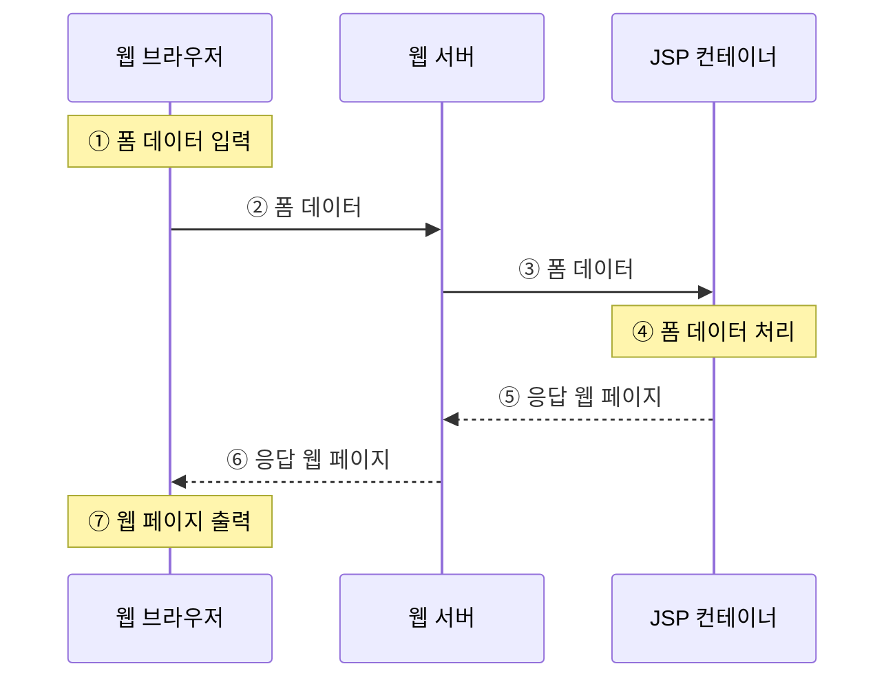
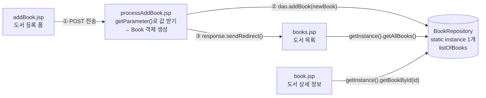

# 📘 7주차 — 폼 태그

> [!NOTE]
> **📚 출처** — 『쉽게 배우는 JSP 웹 프로그래밍(2판)』 Chapter 06 기반 강의자료 (슬라이드 52장)
> **표기 규칙** — 본문 = 강의자료 내용 · `💡 보충` = 강의자료 밖 추가 설명(공식 문서로 검증) · `💻 환경` = Mac·IntelliJ·Tomcat 11 실습 시 참고

## 🎯 학습 목표
- 폼의 개념과 특징을 이해합니다.
- 폼 태그 구성 요소의 사용법을 익힙니다.
- 폼 데이터를 처리하는 방법을 이해합니다.
- 폼 태그를 이용하여 북마켓의 도서 등록 페이지를 출력합니다.

## 🗺️ 목차
1. 폼 처리의 개요
2. form 태그
3. input 태그
4. select 태그
5. textarea 태그
6. 폼 데이터 처리
7. [북마켓] 도서 등록 페이지 만들기

---

## 1️⃣ 폼 처리의 개요
*슬라이드 p.6–7*

- **폼**(form): 사용자가 웹 브라우저를 통해 입력한 모든 데이터를 **한 번에 웹 서버로 전송**하는 양식
  - 전송한 데이터는 웹 서버가 처리하고, 처리 결과에 따라 다른 웹 페이지를 보여줌
- 사용자와 웹 애플리케이션이 **상호 작용**하는 중요한 기술 중 하나
- 사용자가 어떤 내용을 원하는지, 요구 사항이 무엇인지 파악할 때 가장 많이 사용하는 웹 애플리케이션의 필수 요소

### 폼을 구성하는 태그의 종류 (표 6-1)
| 태그 | 설명 |
|---|---|
| `form` | 폼을 정의하는 태그로 최상위 태그이다. |
| `input` | 사용자가 입력할 수 있는 태그이다. |
| `select` | 항목을 선택할 수 있는 태그이다. |
| `textarea` | 여러 줄을 입력할 수 있는 태그이다. |

### 폼 데이터 처리 과정 (그림 6-1)

- ① 사용자가 웹 브라우저에서 폼 데이터 입력 → ② 웹 서버로 전송 → ③ 웹 서버가 JSP 컨테이너에 전달 → ④ JSP 컨테이너가 폼 데이터 처리 → ⑤ 응답 웹 페이지를 웹 서버로 → ⑥ 웹 서버가 브라우저에 응답 → ⑦ 브라우저가 웹 페이지 출력

---

## 2️⃣ form 태그
*슬라이드 p.9–12*

- 사용자가 다양한 정보를 입력하고 서로 전달할 때 사용하는 태그
- 단독으로 쓰이지 않고, 사용자가 다양한 정보를 입력하는 **양식을 포함하는 최상위 태그**
- 속성으로 폼 데이터를 전송할 때 **어디로** 보낼지, **어떤 방식으로** 보낼지 설정
- form 태그의 모든 속성은 필수가 아니라 **선택적**으로 사용

### 📌 구문
```html
<form 속성1="값1" [속성2="값2" …]>
 // 다양한 입력 양식 태그(<input>, <select>, <textarea>)
</form>
```

### form 태그의 속성 (표 6-2)
| 속성 | 설명 |
|---|---|
| `action` | 폼 데이터를 받아 처리하는 웹 페이지의 URL을 설정한다. |
| `method` | 폼 데이터가 전송되는 HTTP 방식을 설정한다. |
| `name` | 폼을 식별하기 위한 이름을 설정한다. |
| `target` | 폼 처리 결과의 응답을 실행할 프레임을 설정한다. |
| `enctype` | 폼을 전송하는 콘텐츠 MIME 유형을 설정한다. |
| `accept-charset` | 폼 전송에 사용할 문자 인코딩을 설정한다. |

### form 태그 사용 예
*(p.10과 p.11은 같은 슬라이드가 중복 수록됨)*
```html
<html>
<head>
<title>Form Processing</title>
</head>
<body>
    <form action="http://localhost:8080/ch06/process.jsp" method="get"
            name="login" accept-charset="utf-8">
        …(생략)…
    </form>
</body>
</html>
```
- `action`에 처리 페이지의 전체 URL, `method="get"`, 폼 이름 `login`, 전송 문자 인코딩 `utf-8`을 지정한 형태
- 이후 실습 예제의 실행 URL은 `localhost:8080/JSPBook/ch06/…`처럼 프로젝트 이름(`JSPBook`)이 경로에 들어감 — 이 사용 예의 URL은 형식 설명용

> [!NOTE]
> **📌 NOTE — GET 방식과 POST 방식의 차이**
> - URL 끝에 데이터를 붙여 보내는 **GET** 방식은 데이터가 외부에 노출되어 보안에 취약함 → 개인 정보 등을 보호해야 할 때는 **POST** 방식을 사용해야 함
> - GET 방식: 지정된 리소스에서 데이터를 **요청할 때, 즉 읽을 때** 사용
> - POST 방식: 지정된 리소스에서 데이터를 **처리할 때, 즉 쓰고·수정하고·삭제할 때** 사용
> - 보안이 필요하지 않으면서 리소스에서 자원을 읽는 경우 GET, 그렇지 않은 경우 POST를 사용
>
> | 구분 | GET 방식 | POST 방식 |
> |---|---|---|
> | 전송 형태 | 이름과 값의 형태로 URL에 포함되어 전송 | HTTP 헤더 속에 감춰서 전송 |
> | 전송량 | 제한적(4,096B) | 제한 없음 |
> | 속도 | 빠름 | 느림 |
> | 보안 | 없음 | 있음 |

> [!WARNING]
> **🔍 검증 — NOTE 표의 일부 표현은 실제 HTTP 동작과 다름**
> - POST 데이터는 '헤더 속'이 아니라 **요청 본문**(request body)에 담겨 전송됨. GET은 본문이 비어 있어 데이터가 URL 뒤 `?` 다음에 붙음
> - GET의 전송량(URL 길이) 제한은 HTTP 표준이 정한 4,096B가 아님 — RFC 9110은 오히려 최소 8000옥텟 길이의 URI 지원을 권장하고, 실제 제한은 **브라우저·서버마다 다름**. POST도 서버 설정의 제한을 받음(예: Tomcat 11 커넥터 `maxPostSize` 기본 2 MiB — 폼 파라미터로 해석하는 본문에 적용)
> - POST는 주소창에 안 보일 뿐 **암호화되지는 않음** → 실제 보안은 HTTPS로 전송해야 확보됨
> - 근거: [MDN — Sending form data](https://developer.mozilla.org/en-US/docs/Learn_web_development/Extensions/Forms/Sending_and_retrieving_form_data), [MDN — `<form>`](https://developer.mozilla.org/en-US/docs/Web/HTML/Reference/Elements/form), [RFC 9110 §4.1](https://www.rfc-editor.org/rfc/rfc9110.html#section-4.1), [Tomcat 11 — HTTP Connector](https://tomcat.apache.org/tomcat-11.0-doc/config/http.html)

---

## 3️⃣ input 태그
*슬라이드 p.14–17*

- 사용자가 텍스트 입력이나 선택 등을 다양하게 할 수 있도록 공간을 만드는 태그
- **종료 태그 없이 단독**으로 사용할 수 있음

### 📌 구문
```html
<input 속성1="값1" [속성2="값2" …]>
```

### input 태그의 기본 속성 (표 6-3)
| 속성 | 속성 값 | 설명 |
|---|---|---|
| `type` | `text` | 기본값으로 한 줄의 텍스트를 입력할 때 사용한다. |
| `type` | `radio` | 라디오 버튼으로 열거된 것 중 하나만 선택할 때 사용한다. |
| `type` | `checkbox` | 체크 박스로 열거된 것 중 다중 선택을 할 때 사용한다. |
| `type` | `password` | 암호를 입력할 때 사용한다. |
| `type` | `hidden` | 보이지 않게 숨겨서 값을 전송할 때 사용한다. |
| `type` | `file` | 파일 업로드를 위한 파일을 선택할 때 사용한다. |
| `type` | `button` | 버튼 모양을 출력할 때 사용한다. |
| `type` | `reset` | 폼에 입력된 값을 모두 초기화할 때 사용한다. |
| `type` | `submit` | 폼에 입력된 값을 모두 서버에 전송할 때 사용한다. |
| `name` | 텍스트 | 입력 양식을 식별하는 이름을 설정한다. |
| `value` | 텍스트 | 입력 양식의 초깃값을 설정한다. |

### input 태그 사용 예
```jsp
<%@ page contentType="text/html; charset=utf-8" %>
<html>
<head>
<title>Form Processing</title>
</head>
<body>
    <form action="#" method="get">
        <p> 아 이 디: <input type="text" name="id">
        <p> 비밀번호: <input type="password" name="passwd">
        <p> <input type="submit" value="전송">
    </form>
</body>
</html>
```
- 실행 화면: 아이디 입력란(예: `admin`), 비밀번호 입력란(입력 문자가 `●●●●`로 가려짐), [전송] 버튼

> [!NOTE]
> **📌 NOTE — input 태그의 기본 속성 외에 사용되는 속성**
>
> | 속성 | 속성 값 | 설명 |
> |---|---|---|
> | `readonly` | | 입력 양식을 읽기 전용으로 설정한다. |
> | `maxlength` | 숫자 | 입력 양식의 최대 입력 글자 수를 설정한다. type="text"인 경우에만 사용한다. |
> | `size` | 숫자 | 입력 양식의 너비를 설정한다. type="text"인 경우에만 사용한다. |
> | `disabled` | | 해당 입력 양식을 비활성화로 설정한다. 모든 폼 구성 태그에 사용한다. |
> | `checked` | | 기본값을 선택할 때 설정한다. type="checkbox" 또는 type="radio"인 경우에만 사용한다. |
>
> **HTML5에 추가된 속성**
>
> | 속성 | 속성 값 | 설명 |
> |---|---|---|
> | `required` | | 입력 양식을 필수 태그로 설정한다. 필수 태그를 입력하지 않고 `<submit>` 버튼을 누르면 오류 메시지가 웹 브라우저에 출력된다. |
> | `autofocus` | | 웹 페이지가 로딩되자마자 해당 입력 양식의 포커스를 설정한다. |
> | `placeholder` | 텍스트 | 입력 양식의 힌트를 설정한다. |
> | `pattern` | regexp | 정규 표현식을 사용하여 특정 범위 내의 유효한 값을 입력받을 때 사용한다. |

> [!WARNING]
> **🔍 검증 — `maxlength`·`size`는 text 전용이 아님**
> - MDN 기준 `maxlength`는 `text`·`search`·`url`·`tel`·`email`·`password`, `size`는 `text`·`email`·`password`·`tel`·`url` 타입에서 유효함 → 슬라이드의 'type="text"인 경우에만'은 지나치게 좁은 설명
> - 근거: [MDN — `<input>`](https://developer.mozilla.org/en-US/docs/Web/HTML/Reference/Elements/input)

> [!TIP]
> **💡 보충 — readonly와 disabled의 차이: 서버로 전송되는가?**
> - `readonly`: 수정만 막을 뿐 포커스를 받고 값도 **폼과 함께 전송됨**
> - `disabled`: 포커스를 받지 못하고 **폼 전송에서 제외됨** → 처리 페이지에서 해당 파라미터가 없음
> - 근거: [MDN — readonly 속성](https://developer.mozilla.org/en-US/docs/Web/HTML/Reference/Attributes/readonly)

### 🧪 [예제 6-1] form 태그와 input 태그로 간단한 회원 가입 양식 만들기
📄 `JSPBook/src/main/webapp/ch06/form01.jsp`
```jsp
<%@ page contentType="text/html; charset=utf-8" %>
<html>
<head>
<title>Form Processing</title>
</head>
<body>
    <h3>회원 가입</h3>
    <form action="#" name="member" method="post">
        <p> 아이디 : <input type="text" name="id"> <input type="button" value="아이디 중복 검사">
        <p> 비밀번호 : <input type="password" name="passwd">
        <p> 이름 : <input type="text" name="name">
        <p> 연락처 : <input type="text" maxlength="4" size="4" name="phone1">
            - <input type="text" maxlength="4" size="4" name="phone2"> -
            <input type="text" maxlength="4" size="4" name="phone3">
        <p> 성별 : <input type="radio" name="sex" value="남성" checked>남성
            <input type="radio" name="sex" value="여성">여성
        <p> 취미 : 독서<input type="checkbox" name="hobby1" checked>
            운동<input type="checkbox" name="hobby2">
            영화<input type="checkbox" name="hobby3">
        <p> <input type="submit" value="가입하기">
            <input type="reset" value="다시쓰기">
    </form>
</body>
</html>
```
- **실행 결과**: `localhost:8080/JSPBook/ch06/form01.jsp` — '회원가입' 제목 아래 아이디(+[아이디 중복검사] 버튼)·비밀번호·이름·연락처(작은 입력칸 3개)·성별(남성 선택됨)·취미(독서 체크됨) 양식과 [가입하기]·[다시쓰기] 버튼
- **코드 포인트**: ① `<form action="#" name="member" method="post">`로 폼을 정의하고 그 안에 입력 태그를 배치 ② `type="button"`은 버튼 모양만 출력(표 6-3) ③ 연락처 칸은 `maxlength="4" size="4"`로 4글자·좁은 너비 ④ 성별 라디오 버튼 2개는 같은 `name="sex"`를 쓰고 `checked`로 '남성'을 기본 선택 ⑤ 취미 체크 박스는 `hobby1`·`hobby2`·`hobby3`처럼 이름이 각각 다름(→ [예제 6-4]에서 하나씩 받음) ⑥ `submit`은 서버로 전송, `reset`은 입력값 초기화

---

## 4️⃣ select 태그
*슬라이드 p.19–23*

- 여러 개의 항목이 나타나는 **목록 상자**에서 항목을 선택하는 태그
- 시작 태그와 종료 태그가 있으며, 리스트 박스에 여러 항목을 추가 삽입하기 위해 **반드시 `option` 태그를 포함**해야 함

### 📌 구문
```html
<select 속성1="값1" [속성2="값2" …]>
    <option 속성1="값" [속성1]> 항목1</option>
    <option 속성2="값" [속성2]> 항목2</option>
    …(생략)…
</select>
```

### select 태그의 속성 (표 6-4)
| 속성 | 속성 값 | 설명 |
|---|---|---|
| `name` | 텍스트 | 목록 상자의 이름을 설정한다. |
| `size` | 숫자 | 한 번에 표시할 항목의 개수를 설정한다. |
| `multiple` | | 다중 선택이 가능하도록 한다. Ctrl을 눌러 목록 상자의 항목을 다중 선택한다. |

> [!TIP]
> **💡 보충 — 다중 선택 키 (Mac)**
> - `Windows: Ctrl+클릭 / Mac: ⌘(Command)+클릭`, 연속 범위는 Shift+클릭 — [MDN — `<select>`](https://developer.mozilla.org/en-US/docs/Web/HTML/Reference/Elements/select)

### option 태그의 속성 (표 6-5)
| 속성 | 속성 값 | 설명 |
|---|---|---|
| `value` | 텍스트 | 항목의 값을 설정한다. |
| `selected` | | 해당 항목을 초깃값으로 선택한다. |
| `disabled` | | 항목을 비활성화한다. |

### select 태그 사용 예
*(p.21과 p.22는 같은 슬라이드가 중복 수록됨)*
```jsp
<%@ page contentType="text/html; charset=utf-8" %>
<html>
<head>
<title>Form Processing</title>
</head>
<body>
    <form action="#" method="get">
        <p> <select name="city" size="3">
                <option value="서울시">서울특별시</option>
                <option value="경기도">경기도</option>
                <option value="인천시">인천광역시</option>
                <option value="충청도">충청도</option>
                <option value="전라도">전라도</option>
                <option value="경상도">경상도</option>
            </select>
        <p> <input type="submit" value="전송">
    </form>
</body>
</html>
```
- 실행 화면: `size="3"`이라 서울특별시·경기도·인천광역시 3개 항목만 보이고 나머지는 스크롤하는 목록 상자 + [전송] 버튼
- 화면에 보이는 글자(`서울특별시`)와 항목의 값(`value="서울시"`)은 따로 지정됨

### 🧪 [예제 6-2] select 태그로 [예제 6-1] 회원 가입 양식의 연락처 수정하기
📄 `JSPBook/src/main/webapp/ch06/form02.jsp`
```jsp
<%@ page contentType="text/html; charset=utf-8" %>
    …(생략)…
        <p> 연락처 : <select name="phone1">
                <option value="010">010</option>
                <option value="011">011</option>
                <option value="016">016</option>
                <option value="017">017</option>
                <option value="019">019</option>
            </select> - <input type="text" maxlength="4" size="4" name="phone2"> - <input type="text" maxlength="4" size="4" name="phone3">
    …(생략)…
```
- **실행 결과**: `localhost:8080/JSPBook/ch06/form02.jsp` — 연락처 첫 칸이 `010`이 표시된 드롭다운으로 바뀌고 나머지 양식은 [예제 6-1]과 같음
- **코드 포인트 (6-1 대비 변경)**: ① 연락처 첫 칸 `<input type="text" maxlength="4" size="4" name="phone1">` → `<select name="phone1">` + `option` 5개(010·011·016·017·019) ② 이름 `phone1`은 그대로 유지 → 처리 페이지에서 같은 이름으로 받음 ③ `size`를 지정하지 않아 실행 화면에서 한 줄짜리 드롭다운으로 표시됨(사용 예의 `size="3"` 목록 상자와 비교) ④ 나머지 부분은 `…(생략)…`(6-1과 동일)

---

## 5️⃣ textarea 태그
*슬라이드 p.25–27*

- **여러 줄**의 텍스트를 입력할 수 있는 태그
- 기본 값은 `<textarea>`와 `</textarea>` 태그 **사이**에 설정
- 입력 폼 안에 사용된 태그와 띄어쓰기가 **그대로 출력**됨

### 📌 구문
```html
<textarea cols="너비 값" rows="높이 값">
…(생략)…
</textarea>
```

### textarea 태그의 속성 (표 6-6)
| 속성 | 속성 값 | 설명 |
|---|---|---|
| `name` | 텍스트 | 이름을 설정한다. |
| `cols` | 숫자 | 입력할 텍스트 영역의 너비(열 크기)를 설정한다. |
| `rows` | 숫자 | 입력할 텍스트 영역의 높이(행 크기)를 설정한다. |
| `wrap` | `off` | 줄 바꿈을 설정한다. wrap="off": 줄 바꿈을 하지 않고 문장을 입력할 때 수평 스크롤바가 생기고 옆으로 계속 문장이 입력된다. |
| `wrap` | `soft` | wrap="soft": Enter를 누르지 않아도 텍스트라인 끝에서 자동으로 행이 바뀐다. |
| `wrap` | `hard` | wrap="hard": soft 상태와 비슷하며 실제 내용을 서버에 전송할 때 캐리지 리턴 문자를 전달한다. |

> [!WARNING]
> **🔍 검증 — `wrap="off"`는 비표준 값**
> - MDN은 `wrap` 값 중 `hard`·`soft`(기본값)만 표준으로 두고 `off`는 **Non-standard**로 표시함. 또 `hard`는 `cols` 속성을 지정해야 효과가 있음
> - 근거: [MDN — `<textarea>`](https://developer.mozilla.org/en-US/docs/Web/HTML/Reference/Elements/textarea)

### textarea 태그 사용 예
```jsp
<%@ page contentType="text/html; charset=utf-8" %>
<html>
<head>
<title>Form Processing</title>
</head>
<body>
    <form action="#" method="get">
        <textarea name="comment" cols="30" rows="3"></textarea>
        <p> <input type="submit" value="전송" />
            <input type="reset" value="취소" />
    </form>
</body>
</html>
```
- 실행 화면: 30열 × 3행 텍스트 영역 + [전송]·[취소] 버튼

### 🧪 [예제 6-3] textarea 태그로 [예제 6-2]의 회원 가입 양식에 가입 인사 추가하기
📄 `JSPBook/src/main/webapp/ch06/form03.jsp`
```jsp
<%@ page contentType="text/html; charset=utf-8" %>
    …(생략)…
        <p> 취미 : 독서<input type="checkbox" name="hobby1" checked>
            운동<input type="checkbox" name="hobby2">
            영화<input type="checkbox" name="hobby3">
        <p> <textarea name="comment" cols="30" rows="3" placeholder="가입 인사를 입력해주세요"></textarea>
    …(생략)…
```
- **실행 결과**: `localhost:8080/JSPBook/ch06/form03.jsp` — 취미 아래에 '가입 인사를 입력해주세요' 힌트가 흐리게 표시된 3줄 입력 영역이 추가됨
- **코드 포인트 (6-2 대비 변경)**: ① 취미 체크 박스 바로 다음 줄에 `<textarea name="comment" cols="30" rows="3" …></textarea>` 추가 ② HTML5 속성 `placeholder`로 입력 힌트 표시 ③ 이름 `comment`가 처리 페이지에서 받을 파라미터 이름이 됨 ④ 연락처 `select` 등 나머지는 6-2와 동일(`…(생략)…`)

---

## 6️⃣ 폼 데이터 처리
*슬라이드 p.29–39*

### 요청 파라미터의 값 받기
*p.29–35*
- `request` **내장 객체**(implicit object)는 웹 브라우저가 서버로 보낸 요청에 대한 다양한 정보를 담고 있음
- 따라서 `getParameter()` 메소드로 **요청 파라미터**(request parameter)의 값을 얻을 수 있음 — 파라미터 이름 = 폼 입력 태그의 `name` 값

### 📌 구문
```java
String 변수=request.getParameter("요청 파라미터 이름");
```

### 체크 박스의 데이터를 전달받는 예
📄 `index.jsp`
```jsp
<%@ page contentType="text/html; charset=utf-8" %>
<html>
<head>
<title>Form Processing</title>
</head>
<body>
    <form action="process.jsp" method="POST">
        <p> 독서<input type="checkbox" name="reading">
            운동<input type="checkbox" name="exercise">
            영화<input type="checkbox" name="movie">
        <p> <input type="submit" value="전송">
    </form>
</body>
</html>
```
📄 `process.jsp`
```jsp
<%@ page contentType="text/html; charset=utf-8" %>
<html>
<head>
<title>Form Processing</title>
</head>
<body>
    <p> 독서 : <%=request.getParameter("reading") %>
    <p> 운동 : <%=request.getParameter("exercise") %>
    <p> 영화 : <%=request.getParameter("movie") %>
</body>
</html>
```
- 실행 결과: 독서·영화만 체크하고 [전송] → `독서 : on` / `운동 : null` / `영화 : on`

> [!TIP]
> **💡 보충 — 체크 박스 값이 `on` / `null`로 나오는 이유**
> - `value` 속성을 생략한 체크 박스는 체크 시 기본값 **`on`** 이 전송됨
> - 체크하지 않은 체크 박스는 **이름·값 모두 전송되지 않음** → `getParameter()`는 존재하지 않는 파라미터에 대해 `null`을 반환
> - 근거: [MDN — `<input type="checkbox">`](https://developer.mozilla.org/en-US/docs/Web/HTML/Reference/Elements/input/checkbox), [Jakarta Servlet API — `ServletRequest`](https://jakarta.ee/specifications/platform/11/apidocs/jakarta/servlet/servletrequest)

### 🧪 [예제 6-4] [예제 6-3]의 회원 가입 양식에서 폼 데이터 전송받기
📄 `JSPBook/src/main/webapp/ch06/form04.jsp`
```jsp
<%@ page contentType="text/html; charset=utf-8" %>
…(생략)…
    <form action="form04_process.jsp" name="member" method="post">
        …(생략)…
```
📄 `JSPBook/src/main/webapp/ch06/form04_process.jsp`
```jsp
<%@ page contentType="text/html; charset=utf-8" %>
<html>
<head>
<title>Form Processing</title>
</head>
<body>
    <%
        request.setCharacterEncoding("UTf-8");

        String id=request.getParameter("id");
        String passwd=request.getParameter("passwd");
        String name=request.getParameter("name");
        String phone1=request.getParameter("phone1");
        String phone2=request.getParameter("phone2");
        String phone3=request.getParameter("phone3");
        String sex=request.getParameter("sex");
        String hobby1=request.getParameter("hobby1");
        String hobby2=request.getParameter("hobby2");
        String hobby3=request.getParameter("hobby3");
        String comment=request.getParameter("comment");
    %>
    <p> 아이디 : <%=id %>
    <p> 비밀번호 : <%=passwd %>
    <p> 이름 : <%=name %>
    <p> 연락처 : <%=phone1 %>-<%=phone2 %>-<%=phone3 %>
    <p> 성별 : <%=sex %>
    <p> 취미 : <%=hobby1 %> <%=hobby2 %> <%=hobby3 %>
    <p> 가입 인사 : <%=comment %>
</body>
</html>
```
- **실행 결과**: form04.jsp에 admin / 1234 / 홍길순 / 010-1234-5678 / 독서 체크 / '안녕하세요. 홍길순 가입합니다.'를 입력하고 [가입하기] → `form04_process.jsp`에 `아이디 : admin`, `비밀번호 : 1234`, `이름 : 홍길순`, `연락처 : 010-1234-5678`, `성별 : 남성`, `취미 : on null null`, `가입인사 : 안녕하세요. 홍길순 가입합니다.` 출력 (캡처의 입력 화면은 '여성'이 선택된 상태라 결과의 '남성'과 맞지 않음 — 캡처 불일치)
- **코드 포인트 (6-3 대비 변경)**: ① form04.jsp는 `action="form04_process.jsp"`로 처리 페이지를 지정한 것만 바뀜(`method="post"`) ② 처리 페이지는 스크립틀릿 첫 줄에서 `request.setCharacterEncoding()`으로 요청 인코딩을 지정한 뒤 값을 읽음 ③ 폼 태그의 `name` 값(`id`, `passwd`, `name`, `phone1~3`, `sex`, `hobby1~3`, `comment`)을 그대로 `getParameter()`의 인자로 사용 ④ 읽은 값은 표현문 `<%=변수 %>`로 출력 ⑤ 취미는 체크 박스 이름이 각각 달라 3번 따로 받으며, `value`가 없으므로 체크한 것은 `on`, 안 한 것은 `null`

> [!WARNING]
> **🔍 검증 — `"UTf-8"` 오타**
> - form04_process.jsp의 `request.setCharacterEncoding("UTf-8");`은 `"UTF-8"`의 오타(다음 예제부터는 `"UTF-8"`)
> - Java의 문자셋 이름은 대소문자를 구분하지 않으므로 동작에는 지장이 없지만, 표기는 `"UTF-8"`로 통일하는 것이 바람직함
> - 근거: [Java SE 21 — `java.nio.charset.Charset`](https://docs.oracle.com/en/java/javase/21/docs/api/java.base/java/nio/charset/Charset.html) ("Charset names are not case-sensitive")

> [!TIP]
> **💡 보충 — `request.setCharacterEncoding("UTF-8")`의 역할과 Tomcat 11에서의 필요성**
> - **역할**: 요청 **본문**(POST 폼 데이터)의 문자 인코딩을 지정. **파라미터를 처음 읽기 전에** 호출해야 하며 그 뒤에 호출하면 효과가 없음 (Jakarta Servlet `ServletRequest` API)
> - 인코딩 지정이 전혀 없으면 서블릿 스펙상 폼 데이터를 ISO-8859-1로 해석 → UTF-8로 보낸 한글이 깨짐 (Tomcat 위키)
> - GET 쿼리 문자열에는 영향 없음 → Tomcat은 URL을 커넥터의 `URIEncoding`(Tomcat 11 기본값 `UTF-8`)으로 디코딩
> - **Tomcat 10.0부터** 기본 `conf/web.xml`에 `<request-character-encoding>UTF-8</request-character-encoding>`(응답도 UTF-8)이 들어 있음 — 마이그레이션 가이드: "conf/web.xml sets the default request and response character encoding to UTF-8". 이 파일은 모든 웹 애플리케이션의 기본값으로 먼저 적용됨
> - 결론: `conf/web.xml`(또는 앱의 `WEB-INF/web.xml`)에서 인코딩을 따로 바꾸지 않은 **Tomcat 11에서는 이 호출을 빼도 POST 한글이 깨지지 않음**. 다만 이 기본값이 없는 Tomcat 9 이하·다른 서버를 고려하면 넣어 두어도 무해하고, 시험은 교재 코드 기준으로 기억할 것
> - 근거: [Jakarta Servlet API — `ServletRequest`](https://jakarta.ee/specifications/platform/11/apidocs/jakarta/servlet/servletrequest), [Tomcat 마이그레이션 가이드 (9.0.x → 10.0.x)](https://tomcat.apache.org/migration-10.html), [Tomcat 11.0.x `conf/web.xml`](https://github.com/apache/tomcat/blob/11.0.x/conf/web.xml), [Tomcat 11 — HTTP Connector](https://tomcat.apache.org/tomcat-11.0-doc/config/http.html), [Tomcat 위키 — Character Encoding Issues](https://cwiki.apache.org/confluence/display/TOMCAT/Character+Encoding)

### 🧪 [예제 6-5] [예제 6-4]의 회원 가입 양식에서 폼 데이터 전송받기
📄 `JSPBook/src/main/webapp/ch06/form05.jsp`
```jsp
<%@ page contentType="text/html; charset=utf-8" %>
…(생략)…
    <form action="form05_process.jsp" name="member" method="post">
…(생략)…
        <p> 취미 : 독서<input type="checkbox" name="hobby" value="독서" checked>
            운동<input type="checkbox" name="hobby" value="운동">
            영화<input type="checkbox" name="hobby" value="영화">
        <p> <textarea name="comment" cols="30" rows="3" placeholder="가입 인사를 입력해주세요"></textarea>
…(생략)…
```
📄 `JSPBook/src/main/webapp/ch06/form05_process.jsp`
```jsp
<%@ page contentType="text/html; charset=utf-8" %>
<html>
<head>
<title>Form Processing</title>
</head>
<body>
    <%
        request.setCharacterEncoding("UTF-8");

        String id=request.getParameter("id");
        String passwd=request.getParameter("passwd");
        String name=request.getParameter("name");
        String phone1=request.getParameter("phone1");
        String phone2=request.getParameter("phone2");
        String phone3=request.getParameter("phone3");
        String sex=request.getParameter("sex");
        String[] hobby=request.getParameterValues("hobby");
        String comment=request.getParameter("comment");
    %>
    <p> 아이디 : <%=id %>
    <p> 비밀번호 : <%=passwd %>
    <p> 이름 : <%=name %>
    <p> 연락처 : <%=phone1 %>-<%=phone2 %>-<%=phone3 %>
    <p> 성별 : <%=sex %>

    <p> 취미 : <%
            if (hobby !=null) {
                for (int i=0; i < hobby.length; i++) {
                    out.println(" " + hobby[i]);
                }
            }
        %>
    <p> 가입 인사 : <%=comment %>
</body>
</html>
```
- **실행 결과**: `/ch06/form05_process.jsp` — `취미 : 독서 영화`처럼 체크한 항목의 `value`가 공백으로 구분되어 출력(그 밖에 아이디 admin, 연락처 010-1234-5678, 성별 여성, 가입인사 출력. 캡처에는 비밀번호·이름 값이 서로 바뀌어 찍혀 있음)
- **코드 포인트 (6-4 대비 변경)**: ① form05.jsp: `action="form05_process.jsp"`, 취미 체크 박스 3개의 이름을 모두 `hobby`로 통일하고 `value="독서"`·`"운동"`·`"영화"`를 지정 ② 처리 페이지: `hobby1~3` 3줄 대신 `String[] hobby=request.getParameterValues("hobby");` 한 줄로 같은 이름의 값들을 **배열**로 받음 ③ 하나도 체크하지 않으면 배열이 `null`이므로 `if (hobby !=null)`로 검사한 뒤 `for`문에서 `out.println(" " + hobby[i])`로 출력 ④ 인코딩 표기가 `"UTF-8"`로 바로잡힘

### 요청 파라미터의 전체 값 받기
*p.36–39*
- `getParameter()` 메소드로는 폼 페이지가 서버로 보낸 요청 파라미터 값을 하나씩 얻음 (슬라이드 본문의 `getParamete()`는 오타)
- **일괄 처리 메소드**를 이용하면 요청 파라미터 이름을 일일이 지정하지 않아도 모든 값을 전달받을 수 있음
- 텍스트 박스, 라디오 버튼, 드롭다운 박스 등 다양한 유형의 폼 데이터를 한 번에 전달받을 수 있음

### 폼 데이터의 일괄 처리 메소드 (표 6-7)
| 메소드 | 형식 | 설명 |
|---|---|---|
| `getParameterNames()` | `java.util.Enumeration` | 모든 입력 양식의 요청 파라미터 이름을 순서에 상관없이 Enumeration(열거형) 형태로 전달받는다. |
| `hasMoreElements()` | `boolean` | Enumeration(열거형) 요소가 있으면 true를 반환하고, 그렇지 않으면 false를 반환한다. |
| `nextElement()` | E(Enumeration 객체를 생성할 때의 타입) | Enumeration(열거형) 요소를 반환한다. |

### 체크 박스의 전체 데이터를 전달받는 예
📄 `process.jsp`
```jsp
<%@ page contentType="text/html; charset=utf-8" %>
<%@ page import="java.io.*, java.util.*" %>
<html>
<head>
<title>Form Processing</title>
</head>
<body>
    <table border="1">
        <tr>
            <th>요청 파라미터 이름</th>
            <th>요청 파라미터 값</th>
        </tr>
        <%
            Enumeration paramNames=request.getParameterNames();
            while (paramNames.hasMoreElements()) {
                String name=(String) paramNames.nextElement();
                out.print("<tr><td>" + name + " </td>\n");
                String paramValue=request.getParameter(name);
                out.println("<td> " + paramValue + "</td></tr>\n");
            }
        %>
    </table>
</body>
</html>
```
- 실행 결과: 표에 `reading | on`, `movie | on` 두 행만 출력 — 체크하지 않은 `exercise`는 파라미터 이름 목록에도 나타나지 않음

### 🧪 [예제 6-6] [예제 6-4]의 회원 가입 양식에서 폼 데이터를 한 번에 전송받기
📄 `JSPBook/src/main/webapp/ch06/form06.jsp`
```jsp
<%@ page contentType="text/html; charset=utf-8" %>
…(생략)…
    <form action="form06_process.jsp" name="member" method="post">
…(생략)…
```
📄 `JSPBook/src/main/webapp/ch06/form06_process.jsp`
```jsp
<%@ page contentType="text/html; charset=utf-8" %>
<%@ page import="java.io.*, java.util.*" %>
<html>
<head>
<title>Form Processing</title>
</head>
<body>
    <table border="1">
        <tr>
            <th>요청 파라미터 이름</th>
            <th>요청 파라미터 값</th>
        </tr>
        <%
            request.setCharacterEncoding("UTF-8");

            Enumeration paramNames=request.getParameterNames();
            while (paramNames.hasMoreElements()) {
                String name=(String) paramNames.nextElement();
                out.print("<tr><td>" + name + " </td>\n");
                String paramValue=request.getParameter(name);
                out.println("<td> " + paramValue + "</td></tr>\n");
            }
        %>
    </table>
</body>
</html>
```
- **실행 결과**: `localhost:8080/JSPBook/ch06/form06_process.jsp` — '요청 파라미터 이름 | 요청 파라미터 값' 표에 `id`(admin)·`passwd`(1234)·`name`(홍길순)·`phone`(010)·`phone2`(1234)·`phone3`(5678)·`sex`(여성)·`hobby`(독서)·`comment`(안녕하세요. 홍길순 가입합니다.) 행이 출력됨
- **코드 포인트 (6-4·6-5 대비 변경)**: ① form06.jsp는 `action="form06_process.jsp"`만 바뀜 ② 처리 페이지는 변수를 하나씩 선언하는 대신 `getParameterNames()`로 파라미터 이름 목록(Enumeration)을 얻고 `while (paramNames.hasMoreElements())` + `nextElement()`로 반복 ③ 각 이름으로 `getParameter(name)`을 호출해 값을 얻고, `out.print()`/`out.println()`으로 `<tr><td>` 행을 직접 출력 ④ `Enumeration`(java.util)을 쓰기 위해 `<%@ page import="java.io.*, java.util.*" %>` 추가 ⑤ `nextElement()`의 반환값을 `(String)`으로 형변환 ⑥ 앞의 체크 박스 예(p.37)와 비교하면 `request.setCharacterEncoding("UTF-8");` 한 줄이 추가된 것만 다름

> [!TIP]
> **💡 보충 — 요청 파라미터 메소드 정리 (Jakarta Servlet API)**
>
> | 메소드 | 반환형 | 파라미터가 없을 때 | 특징 |
> |---|---|---|---|
> | `getParameter(String name)` | `String` | `null` | 값이 여러 개인 파라미터면 **첫 번째 값**만 반환 |
> | `getParameterValues(String name)` | `String[]` | `null` | 같은 이름의 모든 값(값이 하나면 길이 1인 배열) |
> | `getParameterNames()` | `Enumeration<String>` | 빈 Enumeration | 파라미터 **이름** 목록 |
>
> - [예제 6-6]처럼 `getParameterNames()` + `getParameter()` 조합이면 `hobby`를 여러 개 체크해도 **첫 값만** 표에 나옴 → 전부 보려면 `getParameterValues()` 사용
> - 실제 반환형이 `Enumeration<String>`이므로 `Enumeration<String> paramNames=…`로 받으면 `(String)` 형변환이 필요 없음
> - 근거: [Jakarta Servlet API — `ServletRequest`](https://jakarta.ee/specifications/platform/11/apidocs/jakarta/servlet/servletrequest)

> [!WARNING]
> **🔍 검증 — [예제 6-6] 관련 특이사항**
> - `<table border="1">`의 `border` 속성은 HTML 표준에서 **deprecated** → 표 테두리는 CSS `border` 속성 사용 권장 ([MDN — `<table>`](https://developer.mozilla.org/en-US/docs/Web/HTML/Reference/Elements/table))
> - 실행 화면의 `phone`은 [예제 6-2] 이후 양식의 `name="phone1"`과 맞지 않고, `hobby`는 [예제 6-5] 양식의 이름이라 제목의 '[예제 6-4]의 회원 가입 양식'(`hobby1~3`)과도 다름 → 캡처는 다른 버전의 양식으로 찍은 것으로 보이며, 코드대로 실행하면 폼 태그의 `name` 값이 그대로 표시됨

---

## 7️⃣ [북마켓] 도서 등록 페이지 만들기
*슬라이드 p.41–51*

### 프로젝트 로드맵 (그림 6-2)
- 시작 페이지 만들기 → 한글 출력 및 페이지 모듈화하기 → 도서 목록 표시하기 → 도서 상세 정보 표시하기 → **도서 등록 페이지 만들기(6장, 이번 주차)** → 장바구니 페이지 만들기 → 주문 처리 페이지 만들기
- 도서 등록 페이지 만들기 → 도서 이미지 등록하기 → 유효성 검사하기 → 다국어 처리하기 → 보안 처리하기
- 그 밖에: 데이터베이스(→ 도서 목록 표시하기 / → 회원가입·수정·탈퇴 → 게시판), 예외 처리 페이지 만들기, 로그 기록하기

### 프로젝트 실행 결과 (그림 6-3)
- 왼쪽 — **도서 등록**(Book Addition) 페이지: 도서코드·도서명·가격·저자·출판사·출판일·상세정보·분류·재고수 입력란, 상태(신규도서·중고도서·E-Book) 라디오 버튼, [등록] 버튼
- 오른쪽 — 등록 후 이동한 **도서목록**(BookList) 페이지: 기존 3권(C# 프로그래밍, 자바마스터, 파이썬 프로그래밍) 뒤에 새 도서 'R 데이터 분석 입문' 카드가 추가됨

### 전체 처리 흐름 (슬라이드 코드 기준 정리)


### 🧪 [예제 6-7] 도서 정보 등록 페이지 만들기
*p.43–46 · 슬라이드 단계 제목: '1. 도서 상세 정보를 가져오는 메소드 만들기'(아래 🔍 검증 참고)*

📄 `BookMarket/src/main/webapp/addBook.jsp`
```jsp
<%@ page contentType="text/html; charset=utf-8" %>
<html>
<head>
<link href="https://cdn.jsdelivr.net/npm/bootstrap@5.3.0-alpha1/dist/css/bootstrap.min.css" rel="stylesheet">
<title>도서 등록</title>
</head>
<body>
<div class="container py-4">
  <%@ include file="menu.jsp" %>

  <div class="p-5 mb-4 bg-body-tertiary rounded-3">
    <div class="container-fluid py-5">
      <h1 class="display-5 fw-bold">도서 등록</h1>
      <p class="col-md-8 fs-4">Book Addition</p>
    </div>
  </div>

  <div class="row align-items-md-stretch">
    <form name="newBook" action="./processAddBook.jsp" method="post">
      <div class="mb-3 row">
        <label class="col-sm-2">도서코드</label>
        <div class="col-sm-3">
          <input type="text" name="bookId" class="form-control">
        </div>
      </div>
      <div class="mb-3 row">
        <label class="col-sm-2">도서명</label>
        <div class="col-sm-3">
          <input type="text" name="name" class="form-control">
        </div>
      </div>
      <div class="mb-3 row">
        <label class="col-sm-2">가격</label>
        <div class="col-sm-3">
          <input type="text" name="unitPrice" class="form-control">
        </div>
      </div>
      <div class="mb-3 row">
        <label class="col-sm-2">저자</label>
        <div class="col-sm-3">
          <input type="text" name="author" class="form-control">
        </div>
      </div>
      <div class="mb-3 row">
        <label class="col-sm-2">출판사</label>
        <div class="col-sm-3">
          <input type="text" name="publisher" class="form-control">
        </div>
      </div>
      <div class="mb-3 row">
        <label class="col-sm-2">출판일</label>
        <div class="col-sm-3">
          <input type="text" name="releaseDate" class="form-control">
        </div>
      </div>

      <div class="mb-3 row">
        <label class="col-sm-2">상세정보</label>
        <div class="col-sm-5">
          <textarea name="description" cols="50" rows="2" class="form-control" placeholder="100자 이상 적어주세요"></textarea>
        </div>
      </div>
      <div class="mb-3 row">
        <label class="col-sm-2">분류</label>
        <div class="col-sm-3">
          <input type="text" name="category" class="form-control">
        </div>
      </div>
      <div class="mb-3 row">
        <label class="col-sm-2">재고수</label>
        <div class="col-sm-3">
          <input type="text" name="unitsInStock" class="form-control">
        </div>
      </div>
      <div class="mb-3 row">
        <label class="col-sm-2">상태</label>
        <div class="col-sm-5">
          <input type="radio" name="condition" value="New"> 신규도서
          <input type="radio" name="condition" value="Old"> 중고도서
          <input type="radio" name="condition" value="EBook"> E-Book
        </div>
      </div>
      <div class="mb-3 row">
        <div class="col-sm-offset-2 col-sm-10">
          <input type="submit" class="btn btn-primary" value="등록">
        </div>
      </div>
    </form>
  </div>
  <jsp:include page="footer.jsp" />
</div>
</body>
</html>
```
- **실행 결과**: 그림 6-3 왼쪽의 '도서 등록 / Book Addition' 화면
- **코드 포인트**: ① 이번 주차에 **새로 만드는 파일** — 상단 메뉴(`<%@ include file="menu.jsp" %>`)·제목 영역·하단(`<jsp:include page="footer.jsp" />`) 구성은 기존 북마켓 페이지와 같은 틀 ② `<form name="newBook" action="./processAddBook.jsp" method="post">` — 등록 처리 페이지로 POST 전송 ③ 입력 태그의 `name`(bookId, name, unitPrice, author, publisher, releaseDate, description, category, unitsInStock, condition)이 5주차에 만든 Book 클래스의 멤버 변수 이름과 같음 → 처리 페이지에서 같은 이름으로 `getParameter()` ④ 상세정보는 `textarea`(`cols="50" rows="2"`, `placeholder`), 상태는 같은 `name="condition"`을 쓰는 라디오 버튼 3개(`New`·`Old`·`EBook`) ⑤ `mb-3 row`·`col-sm-2`·`form-control`·`btn btn-primary` 등 Bootstrap 클래스로 레이블과 입력란을 정렬

> [!WARNING]
> **🔍 검증 — [예제 6-7] 슬라이드 오류 2가지**
> - p.43의 단계 제목 '1. 도서 상세 정보를 가져오는 메소드 만들기'는 6주차 [예제 5-9]의 1단계 제목과 같은 문구로, 실제 내용(`addBook.jsp` 등록 폼 작성)과 맞지 않음 — 복사 오류로 보임
> - `col-sm-offset-2`는 Bootstrap 5.3에 없는 클래스명(Bootstrap 4부터 `.col-{breakpoint}-{modifier}-{size}` → `.{modifier}-{breakpoint}-{size}`로 바뀌어 오프셋은 `offset-sm-2`). 링크한 Bootstrap 5.3에서는 오프셋이 적용되지 않아 그림 6-3에서도 [등록] 버튼이 레이블 열에 붙어 있음. 의도대로라면 `class="offset-sm-2 col-sm-10"`
> - 근거: [Bootstrap 5.3 — Columns (Offsetting columns)](https://getbootstrap.com/docs/5.3/layout/columns/), [Bootstrap 4 — Migration](https://getbootstrap.com/docs/4.0/migration/)

### 🧪 [예제 6-8] 도서 정보 등록 데이터 처리하기
*p.47–51*

**1. 신규 도서 데이터를 저장하는 메소드 만들기**

📄 `BookMarket/src/main/java/dao/BookRepository.java`
```java
package dao;
…(생략)…
public class BookRepository {

    private ArrayList<Book> listOfBooks=new ArrayList<Book>();
    private static BookRepository instance=new BookRepository();

    public static BookRepository getInstance() {
        return instance;
    }
    …(생략)…
    public void addBook(Book book) {
        listOfBooks.add(book);
    }
}
```

**2. 신규 도서 등록 처리 페이지 만들기**

📄 `BookMarket/src/main/webapp/processAddBook.jsp`
```jsp
<%@ page contentType="text/html; charset=utf-8" %>
<%@ page import="dto.Book" %>
<%@ page import="dao.BookRepository" %>

<%
  request.setCharacterEncoding("UTF-8");

  String bookId=request.getParameter("bookId");
  String name=request.getParameter("name");
  String unitPrice=request.getParameter("unitPrice");
  String author=request.getParameter("author");
  String publisher=request.getParameter("publisher");
  String releaseDate=request.getParameter("releaseDate");
  String description=request.getParameter("description");
  String category=request.getParameter("category");
  String unitsInStock=request.getParameter("unitsInStock");
  String condition=request.getParameter("condition");

  Integer price;

  if (unitPrice.isEmpty())
     price=0;
  else
     price=Integer.valueOf(unitPrice);

  long stock;

  if (unitsInStock.isEmpty())
     stock=0;
  else
     stock=Long.valueOf(unitsInStock);

  BookRepository dao=BookRepository.getInstance();

  Book newBook=new Book();
  newBook.setBookId(bookId);
  newBook.setName(name);
  newBook.setUnitPrice(price);
  newBook.setAuthor(author);
  newBook.setPublisher(publisher);
  newBook.setPublisher(releaseDate);
  newBook.setDescription(description);
  newBook.setCategory(category);
  newBook.setUnitsInStock(stock);
  newBook.setCondition(condition);

  dao.addBook(newBook);

  response.sendRedirect("books.jsp");
%>
```

**3. 도서 목록 페이지 수정하기**

📄 `BookMarket/src/main/webapp/books.jsp`
```jsp
<%@ page contentType="text/html; charset=utf-8" %>
<%@ page import="java.util.ArrayList" %>
<%@ page import="dto.Book" %>
<%@ page import="dao.BookRepository" %>
…(생략)…
  <div class="p-5 mb-4 bg-body-tertiary rounded-3">
    <div class="container-fluid py-5">
      <h1 class="display-5 fw-bold">도서목록</h1>
      <p class="col-md-8 fs-4">BookList</p>
    </div>
  </div>
  <%
    BookRepository dao=BookRepository.getInstance();
    ArrayList<Book> listOfBooks=dao.getAllBooks();
  %>
  <div class="row align-items-md-stretch text-center">
…(생략)…
```

**4. 도서 상세 정보 페이지 수정하기**

📄 `BookMarket/src/main/webapp/book.jsp`
```jsp
<%@ page contentType="text/html; charset=utf-8" %>
<%@ page import="dto.Book" %>
<%@ page import="dao.BookRepository" %>
…(생략)…
  <%
    String id=request.getParameter("id");
    BookRepository dao=BookRepository.getInstance();
    Book book=dao.getBookById(id);
  %>
  <div class="row align-items-md-stretch">
    <div class="col-md-12">
…(생략)…
```

- **실행 결과**: addBook.jsp에서 도서 정보를 입력하고 [등록] → processAddBook.jsp가 저장한 뒤 `books.jsp`로 이동 → 목록 끝에 새 도서 카드가 추가됨(그림 6-3 오른쪽)
- **코드 포인트**:
  - **BookRepository.java (추가된 부분)**: ① `private static BookRepository instance=new BookRepository();`로 객체를 **하나만** 미리 만들어 두고 ② `public static` 메소드 `getInstance()`로 그 객체를 반환 ③ `addBook(Book book)`은 `listOfBooks.add(book)`으로 목록에 추가 (이전 주차에 만든 생성자·`getAllBooks()`·`getBookById()` 등은 `…(생략)…` 처리)
  - **processAddBook.jsp (새 파일)**: ④ `setCharacterEncoding("UTF-8")` 후 addBook.jsp의 `name` 10개를 `getParameter()`로 받음 ⑤ 가격·재고수는 문자열로 오므로 빈 값(`isEmpty()`)이면 0, 아니면 `Integer.valueOf()`/`Long.valueOf()`로 변환 ⑥ `new Book()` 후 setter로 값을 채우고 `dao.addBook(newBook)`으로 저장 ⑦ `response.sendRedirect("books.jsp")`로 도서 목록 페이지로 이동 — 화면 출력이 없는 처리 전용 페이지라 HTML 태그가 없음
  - **books.jsp·book.jsp (이전 주차 대비 변경)**: ⑧ 5주차 [예제 4-12]·6주차 [예제 5-9]에서 `<jsp:useBean id="bookDAO" class="dao.BookRepository" scope="session" />`의 `bookDAO`로 쓰던 저장소를, `<%@ page import="dao.BookRepository" %>` + `BookRepository dao=BookRepository.getInstance();`로 얻도록 변경 → `dao.getAllBooks()`, `dao.getBookById(id)` 호출

> [!TIP]
> **💡 보충 — 왜 모든 페이지가 `getInstance()`를 써야 할까?**
> - 5주차에서 배운 대로 `<jsp:useBean>`은 `id`·`scope`로 객체를 찾고 **없으면 새 객체를 생성**함 → `scope="session"`이면 세션마다 별도의 BookRepository(별도 `listOfBooks`)가 생김
> - processAddBook.jsp는 `getInstance()`가 돌려주는 **static 객체**에 도서를 추가하므로, 목록·상세 페이지도 같은 객체를 써야 새 도서가 보임
> - 이처럼 클래스의 객체를 하나만 만들어 공유하는 구조를 흔히 **싱글턴**(singleton) 패턴이라 부름

> [!WARNING]
> **🔍 검증 — processAddBook.jsp의 `setPublisher(releaseDate)` 버그**
> - `newBook.setPublisher(releaseDate);`(슬라이드 41번째 줄)는 `newBook.setReleaseDate(releaseDate);`여야 함 — Book 클래스에는 5주차 [예제 4-12]에서 만든 `releaseDate` 필드와 `setReleaseDate()`가 있음
> - 그대로 실행하면 출판사 값이 출판일 문자열로 **덮어써지고** 출판일은 설정되지 않음(`null`) → 그림 6-3 오른쪽 목록에서도 새 도서의 '출판사 | 가격' 줄에 출판사 대신 날짜 형태(2023/…)의 값이 보임(캡처가 흐려 정확한 날짜는 판독 불가)

---

## 🧠 핵심 요약
- **폼** = 사용자가 입력한 데이터를 한 번에 서버로 보내는 양식. 구성 태그: `form`(최상위) · `input` · `select`(+`option`) · `textarea`
- `form`: `action`=처리할 페이지 URL, `method`=전송 방식(GET은 URL에 붙어 노출 → 읽기용 / POST는 노출되지 않음 → 쓰기·수정·삭제, 개인 정보)
- `input`의 `type`: text(기본값)·radio·checkbox·password·hidden·file·button·reset·submit / `name`=식별 이름(=서버에서 받는 파라미터 이름), `value`=초깃값 / HTML5 추가: required·autofocus·placeholder·pattern
- `select`는 반드시 `option`을 포함(`size`·`multiple`, `option`의 `value`·`selected`·`disabled`), `textarea`는 여러 줄 입력(`cols`·`rows`·`wrap`, 기본값은 태그 사이)
- 처리 페이지: `request.getParameter("이름")` → `String`(없으면 `null`) / 같은 이름 여러 값(체크 박스) → `getParameterValues("이름")` → `String[]`
- 전체 파라미터: `getParameterNames()` → `Enumeration` → `hasMoreElements()`·`nextElement()`로 반복하며 `getParameter(name)`
- 파라미터를 읽기 **전에** `request.setCharacterEncoding("UTF-8")`로 요청 인코딩 지정
- 북마켓: `addBook.jsp`(등록 폼) → `processAddBook.jsp`(파라미터 → `Book` → `addBook()` → `sendRedirect("books.jsp")`), 모든 페이지가 `BookRepository.getInstance()`로 같은 저장소 사용

## ✍️ 시험 대비 체크포인트
- **Q.** 폼을 구성하는 태그 4가지와 그중 최상위 태그는? → **A.** `form`, `input`, `select`, `textarea` / 최상위는 `form`
- **Q.** 폼 데이터를 받아 처리할 페이지의 URL과 전송 방식을 지정하는 form 속성은? → **A.** `action`, `method`
- **Q.** 교재 표 기준 GET과 POST의 차이(전송 형태·전송량·속도·보안)는? → **A.** GET: 이름=값 형태로 URL에 포함, 제한적(4,096B), 빠름, 보안 없음 / POST: HTTP 헤더 속에 감춰서 전송, 제한 없음, 느림, 보안 있음 (실제 동작과의 차이는 2️⃣의 🔍 검증 참고)
- **Q.** GET과 POST는 각각 어떤 작업에 쓰는가? → **A.** GET은 리소스를 읽을 때, POST는 쓰기·수정·삭제할 때(개인 정보 보호가 필요할 때도 POST)
- **Q.** input의 `type`을 생략하면? radio와 checkbox의 차이는? → **A.** 기본값 `text` / radio는 하나만 선택, checkbox는 다중 선택(기본 선택은 `checked`)
- **Q.** HTML5에서 추가된 input 속성 4가지는? → **A.** `required`, `autofocus`, `placeholder`, `pattern`
- **Q.** select에 항목을 넣을 때 반드시 쓰는 태그, 항목을 처음부터 선택해 두는 속성, 다중 선택 속성은? → **A.** `option` / `selected` / `multiple`(Ctrl을 누르고 선택)
- **Q.** textarea의 기본값은 어디에 쓰며, 너비·높이 속성은? → **A.** `<textarea>`와 `</textarea>` 사이 / `cols`(열), `rows`(행)
- **Q.** 요청 파라미터 값을 얻는 기본 구문은? → **A.** `String 변수=request.getParameter("요청 파라미터 이름");`
- **Q.** `value` 없는 체크 박스(독서·영화만 체크)를 `getParameter()`로 받으면? → **A.** 체크한 것은 `on`, 체크하지 않은 것은 `null` (p.30 실행 결과)
- **Q.** 이름이 같은 체크 박스 여러 개의 값을 모두 받는 메소드와 반환형은? → **A.** `getParameterValues("hobby")` → `String[]` (null 검사 후 for문으로 출력)
- **Q.** 파라미터 이름을 몰라도 모든 폼 데이터를 받는 방법은? → **A.** `getParameterNames()`로 `Enumeration`을 얻고 `hasMoreElements()`/`nextElement()`로 반복하며 `getParameter(name)` 호출
- **Q.** 표 6-7에서 `getParameterNames()`의 형식과 `nextElement()`의 반환 형식은? → **A.** `java.util.Enumeration` / `E`(Enumeration 객체를 생성할 때의 타입)
- **Q.** 처리 페이지에서 폼 데이터를 읽기 전에 요청 인코딩을 UTF-8로 지정하는 코드는? → **A.** `request.setCharacterEncoding("UTF-8");`
- **Q.** [예제 6-8]에서 BookRepository에 추가한 메소드 2개와, 등록 후 목록으로 이동하는 코드는? → **A.** `getInstance()`, `addBook(Book book)` / `response.sendRedirect("books.jsp");`

## 🔗 참고 자료
- [Jakarta EE 11 API — `jakarta.servlet.ServletRequest`](https://jakarta.ee/specifications/platform/11/apidocs/jakarta/servlet/servletrequest) — `getParameter()`·`getParameterValues()`·`getParameterNames()` 반환값과 `null`, 다중 값의 첫 값 반환, `setCharacterEncoding()` 호출 시점
- [Apache Tomcat — Migration Guide (9.0.x → 10.0.x)](https://tomcat.apache.org/migration-10.html) — "web.xml defaults": `conf/web.xml`의 기본 요청·응답 인코딩 UTF-8
- [Apache Tomcat 11.0.x 소스 — `conf/web.xml`](https://github.com/apache/tomcat/blob/11.0.x/conf/web.xml) — `<request-character-encoding>UTF-8</request-character-encoding>` 기본 포함, 모든 웹 앱의 기본값으로 적용
- [Apache Tomcat 11 — HTTP Connector](https://tomcat.apache.org/tomcat-11.0-doc/config/http.html) — `URIEncoding` 기본값 UTF-8, `maxPostSize` 기본 2 MiB
- [Apache Tomcat 위키 — Character Encoding Issues](https://cwiki.apache.org/confluence/display/TOMCAT/Character+Encoding) — 인코딩 미지정 시 ISO-8859-1 해석, 파라미터 파싱 전에 설정해야 함
- [Java SE 21 API — `java.nio.charset.Charset`](https://docs.oracle.com/en/java/javase/21/docs/api/java.base/java/nio/charset/Charset.html) — 문자셋 이름 대소문자 무시
- [MDN — Sending form data](https://developer.mozilla.org/en-US/docs/Learn_web_development/Extensions/Forms/Sending_and_retrieving_form_data) — GET(URL)·POST(요청 본문) 데이터 위치, URL 길이 제한, HTTPS 암호화
- [MDN — `<form>`](https://developer.mozilla.org/en-US/docs/Web/HTML/Reference/Elements/form) — `method`(post=요청 본문, get=URL에 `?`로 추가)
- [RFC 9110 — HTTP Semantics §4.1](https://www.rfc-editor.org/rfc/rfc9110.html#section-4.1) — URI는 최소 8000옥텟 길이 지원 권장(고정 상한 없음)
- [MDN — `<input>`](https://developer.mozilla.org/en-US/docs/Web/HTML/Reference/Elements/input) — `maxlength`·`size`가 유효한 type
- [MDN — readonly 속성](https://developer.mozilla.org/en-US/docs/Web/HTML/Reference/Attributes/readonly) — readonly와 disabled의 전송 여부 차이
- [MDN — `<input type="checkbox">`](https://developer.mozilla.org/en-US/docs/Web/HTML/Reference/Elements/input/checkbox) — `value` 생략 시 기본값 `on`, 체크 안 하면 전송되지 않음
- [MDN — `<select>`](https://developer.mozilla.org/en-US/docs/Web/HTML/Reference/Elements/select) — 다중 선택 키(Ctrl, macOS는 Command)
- [MDN — `<textarea>`](https://developer.mozilla.org/en-US/docs/Web/HTML/Reference/Elements/textarea) — `wrap` 값(`off` 비표준), `hard`는 `cols` 필요
- [MDN — `<table>`](https://developer.mozilla.org/en-US/docs/Web/HTML/Reference/Elements/table) — `border` 속성 deprecated
- [Bootstrap 5.3 — Columns](https://getbootstrap.com/docs/5.3/layout/columns/) — 오프셋 클래스 `offset-{breakpoint}-*`
- [Bootstrap 4 — Migration](https://getbootstrap.com/docs/4.0/migration/) — 그리드 수정자 클래스명 변경
