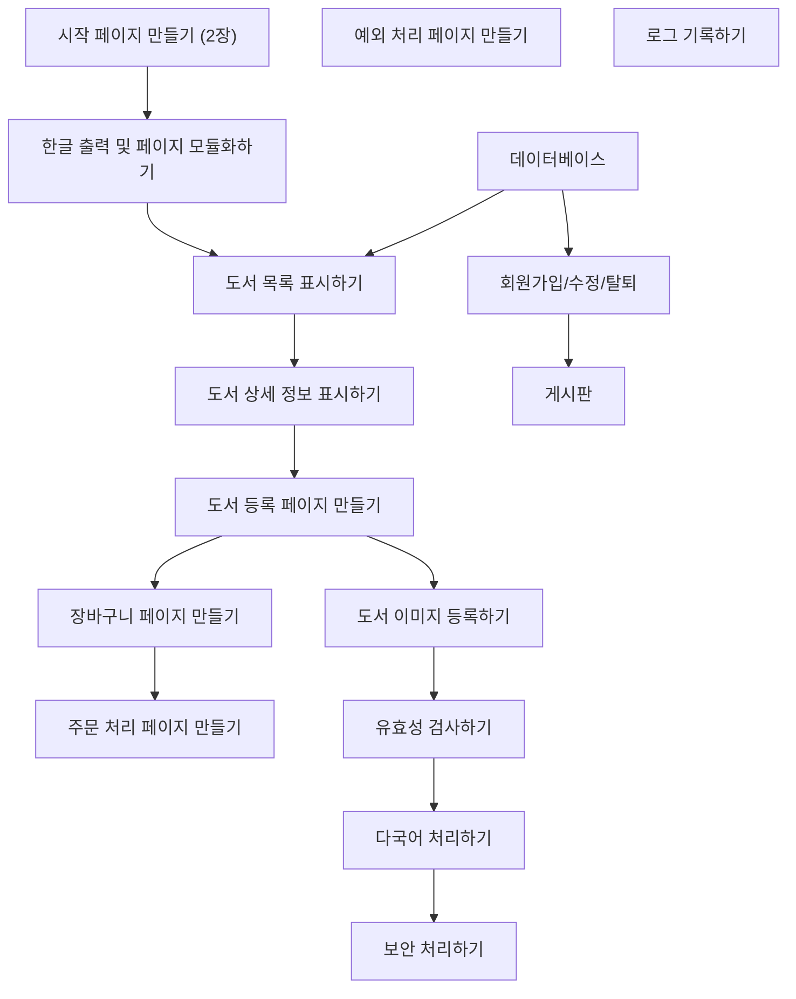

# 📘 3주차 — JSP 기본 문법

> [!NOTE]
> **📚 출처** — Chapter 02 「스트립트 태그: 시작 페이지 만들기」(표지 표기 그대로) 기반 강의자료 (슬라이드 38장, Copyright© 2023 Hanbit Academy, Inc.)
> PDF 내용만 정리함 (실습 환경 맞춤·외부 보충 없음)

## 🎯 학습 목표
*슬라이드 p.4*

- 스크립트 태그의 개념과 특징을 이해함
- 스크립트 태그 구성 요소의 사용법을 익힘
- 스크립트 태그를 이용하여 북마켓의 시작 페이지를 만듦
- 부트스트랩 CSS를 이용하여 북마켓의 시작 페이지를 변경함

## 🗺️ 목차
*슬라이드 p.3*

1. 스크립트 태그의 개요
2. 선언문 태그
3. 스크립틀릿 태그
4. 표현문 태그 (NOTE: JSP 주석과 HTML 주석 태그 포함)
5. [북마켓] 시작 페이지 만들기

---

## 1️⃣ 스크립트 태그의 개요
*슬라이드 p.5–9*

### 스크립트 태그
*슬라이드 p.6*

- `<% ... %>` 사용
- JSP 페이지가 서블릿 프로그램에서 서블릿 클래스로 변환할 때
  - JSP 컨테이너가 자바 코드가 삽입되어 있는 스크립트 태그를 처리하고 나머지는 HTML 코드나 일반 텍스트로 간주함

**표 2-1 스크립트 태그의 종류**

| 스크립트 태그 | 형식 | 설명 |
|---|---|---|
| 선언문(declaration) | `<%! … %>` | 자바 변수나 메소드를 정의하는 데 사용함 |
| 스크립틀릿(scriptlet) | `<% … %>` | 자바 로직 코드를 작성하는 데 사용함 |
| 표현문(expression) | `<%= … %>` | 변수, 계산식, 메소드 호출 결과를 문자열 형태로 출력하는 데 사용함 |

### JSP 페이지에 작성된 스크립트 태그가 자바 서블릿 프로그램으로 번역 예
*슬라이드 p.7–9*

📄 `scripting.jsp`
```jsp
<html>
<head>
<title>Scripting Tag</title>
</head>
<body>
    <h2>Scripting Tag</h2>
    <%! int count = 3;

    String makeItLower(String data) {
      return data.toLowerCase();
    } %>

    <%
      for(int i = 1; i <= count; i++) {
         out.println("Java Server Pages " + i + ".<br>");
         }
    %>

    <%= makeItLower("Hello World") %>
</body>
</html>
```
- **코드 포인트**:
  - ❶ 선언문 태그를 사용하여 자바 변수와 메소드 정의 → `int count = 3;`, `makeItLower()`
  - ❷ 스크립틀릿 태그로 자바 로직 코드 작성 → `for` 문
  - ❸ 표현문 태그로 선언문의 메소드를 호출하여 문자열 형태로 출력 → `makeItLower("Hello World")`

**번역된 서블릿 파일의 보관 위치** (p.8–9)

- `톰캣설치 ROOT\work\Catalina\localhost\ROOT\org\apache\jsp\`
  - `scripting_jsp.java`와 `scripting_jsp.class`로 각각 보관됨

📄 `scripting_jsp.java` (p.8에서 p.9로 이어짐)
```java
…(생략)…
package org.apache.jsp;

import jakarta.servlet.*;
import jakarta.servlet.http.*;
import jakarta.servlet.jsp.*;

public final class scripting_jsp extends org.apache.jasper.runtime.HttpJspBase
implements org.apache.jasper.runtime.JspSourceDependent,
org.apache.jasper.runtime.JspSourceImports,
org.apache.jasper.runtime.JspSourceDirectives {
    int count = 3;
    String makeItLower(String data) {
        return data.toLowerCase();
    }
…(생략)…
public void _jspService(final jakarta.servlet.http.HttpServletRequest request,
final jakarta.servlet.http.HttpServletResponse response) throws java.io.IOException, jakarta.servlet.ServletException {
…(생략)…
    for(int i = 0; i <= count; i++) {
        out.println("Java Server Pages " + i + "<br>");
    }
    out.write("\r\n");
    out.write("\r\n");
    out.write("\r\n");
    out.write("    ");
    out.print(makeItLower("Hello World"));
…(생략)…
    }
}
```
※ 슬라이드 표기 그대로

- **실행 결과**: 제목 `Scripting Tag` 아래 `Java Server Pages 1.` / `Java Server Pages 2.` / `Java Server Pages 3.` / `hello world` 출력 (p.9)
- **코드 포인트**: JSP와 번역된 서블릿의 대응 관계는 다음과 같음

| 번호 | JSP 페이지 (`scripting.jsp`) | 번역된 서블릿 (`scripting_jsp.java`) | 슬라이드 표시 |
|---|---|---|---|
| ❶ | `<%! int count = 3; … String makeItLower(String data) {…} %>` | 클래스 `scripting_jsp` 안의 `int count = 3;`, `String makeItLower(String data) {…}` | 선언부 |
| ❷ | `<% for(int i = 1; i <= count; i++) {…} %>` | `_jspService()` 안의 `for(int i = 0; i <= count; i++) {…}` | 처리부 |
| ❸ | `<%= makeItLower("Hello World") %>` | `out.print(makeItLower("Hello World"));` | 출력부 |

---

## 2️⃣ 선언문 태그
*슬라이드 p.10–17*

### 선언문 태그(declaration tag)
*슬라이드 p.11*

- 변수나 메소드를 선언하는 태그
- 변수: 전역변수로 사용
- 메소드: 전역 메소드로 사용
- 형식: `<%! 자바 코드; %>`
- **코드 포인트**: 끝의 `;` → 각 행이 세미콜론으로 끝나야 함

### 선언문 태그 사용 예: 전역변수 선언
*슬라이드 p.12–13*

```jsp
<html>
<head>
<title>Scripting Tag</title>
</head>
<%-- 선언문 태그 [메소드] --%>
<%! int count = 0; %>
<body>
    Page Count is
    <%-- 스크립틀릿 태그 --%>
    <%
        out.println(++count);
    %>
</body>
</html>
```
※ 슬라이드 표기 그대로

- **실행 결과**: `Page Count is 1`
- **코드 포인트**:
  - ❶ `<%! int count = 0; %>`의 `count` → 전역변수 count를 0으로 초기화
  - ❷ `++count` → 전역변수 count를 1 증가시킴

**번역된 서블릿 프로그램** (p.13)
```java
public final class hello_jsp extends org.apache.jasper.runtime.HttpJspBase
implements org.apache.jasper.runtime.JspSourceDependent, org.apache.jasper.runtime.JspSourceImports, org.apache.jasper.runtime.JspSourceDirectives {
    int count = 0;
   …
public void _jspService(final jakarta.servlet.http.HttpServletRequest request,
final jakarta.servlet.http.HttpServletResponse response) throws IOException,
ServletException {
        response.setContenType("text/html");
        …
        out.write("<body>\r\n");
        out.write("Page count is \r\n");
        out.write("     ");
        out.print(++count);
        out.write("\r\n");
        …
    }
}
```
※ 슬라이드 표기 그대로

| 번호 | JSP 페이지 (p.12) | 번역된 서블릿 (p.13) |
|---|---|---|
| ❶ | `<%! int count = 0; %>` | 클래스 `hello_jsp` 안의 `int count = 0;` |
| ❷ | `out.println(++count);` | `_jspService()` 안의 `out.print(++count);` |

### 선언문 태그 사용 예: 전역 메소드 선언
*슬라이드 p.14*

```jsp
<html>
<head>
<title>Scripting Tag</title>
</head>
<body>
    Page Count is:
    <%-- 스크립틀릿 태그 --%>
    <%
        out.print(myMethod(0));
    %>
    <%-- 선언문 태그 [메소드] --%>
    <%! public int myMethod(int count) {
            return ++count;
    } %>
</body>
</html>
```
- **코드 포인트**:
  - `myMethod(0)` → 전역 메소드 myMethod( ) 호출
  - `<%! public int myMethod(int count) { return ++count; } %>` → 전역 메소드 myMethod( ) 설정

### 🧪 [예제 2-1] 선언문 태그에 전역변수 사용하기
*슬라이드 p.15*

1. 프로젝트 생성하기: 1장에서 생성한 JSPBook 프로젝트 그대로 사용(이후 프로젝트 동일)
2. JSP 페이지 작성하기
3. 프로젝트 실행하기

📄 `JSPBook/src/main/webapp/ch02/declaration01.jsp`
```jsp
<html>
<head>
<title>Scripting Tag</title>
</head>
<body>
    <%! int data = 50; %>
    <%
        out.println("Value of the variable is:" + data);
    %>
</body>
</html>
```
- **실행 결과**: 탭 `Scripting Tag`, 주소창 `/ch02/declaration01.jsp` → `Value of the variable is:50`
- **코드 포인트**: 강조 표시 → `<%! int data = 50; %>`

### 🧪 [예제 2-2] 선언문 태그에 전역 메소드 사용하기 1
*슬라이드 p.16*

📄 `JSPBook/src/main/webapp/ch02/declaration02.jsp`
```jsp
<html>
<head>
<title>Scripting Tag</title>
</head>
<body>
    <%! int sum(int a, int b) {
        return a + b;
    } %>
    <%
        out.println("2 + 3 = " + sum(2, 3));
    %>
</body>
</html>
```
- **실행 결과**: 탭 `Scripting Tag`, 주소창 `/ch02/declaration02.jsp` → `2 + 3 = 5`
- **코드 포인트**: 강조 표시 → `<%! int sum(int a, int b) { return a + b; } %>`

### 🧪 [예제 2-3] 선언문 태그에 전역 메소드 사용하기 2
*슬라이드 p.17*

📄 `JSPBook/src/main/webapp/ch02/declaration03.jsp`
```jsp
<html>
<head>
<title>Scripting Tag</title>
</head>
<body>
    <%! String makeItLower(String data) {
        return data.toLowerCase();
    } %>
    <%
        out.println(makeItLower("Hello World"));
    %>
</body>
</html>
```
- **실행 결과**: 탭 `Scripting Tag`, 주소창 `/ch02/declaration03.jsp` → `hello world`
- **코드 포인트**: 강조 표시 → `<%! String makeItLower(String data) { return data.toLowerCase(); } %>`

---

## 3️⃣ 스크립틀릿 태그
*슬라이드 p.18–22*

### 스크립틀릿 태그(scriptlet tag)
*슬라이드 p.19*

- 자바 코드로 이루어진 로직 부분을 표현함
- out 객체를 사용하지 않고도 쉽게 HTML 응답을 만들어냄
- 형식: `<% 자바 코드; %>`
- **코드 포인트**: 끝의 `;` → 각 행이 세미콜론으로 끝나야 함

**표 2-2 선언문 태그와 스크립틀릿 태그의 비교**

| 선언문 태그 | 스크립틀릿 태그 |
|---|---|
| 변수뿐만 아니라 메소드를 선언할 수 있음 | 스크립틀릿 태그는 메소드 없이 변수만을 선언할 수 있음 |
| 서블릿 프로그램으로 변환될 때 `_jspService( )` 메소드 외부에 배치됨 | 서블릿 프로그램으로 변환될 때 `_jspService( )` 메소드 내부에 배치됨 |

### 스크립틀릿 태그로 선언된 지역변수의 예
*슬라이드 p.20*

```jsp
<html>
<head>
<title>Scripting Tag</title>
</head>
<%
    int count = 0;
%>
<body>
    Page Count is
    <%
        out.println(++count);
    %>
</body>
</html>
```
- **실행 결과**: `Page Count is 1`
- **코드 포인트**:
  - `int count = 0;` → 지역변수 count를 0으로 초기화
  - `++count` → 지역변수 count를 1 증가시킴

### 🧪 [예제 2-4] 스크립틀릿 태그에 지역변수 사용하기
*슬라이드 p.21*

📄 `JSPBook/src/main/webapp/ch02/scriptlet01.jsp`
```jsp
<html>
<head>
<title>Scripting Tag</title>
</head>
<body>
    <%
        int a = 2;
        int b = 3;
        int sum = a + b;
        out.println("2 + 3 = " + sum);
    %>
</body>
</html>
```
- **실행 결과**: 탭 `Scripting Tag`, 주소창 `/ch02/scriptlet01.jsp` → `2 + 3 = 5`
- **코드 포인트**: 강조 표시 → 스크립틀릿 태그 `<% … %>` 전체

### 🧪 [예제 2-5] 스크립틀릿 태그에 0부터 10까지 짝수 출력하기
*슬라이드 p.22*

📄 `JSPBook/src/main/webapp/ch02/scriptlet02.jsp`
```jsp
<html>
<head>
<title>Scripting tag</title>
</head>
<body>
    <%
        for (int i = 0; i <= 10; i++) {
            if (i % 2 == 0)
                out.println(i + "<br>");
        }
    %>
</body>
</html>
```
- **실행 결과**: 탭 `Scripting tag`, 주소창 `/ch02/scriptlet02.jsp` → `0`, `2`, `4`, `6`, `8`, `10`이 한 줄에 하나씩 출력
- **코드 포인트**: 강조 표시 → 스크립틀릿 태그 `<% … %>` 전체

---

## 4️⃣ 표현문 태그
*슬라이드 p.23–30*

### 표현문 태그(expression tag)
*슬라이드 p.24*

- 웹 브라우저에 출력할 부분을 표현함
- 표현문 태그에 숫자, 문자, 불린(Boolean) 등의 기본 데이터 타입과 자바 객체 타입도 사용 가능
- 표현문 태그는 스크립틀릿 태그에서 사용할 수 없음
  - out.print() 메소드를 사용해야 함
- 형식: `<%= 자바 코드 %>`
- **코드 포인트**: `자바 코드` 부분 → 각 행을 세미콜론으로 종료할 수 없음

### 표현문 태그 사용 예
*슬라이드 p.25*

```jsp
<html>
<head>
<title>Scripting Tag</title>
</head>
<%
    int count = 0;
%>
<body>
    Page Count is
    <%= ++count %>
</body>
</html>
```
- **실행 결과**: `Page Count is 1`
- **코드 포인트**: `++count` → 지역변수 count를 1 증가시킴

### 🧪 [예제 2-6] 표현문 태그로 현재 날짜 출력하기
*슬라이드 p.26*

📄 `JSPBook/src/main/webapp/ch02/expression01.jsp`
```jsp
<html>
<head>
<title>Scripting Tag</title>
</head>
<body>
    <p> Today's date: <%= new java.util.Date() %></p>
</body>
</html>
```
- **실행 결과**: 탭 `Scripting Tag`, 주소창 `/ch02/expression01.jsp` → `Today's date: Tue Aug 22 17:26:32 KST 2023`
- **코드 포인트**: 강조 표시 → `<p> Today's date: <%= new java.util.Date() %></p>`

### 🧪 [예제 2-7] 표현문 태그로 연산 결과 출력하기
*슬라이드 p.27*

📄 `JSPBook/src/main/webapp/ch02/expression02.jsp`
```jsp
<html>
<head>
<title>Scripting Tag</title>
</head>
<body>
    <%
        int a = 10;
        int b = 20;
        int c = 30;
    %>
    <%= a + b + c %>
</body>
</html>
```
- **실행 결과**: 탭 `Scripting Tag`, 주소창 `/ch02/expression02.jsp` → `60`
- **코드 포인트**: 강조 표시 → `<%= a + b + c %>`

### NOTE: JSP 주석과 HTML 주석 태그
*슬라이드 p.28–30* (슬라이드 머리글은 "3. 웹 프로그래밍 언어의 종류와 특징"으로 표기됨)

> [!NOTE]
> **JSP 주석과 HTML 주석 태그**
>
> **• JSP 주석 태그(comments tag)** (p.28–29)
> - JSP 웹 컨테이너가 무시하는 텍스트를 표시함
> - 주석 태그는 JSP 페이지의 일부를 주석 처리하여 숨길 때 유용함
> - 주석은 프로그램의 실행에는 영향을 미치지 않지만 프로그램의 이해 및 소스코드의 분석을 위해 반드시 기술할 것을 권장함
> - 주석 태그는 JSP 웹 페이지에서만 사용되며, 웹 브라우저를 통해 해당 페이지의 출력 결과를 확인하거나 웹 브라우저상에서 소스 보기를 해도 주석 태그 내의 내용이 표시되지 않음
> - 즉 주석 태그에 포함된 내용은 주석 처리이므로 화면에 표시되지도 않고 실행되지도 않음
> - 주석 태그 구문: `<%-- JSP 주석 처리 내용 --%>`
>
> **[적용 예: JSP 웹 페이지에서 주석 처리하기]**
> ```jsp
> <html>
> <head>
> <title>A Comment Test</title></head>
> <body>
> <h2>A Test of Comments</h2>
> <%-- This comment will not be visible in the page source --%>
> </body>
> </html>
> ```
> - **실행 결과**: `A Test of Comments`
> - 위의 예에서 주석 태그 `<%-- --%>`는 JSP 엔진에 의해 무시되는 내용으로 웹 브라우저에 출력되지 않음
>
> **• HTML 주석(`<!-- ~ -->`)** (p.30)
> - 서블릿으로 변환할 때 주석이 무시되지 않고 실행되는 페이지에서 주석으로 처리됨
> - 따라서 주석 안에 포함된 표현문 태그와 스크립틀릿 태그가 모두 컴파일됨
> - HTML 주석의 경우 name이라는 변수가 없다면 변수가 정의되지 않은 것에 대한 오류 메시지를 표시함
> - 그러나 JSP 주석의 경우 주석문 안에 포함된 코드를 모두 무시하므로 name이라는 변수가 없더라도 오류 메시지를 표시하지 않음

---

## 5️⃣ [북마켓] 시작 페이지 만들기
*슬라이드 p.31–37*

### 프로젝트 로드맵
*슬라이드 p.32*

**그림 2-1 시작 페이지 만들기**

- 현재 단계: `2장` 표시가 붙은 **시작 페이지 만들기**(회색 상자)
- 화살표 흐름
  - 시작 페이지 만들기 → 한글 출력 및 페이지 모듈화하기 → 도서 목록 표시하기
  - 도서 목록 표시하기 → 도서 상세 정보 표시하기 → 도서 등록 페이지 만들기 → 장바구니 페이지 만들기 → 주문 처리 페이지 만들기
  - 도서 등록 페이지 만들기 → 도서 이미지 등록하기 → 유효성 검사하기 → 다국어 처리하기 → 보안 처리하기
  - 데이터베이스 → 도서 목록 표시하기
  - 데이터베이스 → 회원가입/수정/탈퇴 → 게시판
- 화살표 없이 따로 놓인 단계: 예외 처리 페이지 만들기, 로그 기록하기



### 프로젝트 실행 결과
*슬라이드 p.33*

**그림 2-2 완성된 북마켓 시작 페이지**

- **실행 결과**: 탭 `Welcome`, 주소창 `localhost:8080/BookMarket/welcome.jsp`
  - 맨 위: 집 아이콘 + `Home`
  - 회색 상자: `Welcome to Book Shopping Mall`(큰 제목), `BookMarket`
  - 가운데: `Welcome to Web Market!`
  - 맨 아래: `© BookMarket`

### 🧪 [예제 2-8] 북마켓 시작 페이지 만들기
*슬라이드 p.34–37*

#### 1. 시작 페이지 작성하기
*슬라이드 p.34*

📄 `BookMarket/src/main/webapp/welcome.jsp`
```jsp
<html>
<head>
<title>Welcome</title>
</head>
<body>
    <%! String greeting = "Welcome to Book Shopping Mall";
    String tagline = "Welcome to Web Market!"; %>
    <h1><%= greeting %></h1>
    <h3><%= tagline %></h3>
</body>
</html>
```

#### 2. 부트스트랩 CSS 적용하기
*슬라이드 p.35–37*

📄 `BookMarket/src/main/webapp/welcome.jsp`
```jsp
<html >
<head>
   <link 04 href="https://cdn.jsdelivr.net/npm/bootstrap@5.3.1/dist/css/bootstrap.min.css" rel="stylesheet">
<title>Welcome</title>
</head>
<body>
<div class="container py-4">
   <header class="pb-3 mb-4 border-bottom">
     <a href="./welcome.jsp" class="d-flex align-items-center text-dark text-decoration-none">
     <svg  width="32" height="32" fill="currentColor" class="bi bi-house-fill" viewBox="0 0 16 16">
     <path d="M8.707 1.5a1 1 0 0 0-1.414 0L.646 8.146a.5.5 0 0 0 .708.708L8 2.207l6 .646 6.647a.5.5 0 0 0 .708-.708L13 5.793V2.5a.5.5 0 0 0-.5-.5h-1a.5.5 0 0 0-.5.5v1.293L8.707 1.5Z"/>
     <path d="m8 3.293 6 6V13.5a1.5 1.5 0 0 1-1.5 1.5h-9A1.5 1.5 0 0 1 2 13 .5V9.293l6-6Z"/>
     </svg>
             <span class="fs-4">Home</span>
      </a>
   </header>

<%! String greeting = "Welcome to Book Shopping Mall";
String tagline = "Welcome to Web Market!"; %>

   <div class="p-5 mb-4 bg-body-tertiary rounded-3">
     <div class="container-fluid py-5">
       <h1 class="display-5 fw-bold"><%= greeting %></h1>
       <p class="col-md-8 fs-4">BookMarket</p>
     </div>
   </div>

   <div class="row align-items-md-stretch   text-center">
     <div class="col-md-12">
       <div class="h-100 p-5">
         <h3><%= tagline %></h3>
       </div>
     </div>
   </div>

   <footer class="pt-3 mt-4 text-body-secondary border-top">
     &copy; BookMarket
   </footer>
 </div>
</body>
</html>
```
※ 슬라이드 표기 그대로

- **실행 결과**: 주소창 `localhost:8080/BookMarket/welcome.jsp` → 그림 2-2와 같은 화면이며, p.37에서 각 영역을 ❶~❻으로 표시함
- **코드 포인트**: `<link … href="https://cdn.jsdelivr.net/npm/bootstrap@5.3.1/dist/css/bootstrap.min.css" rel="stylesheet">` → 부트스트랩 5.3버전 설정
- 영역별 코드와 화면(p.35–37)

| 번호 | 슬라이드 설명 | 코드 | 화면(p.37) |
|---|---|---|---|
| ❶ | 메뉴 영역 | `<header class="pb-3 mb-4 border-bottom">` ~ `</header>` | 맨 위 Home 줄 |
| ❷ | 중간 타이틀 영역 | `<div class="p-5 mb-4 bg-body-tertiary rounded-3">` ~ `</div>` | `Welcome to Book Shopping Mall` / `BookMarket` |
| ❸ | 본문 영역 | `<div class="row …">` ~ `</div>` | `Welcome to Web Market!` |
| ❹ | 바닥글 영역 | `<footer class="pt-3 mt-4 text-body-secondary border-top">` ~ `</footer>` | `© BookMarket` |
| ❺ | 아이콘 표시 | `<svg …>` ~ `</svg>` | 집 모양 아이콘 |
| ❻ | Home 메뉴 표시 | `<span class="fs-4">Home</span>` | `Home` 글자 |

---

## 🧠 핵심 요약

| 구분 | 선언문 | 스크립틀릿 | 표현문 |
|---|---|---|---|
| 형식 | `<%! … %>` | `<% … %>` | `<%= … %>` |
| 용도 (표 2-1) | 자바 변수나 메소드 정의 | 자바 로직 코드 작성 | 변수, 계산식, 메소드 호출 결과를 문자열 형태로 출력 |
| 선언 대상 | 변수뿐만 아니라 메소드도 선언 가능 → 전역변수·전역 메소드 | 메소드 없이 변수만 선언 가능 → 지역변수 | — |
| 서블릿 변환 시 | `_jspService( )` 메소드 외부에 배치 (선언부) | `_jspService( )` 메소드 내부에 배치 (처리부) | `out.print(…)` 문으로 번역 (출력부, p.9) |
| 세미콜론 | 각 행이 세미콜론으로 끝나야 함 | 각 행이 세미콜론으로 끝나야 함 | 각 행을 세미콜론으로 종료할 수 없음 |

- 스크립트 태그는 `<% ... %>`를 사용하며, JSP 페이지가 서블릿 클래스로 변환될 때 JSP 컨테이너가 자바 코드가 삽입된 스크립트 태그를 처리하고 나머지는 HTML 코드나 일반 텍스트로 간주함
- 번역된 서블릿은 `톰캣설치 ROOT\work\Catalina\localhost\ROOT\org\apache\jsp\`에 `scripting_jsp.java`, `scripting_jsp.class`로 각각 보관됨
- 표현문 태그에는 숫자, 문자, 불린(Boolean) 등 기본 데이터 타입과 자바 객체 타입을 사용할 수 있음
- 표현문 태그는 스크립틀릿 태그 안에서 사용할 수 없으므로 `out.print()` 메소드를 사용해야 함
- JSP 주석과 HTML 주석 비교

| 구분 | JSP 주석 | HTML 주석 |
|---|---|---|
| 구문 | `<%-- … --%>` | `<!-- ~ -->` |
| 처리 | JSP 웹 컨테이너가 무시함 → 화면에 표시되지도 않고 실행되지도 않음(소스 보기에도 표시되지 않음) | 서블릿으로 변환할 때 무시되지 않고 실행되는 페이지에서 주석으로 처리됨 → 안의 표현문·스크립틀릿 태그가 모두 컴파일됨 |
| 정의되지 않은 변수(name)를 쓴 경우 | 오류 메시지를 표시하지 않음 | 변수가 정의되지 않은 것에 대한 오류 메시지를 표시함 |

- 북마켓 시작 페이지(`welcome.jsp`)
  - 선언문 태그로 `greeting`, `tagline`을 선언하고 표현문 태그로 출력함
  - 부트스트랩 5.3.1 CSS를 `<link>`로 적용함
  - 화면을 ❶ 메뉴, ❷ 중간 타이틀, ❸ 본문, ❹ 바닥글 영역으로 구성함

## ✍️ 시험 대비 체크포인트

- **Q.** 스크립트 태그 세 종류와 각 형식은? → **A.** 선언문 `<%! … %>`, 스크립틀릿 `<% … %>`, 표현문 `<%= … %>`
- **Q.** JSP 페이지가 서블릿 클래스로 변환될 때 JSP 컨테이너는 스크립트 태그와 나머지 부분을 어떻게 처리하나? → **A.** 자바 코드가 삽입된 스크립트 태그는 처리하고, 나머지는 HTML 코드나 일반 텍스트로 간주함
- **Q.** 선언문 태그로 선언한 변수와 메소드는 각각 무엇으로 사용되나? → **A.** 변수는 전역변수, 메소드는 전역 메소드로 사용됨
- **Q.** 선언문 태그와 스크립틀릿 태그 중 메소드를 선언할 수 있는 것은? → **A.** 선언문 태그 (스크립틀릿 태그는 메소드 없이 변수만 선언할 수 있음)
- **Q.** 서블릿 프로그램으로 변환될 때 선언문과 스크립틀릿은 `_jspService( )` 메소드의 어디에 배치되나? → **A.** 선언문은 외부, 스크립틀릿은 내부에 배치됨
- **Q.** 세 태그의 세미콜론 규칙은? → **A.** 선언문과 스크립틀릿은 각 행이 세미콜론으로 끝나야 하고, 표현문은 각 행을 세미콜론으로 종료할 수 없음
- **Q.** 스크립틀릿 태그 안에서 값을 출력하려면? → **A.** 표현문 태그는 스크립틀릿 태그에서 사용할 수 없으므로 `out.print()` 메소드를 사용해야 함
- **Q.** 표현문 태그에 사용할 수 있는 데이터 타입은? → **A.** 숫자, 문자, 불린(Boolean) 등의 기본 데이터 타입과 자바 객체 타입
- **Q.** `scripting.jsp`가 번역된 파일은 어디에 어떤 이름으로 보관되나? → **A.** `톰캣설치 ROOT\work\Catalina\localhost\ROOT\org\apache\jsp\`에 `scripting_jsp.java`와 `scripting_jsp.class`로 보관됨
- **Q.** `scripting_jsp.java`의 ❶ 선언부, ❷ 처리부, ❸ 출력부는 각각 JSP의 어떤 태그에서 왔나? → **A.** ❶ 선언문(`count` 변수와 `makeItLower()` 메소드), ❷ 스크립틀릿(`for` 문), ❸ 표현문(`out.print(makeItLower("Hello World"));`로 번역)
- **Q.** [예제 2-5]의 실행 결과는? → **A.** 0부터 10까지의 짝수 `0`, `2`, `4`, `6`, `8`, `10`이 한 줄에 하나씩 출력됨
- **Q.** [예제 2-7]에서 `<%= a + b + c %>`(a = 10, b = 20, c = 30)의 출력은? → **A.** `60`
- **Q.** JSP 주석과 HTML 주석의 구문과 차이는? → **A.** JSP 주석 `<%-- --%>`는 JSP 웹 컨테이너가 무시하여 화면에 표시되지도 실행되지도 않음. HTML 주석 `<!-- ~ -->`는 안에 포함된 표현문 태그와 스크립틀릿 태그가 모두 컴파일됨
- **Q.** 주석 안에 정의되지 않은 변수 name을 쓰면 HTML 주석과 JSP 주석은 각각 어떻게 되나? → **A.** HTML 주석은 변수가 정의되지 않은 것에 대한 오류 메시지를 표시하고, JSP 주석은 표시하지 않음
- **Q.** 북마켓 시작 페이지에 부트스트랩 CSS를 적용한 방법과 화면 구성 영역은? → **A.** `<link>`로 `https://cdn.jsdelivr.net/npm/bootstrap@5.3.1/dist/css/bootstrap.min.css`를 연결함(부트스트랩 5.3버전 설정). 화면은 ❶ 메뉴, ❷ 중간 타이틀, ❸ 본문, ❹ 바닥글 영역으로 구성됨
