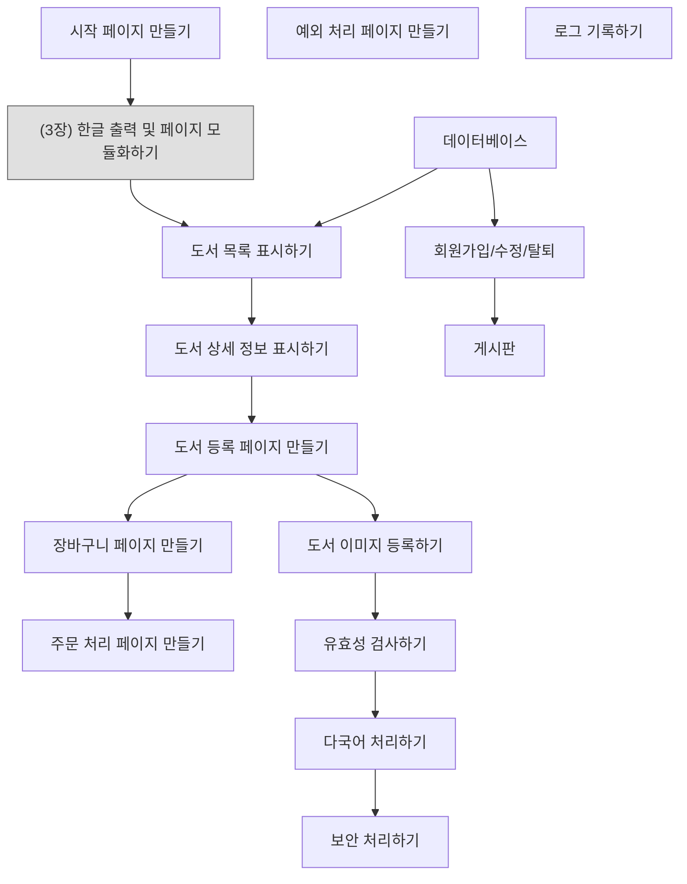

# 📘 4주차 — 디렉티브 태그

> [!NOTE]
> **📚 출처** — Chapter 03 「디렉티브 태그: 한글 출력 및 페이지 모듈화하기」(Hanbit Academy, 2023) 기반 강의자료 (슬라이드 52장)
> PDF 내용만 정리함 (실습 환경 맞춤·외부 보충 없음)

## 🎯 학습 목표
*슬라이드 p.4*

- 디렉티브 태그의 개념과 특징을 이해함
- 디렉티브 태그 구성 요소의 사용법을 익힘
- 디렉티브 태그를 이용하여 북마켓 페이지에 한글을 출력하고 페이지를 모듈화함

## 🗺️ 목차
*슬라이드 p.3*

1. 디렉티브 태그의 개요 — p.5–6
2. page 디렉티브 태그 — p.7–33
3. include 디렉티브 태그 — p.34–40
4. taglib 디렉티브 태그 — p.41–43
5. [북마켓] 한글 출력 및 페이지 모듈화하기 — p.44–51

---

## 1️⃣ 디렉티브 태그의 개요
*슬라이드 p.5–6*

- **디렉티브 태그(directive tag)**
  - JSP 페이지를 어떻게 처리할 것인지를 설정하는 태그
  - JSP 페이지가 서블릿 프로그램에서 서블릿 클래스로 변환할 때 JSP 페이지와 관련된 정보를 JSP 컨테이너에 지시하는 메시지

**표 3-1 디렉티브 태그의 종류**

| 디렉티브 태그 | 형식 | 설명 |
|---|---|---|
| `page` | `<%@ page … %>` | JSP 페이지에 대한 정보를 설정한다. |
| `include` | `<%@ include … %>` | JSP 페이지의 특정 영역에 다른 문서를 포함한다. |
| `taglib` | `<%@ taglib … %>` | JSP 페이지에서 사용할 태그 라이브러리를 설정한다. |

---

## 2️⃣ page 디렉티브 태그
*슬라이드 p.7–33*

### 2.1 page 디렉티브 태그
*슬라이드 p.8–9*

- 현재 JSP 페이지에 대한 정보를 설정하는 태그
- JSP 페이지의 어디에서든 선언할 수 있지만 일반적으로 JSP 페이지의 최상단에 선언하는 것을 권장함

```jsp
<%@ page 속성1="값1" [속성2="값2" … ] %>
```
- **코드 포인트**: `<%@` 부분 표시 — `<%`와 `@` 사이에 공백이 없어야 함

**표 3-2 page 디렉티브 태그의 속성**

| 속성 | 설명 | 기본값 |
|---|---|---|
| `language` | 현재 JSP 페이지가 사용할 프로그래밍 언어를 설정한다. | `java` |
| `contentType` | 현재 JSP 페이지가 생성할 문서의 콘텐츠 유형을 설정한다. | `text/html` |
| `pageEncoding` | 현재 JSP 페이지의 문자 인코딩을 설정한다. | `ISO-8859-1` |
| `import` | 현재 JSP 페이지가 사용할 자바 클래스를 설정한다. | |
| `session` | 현재 JSP 페이지의 세션 사용 여부를 설정한다. | `true` |
| `buffer` | 현재 JSP 페이지의 출력 버퍼 크기를 설정한다. | `8KB` |
| `autoFlush` | 출력 버퍼의 동작 제어를 설정한다. | `true` |
| `isThreadSafe` | 현재 JSP 페이지의 멀티스레드 허용 여부를 설정한다. | `true` |
| `info` | 현재 JSP 페이지에 대한 설명을 설정한다. | |
| `errorPage` | 현재 JSP 페이지에 오류가 발생했을 때 보여줄 오류 페이지를 설정한다. | |
| `isErrorPage` | 현재 JSP 페이지가 오류 페이지인지 여부를 설정한다. | `false` |
| `isELIgnored` | 현재 JSP 페이지의 표현 언어(EL) 지원 여부를 설정한다. | `false` |
| `isScriptingEnabled` | 현재 JSP 페이지의 스크립트 태그 사용 여부를 설정한다. | |

### 2.2 language 속성
*슬라이드 p.10*

- JSP 페이지에서 사용할 프로그래밍 언어를 설정하는 데 사용함
- 기본값: 자바

```jsp
<%@ page language="java" %>
```

### 2.3 contentType 속성
*슬라이드 p.11*

- 현재 JSP 페이지의 콘텐츠 유형(MIME-type)을 설정하는 데 사용함
- 콘텐츠 유형
  - text/html, text/xml, text/plain 등
  - 기본 값: text/html
- 사용 예: text/html 콘텐츠 유형 설정

```jsp
<%@ page contentType="text/html" %>
```

- 사용 예: utf-8 문자열 세트 설정

```jsp
<%@ page contentType="text/html; charset=utf-8" %>
```

### 🧪 [예제 3-1] page 디렉티브 태그에 콘텐츠 유형을 마이크로소프트 워드 문서로 설정하기
*슬라이드 p.12*

📄 `JSPBook/src/main/webapp/ch03/page_contentType01.jsp`
```jsp
<%@ page contentType="application/msword" %>
<html>
<head>
<title>Directives Tag</title>
</head>
<body>
    Today is: <%=new java.util.Date() %>
</body>
</html>
```
- **실행 결과**: 「파일 다운로드」 대화상자 — "이 파일을 열거나 저장하시겠습니까?", 이름: `page_contentType01.doc`, 유형: Microsoft Word 97 - 2003 문서, 123바이트, 시작: localhost, 버튼 열기(O)·저장(S)·취소 / Word 창(제목 `page_contentType0…`) 본문: `Today is: Tue Aug 22 17:32:19 KST 2023`
- **코드 포인트**: 파란색 강조 행 — `<%@ page contentType="application/msword" %>`

### 🧪 [예제 3-2] page 디렉티브 태그에 콘텐츠 유형을 XML 문서로 한글 출력 설정하기
*슬라이드 p.13*

📄 `JSPBook/src/main/webapp/ch03/page_contentType02.jsp`
```jsp
<%@ page contentType="text/xml; charset=utf-8" %>
<html>
<head>
<title>Directives Tag</title>
</head>
<body>
    <h2>contentType 디렉티브 태그</h2>
    <h4>text/html : HTML 출력</h4>
    <h4>charset=utf-8 : 문자 인코딩</h4>
</body>
</html>
```
- **실행 결과**: 탭 `http://localhost:8080/JSPBook/ch03/page_contentType0…`, 주소 표시줄 `/ch03/page_contentType02.jsp` → 문서가 XML 트리로 표시됨 — `<?xml version="1.0"?>`, `- <html>`, `- <head>`, `<title>Directives Tag</title>`, `- <body>`, `<h2>contentType 디렉티브 태그</h2>`, `<h4>text/html : HTML 출력</h4>`, `<h4>charset=utf-8 : 문자 인코딩</h4>`
- **코드 포인트**: 파란색 강조 행 — `<%@ page contentType="text/xml; charset=utf-8" %>`

### 2.4 pageEncoding 속성
*슬라이드 p.14*

- 현재 JSP 페이지의 문자 인코딩 유형을 설정하는 데 사용됨
- 문자 인코딩 유형의 기본 값: ISO-8859-1
- 사용 예: ISO-8859-1 문자 인코딩 유형 설정

```jsp
<%@ page pageEncoding="ISO-8859-1" %>
```
**=** (위와 아래는 같은 설정 — 슬라이드에 등호로 표시)
```jsp
<%@ page contentType="text/html; charset=iso-8859-1" %>
```

### 2.5 import 속성
*슬라이드 p.15*

- 현재 JSP 페이지에서 사용할 자바 클래스를 설정하는 데 사용됨
- 둘 이상의 자바 클래스를 포함하는 경우 쉼표(,)로 구분하여 연속해서 여러 개의 자바 클래스를 설정함
- 또는 여러 개의 자바 클래스를 각각 별도로 설정할 수도 있음
- 사용 예: 자바 패키지 java.io.* 설정

```jsp
<%@ page import="java.io.*" %>
```

- 다중 자바 클래스 참조 예: java.io.*와 java.lang.* 패키지 설정

```jsp
<%@ page import="java.io.*, java.lang.*" %>
```
**=** (위와 아래는 같은 설정 — 슬라이드에 등호로 표시)
```jsp
<%@ page import="java.io.*" %>
<%@ page import="java.lang.*" %>
```

### 🧪 [예제 3-3] page 디렉티브 태그에 Date 클래스를 이용하여 현재 날짜 출력하기
*슬라이드 p.16*

📄 `JSPBook/src/main/webapp/ch03/page_import.jsp`
```jsp
<html>
<head>
<title>Directives Tag</title>
</head>
<body>
    <%@ page import="java.util.Date" %>
    Today is <%=new Date() %>
</body>
</html>
```
- **실행 결과**: 탭 `Directives Tag`, 주소 표시줄 `/ch03/page_import.jsp` → `Today is Tue Aug 22 17:36:04 KST 2023`
- **코드 포인트**: 파란색 강조 행 — `<%@ page import="java.util.Date" %>`

### 2.6 session 속성
*슬라이드 p.17*

- 현재 JSP 페이지의 HTTP 세션 사용 여부를 설정하는 데 사용됨
- 기본 값: 세션을 자동으로 사용하는 true
  - 만약 session 속성 값을 false로 설정할 경우 해당 JSP 페이지에서 내장 객체인 session 변수를 사용할 수 없다는 의미이므로 해당 페이지에 대해 세션을 유지 관리할 수 없음
- 사용 예: session 내장 객체 사용을 위한 true 설정

```jsp
<%@ page session="true" %>
```

### 2.7 buffer 속성
*슬라이드 p.18*

- 현재 JSP 페이지의 출력 버퍼 크기를 설정하는 데 사용
- 속성 값: none과 '버퍼 크기'로 설정
  - 버퍼 크기: 출력 버퍼에 먼저 기록한 후 웹 브라우저로 보냄
- 사용 예: 출력 버퍼 크기를 none으로 설정

```jsp
<%@ page buffer="none" %>
```

- 사용 예: 출력 버퍼 크기를 32KB로 설정

```jsp
<%@ page buffer="32KB" %>
```

### 🧪 [예제 3-4] page 디렉티브 태그에 Date 클래스를 이용하여 현재 날짜 출력하기
*슬라이드 p.19*

📄 `JSPBook/src/main/webapp/ch03/page_buffer.jsp`
```jsp
<html>
<head>
<title>Directives Tag</title>
</head>
<body>
    <%@ page buffer="16kb" %>
    Today is: <%=new java.util.Date() %>
</body>
</html>
```
- **실행 결과**: 탭 `Directives Tag`, 주소 표시줄 `…/ch03/page_buffer.jsp` → `Today is: Tue Aug 22 17:37:09 KST 2023`
- **코드 포인트**: 파란색 강조 행 — `<%@ page buffer="16kb" %>`

### 2.8 autoFlush 속성
*슬라이드 p.20*

- 자동으로 출력 버퍼를 비우는 것을 제어하는 데 사용됨
- 기본값: true
- fasle(슬라이드 표기 그대로) 설정 시 버퍼가 가득 채워질 때 버퍼 오버플로의 예외 발생함
- 사용 예: 출력 버퍼 자동 비우기를 위한 true 설정

```jsp
<%@ page autoFlush="true" %>
```

### 2.9 isThreadSafe 속성
*슬라이드 p.21*

- 현재 JSP 페이지에서 멀티스레드의 동작을 제어하는 데 사용됨
- 기본값: true
- false 설정 시 JSP 페이지에 대한 요청이 순차적으로 처리됨
- 사용 예: 멀티스레드 처리를 위한 true 설정

```jsp
<%@ page isThreadSafe="true" %>
```

### 2.10 info 속성
*슬라이드 p.22*

- 현재 JSP 페이지에 대한 설명을 설정하는 데 사용됨
- JSP 컨테이너는 info 속성을 무시함
- 사용 예: JSP 페이지 설명을 위한 설정

```jsp
<%@ page info="Home Page JSP" %>
```

### 🧪 [예제 3-5] page 디렉티브 태그에 현재 웹 페이지의 설명 작성하기
*슬라이드 p.23*

📄 `JSPBook/src/main/webapp/ch03/page_info.jsp`
```jsp
<%@ page contentType="text/html; charset=utf-8" %>
<html>
<head>
<title>Directives Tag</title>
</head>
<body>
    <%@ page info="Date 클래스를 이용한 날짜 출력하기" %>
    Today is <%=new java.util.Date() %>
</body>
</html>
```
- **실행 결과**: 탭 `Directives Tag`, 주소 표시줄 `ok/ch02/page_info.jsp`(캡처 표기 그대로) → `Today is Tue Aug 22 17:38:17 KST 2023`
- **코드 포인트**: 파란색 강조 행 — `<%@ page info="Date 클래스를 이용한 날짜 출력하기" %>`

### 2.11 errorPage 속성
*슬라이드 p.24*

- JSP 페이지가 실행되는 동안 오류가 발생하면 특정 오류 페이지로 이동하는 데 사용됨
- 사용 예: 이동할 오류 페이지 MyErrorPage.jsp 설정

```jsp
<%@ page errorPage="MyErrorPage.jsp" %>
```

### 🧪 [예제 3-6] page 디렉티브 태그에 이동할 특정 오류 페이지 작성하기
*슬라이드 p.25–26*

**1.** 다음과 같이 웹 페이지를 작성하고 `http://localhost:8080/JSPBook/ch03/page_errorPage.jsp`에서 실행 결과 확인하기

📄 `JSPBook/src/main/webapp/ch03/page_errorPage.jsp`
```jsp
<html>
<head>
<title>Directives Tag</title>
</head>
<body>
    <%
        String str = null;
        out.println(str.toString());
    %>
</body>
</html>
```
- **실행 결과**: 주소 `http://localhost:8080/JSPBook/ch03/page_errorPage.jsp` → `HTTP 상태 500 – 내부 서버 오류` 페이지 — `org.apache.jasper.JasperException: 행 [8]에서 [/ch03/page_errorPage.jsp]을(를) 처리하는 중 예외 발생`, 오류 위치 소스(5~11행), `Stacktrace:` 표시

**2.** page_errorPage.jsp 파일의 page 디렉티브 태그를 추가 수정하고, `http://localhost:8080/JSPBook/ch03/page_errorPage.jsp`에서 실행 결과를 확인하기

📄 `JSPBook/src/main/webapp/ch03/page_errorPage.jsp`
```jsp
<%@ page errorPage="page_errorPage_error.jsp" %>
<html>
<head>
<title>Directives Tag</title>
</head>
<body>
    <%
        String str = null;
        out.println(str.toString());
    %>
</body>
</html>
```
- **실행 결과**: 탭 `Directives Tag`, 주소 표시줄 `…/ch03/page_errorPage.jsp` → `errorPage 디렉티브 태그`(굵게), `에러가 발생했습니다` (이동한 오류 페이지 page_errorPage_error.jsp의 코드는 슬라이드에 없음)
- **코드 포인트**: 파란색 강조 행 — 추가한 `<%@ page errorPage="page_errorPage_error.jsp" %>`

### 2.12 isErrorPage 속성
*슬라이드 p.27*

- 현재 JSP 페이지가 오류 페이지인지 여부를 설정하는 데 사용됨
- 기본값: false
- 예외 처리를 위한 내장 객체인 exception 변수를 사용할 수 없음
- true로 설정 시 현재 JSP 페이지는 오류 페이지가 됨
- 사용 예: 현재 JSP 페이지가 오류 페이지가 되도록 true 설정

```jsp
<%@ page isErrorPage="true" %>
```

### 🧪 [예제 3-7] page 디렉티브 태그에 현재 JSP 페이지 오류 페이지로 설정하기
*슬라이드 p.28–29*

📄 `JSPBook/src/main/webapp/ch03/page_isErrorPage.jsp`
```jsp
<%@ page errorPage="page_isErrorPage_error.jsp" %>
<html>
<head>
<title>Directives Tag</title>
</head>
<body>
    <%
        String str = null;
        out.println(str.toString());
    %>
</body>
</html>
```

📄 `JSPBook/src/main/webapp/ch03/page_isErrorPage_error.jsp`
```jsp
<%@ page contentType="text/html; charset=utf-8" %>
<%@ page isErrorPage="true" %>
<html>
<head>
<title>Directives Tag</title>
</head>
<body>
    <h4>에러가 발생했습니다.</h4>
    <h5>exception 내장 객체 변수</h5>
    <%
        exception.printStackTrace(new java.io.PrintWriter(out));
    %>
</body>
</html>
```
- **실행 결과**: 주소 `http://localhost:8080/JSPBook/ch03/page_isErrorPage.jsp` → `에러가 발생되었습니다.`(캡처 표기 그대로), `exception 내장 객체 변수`, 이어서 스택 트레이스 `java.lang.NullPointerException: Cannot invoke "String.toString()" because "str" is null at …` 출력
- **코드 포인트**: page_isErrorPage_error.jsp의 파란색 강조 행 — `<%@ page isErrorPage="true" %>`

### 2.13 isELIgnored 속성
*슬라이드 p.30*

- 현재 JSP 페이지의 표현 언어 사용 여부를 설정하는 데 사용됨
- 기본값: false
- true로 설정 시 정적 텍스트로 처리
- 사용 예: 표현 언어를 처리하지 않기 위한 true 설정

```jsp
<%@ page isELIgnored="true" %>
```

### 🧪 [예제 3-8] page 디렉티브 태그에 표현 언어를 사용할 수 없도록 설정하기
*슬라이드 p.31–32*

**1.** 웹 페이지를 작성하고 `http://localhost:8080/JSPBook/ch03/page_isELIgnored.jsp`에서 실행 결과 확인하기

📄 `JSPBook/src/main/webapp/ch03/page_isELIgnored.jsp`
```jsp
<%@ page contentType="text/html; charset=utf-8" %>
<html>
<head>
<title>Directives Tag</title>
</head>
<body>
    <%
        request.setAttribute("RequestAttribute", "request 내장 객체");
    %>
    ${requestScope.RequestAttribute}
</body>
</html>
```
- **실행 결과**: 탭 `Directives Tag`, 주소 표시줄 `…/ch03/page_isELIgnored.jsp` → `request 내장 객체`

**2.** page_isELIgnored.jsp 파일의 page 디렉티브 태그를 추가 수정하고, `http://localhost:8080/JSPBook/ch03/page_isELIgnored.jsp`에서 실행 결과 확인하기

📄 `JSPBook/src/main/webapp/ch03/page_isELIgnored.jsp`
```jsp
<%@ page contentType="text/html; charset=utf-8" %>
<%@ page isELIgnored="true" %>
<html>
<head>
<title>Directives Tag</title>
</head>
<body>
    <%
        request.setAttribute("RequestAttribute", "request 내장 객체");
    %>
    ${requestScope.RequestAttribute}
</body>
</html>
```
- **실행 결과**: 탭 `Directives Tag`, 주소 표시줄 `/ch03/page_isELIgnored.jsp` → `${requestScope.RequestAttribute}`가 글자 그대로 출력됨
- **코드 포인트**: 파란색 강조 행 — 추가한 `<%@ page isELIgnored="true" %>`

### 2.14 isScriptingEnabled 속성
*슬라이드 p.33*

- 스크립트 태그(선언문, 스크립틀릿, 표현문) 사용 여부를 설정하는 데 사용됨
- 사용 예: 스크립트 태그를 사용하지 않기 위한 false 설정

```jsp
<%@ page isScriptingEnabled="false" %>
```

---

## 3️⃣ include 디렉티브 태그
*슬라이드 p.34–40*

### 3.1 include 디렉티브 태그
*슬라이드 p.35*

- 현재 JSP 페이지의 특정 영역에 외부 파일의 내용을 포함하는 태그
- 현재 JSP 페이지에 포함할 수 있는 외부 파일
  - HTML, JSP, 텍스트 파일
- include 디렉티브 태그는 JSP 페이지 어디에서든 선언할 수 있음

```jsp
<%@ include file="파일명" %>
```

- file 속성 값
  - 현재 JSP 페이지에 포함할 내용을 가진 외부 파일명
  - 이때 외부 파일이 현재 JSP 페이지와 같은 디렉터리에 있으면 파일명만 설정하고,
  - 그렇지 않으면 전체 URL(또는 상대 경로)을 설정

### 3.2 include 디렉티브 태그 사용 예
*슬라이드 p.36–37*

```jsp
<html>
<body>
<%@ include file="header.jsp" %>
Today is: <%=java.util.Calendar.getInstance().getTime() %>
<%@ include file="footer.jsp" %>
</body>
</html>
```
- **코드 포인트**:
  - `<%@ include file="header.jsp" %>` → header.jsp 파일의 내용을 이 JSP 페이지에 포함함
  - `<%@ include file="footer.jsp" %>` → footer.jsp 파일의 내용을 이 JSP 페이지에 포함함

**그림 3-1 include 디렉티브 태그로 머리글과 바닥글에 외부 파일 포함하기**

| 화면(모니터) | ← JSP 페이지 | 페이지 위쪽 | 페이지 아래쪽 |
|---|---|---|---|
| jspPage1.jsp | jspPage1.jsp | include header.jsp | include footer.jsp |
| jspPage2.jsp | jspPage2.jsp | include header.jsp | include footer.jsp |

- 오른쪽에 외부 파일 header.jsp, footer.jsp가 그려져 있음

**그림 3-2 include 디렉티브 태그로 특정 외부 파일 포함하기**

| 화면(모니터) | ← JSP 페이지 | 페이지 위쪽 |
|---|---|---|
| jspPage1.jsp | jspPage1.jsp | include utils.jsp |
| jspPage2.jsp | jspPage2.jsp | include utils.jsp |

- 오른쪽에 외부 파일 utils.jsp 하나가 그려져 있음

### 🧪 [예제 3-9] include 디렉티브 태그로 외부 파일의 내용 포함하기
*슬라이드 p.38*

📄 `JSPBook/src/main/webapp/ch03/include01.jsp`
```jsp
<%@ page contentType="text/html; charset=utf-8" %>
<html>
<head>
<title>Directives Tag</title>
</head>
<body>
    <%@ include file="include01_header.jsp" %>
    <h4>---------- 현재 페이지 영역 ----------</h4>
</body>
</html>
```
- **실행 결과**: 탭 `Directives Tag`, 주소 표시줄 `/ch03/include01.jsp` → `헤더 페이지 영역입니다`, `---------- 현재 페이지 영역 ----------`
- **코드 포인트**: 파란색 강조 행 — `<%@ include file="include01_header.jsp" %>`

📄 `JSPBook/src/main/webapp/ch03/include01_header.jsp`
```jsp
<%@ page contentType="text/html; charset=utf-8" %>
<html>
<head>
<title>Directives Tag</title>
</head>
<body>
    <h4>헤더 페이지 영역입니다</h4>
</body>
</html>
```
- **실행 결과**: 탭 `Directives Tag`, 주소 표시줄 `/ch03/include01_header.jsp` → `헤더 페이지 영역입니다`

### 🧪 [예제 3-10] include 디렉티브 태그로 머리글과 바닥글에 외부 파일 내용 포함하기
*슬라이드 p.39–40*

📄 `JSPBook/src/main/webapp/ch03/include02.jsp`
```jsp
<%@ page contentType="text/html; charset=utf-8" %>
<html>
<head>
<title>Directives Tag</title>
</head>
<body>
    <%@ include file="include02_header.jsp" %>
    <p>방문해 주셔서 감사합니다.</p>
    <%@ include file="include02_footer.jsp" %>
</body>
</html>
```

📄 `JSPBook/src/main/webapp/ch03/include02_header.jsp`
```jsp
<%@ page contentType="text/html; charset=utf-8" %>
<%!
    int pageCount = 0;
    void addCount() {
        pageCount++;
    }
%>
<%
    addCount();
%>
<p>이 사이트 방문은 <%=pageCount %>번째 입니다.</p>
```

📄 `JSPBook/src/main/webapp/ch03/include02_footer.jsp`
```jsp
Copyright ©JSPBook
```
- **실행 결과**: 탭 `Directives Tag`, 주소 표시줄 `/ch03/include02.jsp` → `이 사이트 방문은 1번째 입니다.`, `방문해 주셔서 감사합니다.`, `Copyright ©JSPBook`
- **코드 포인트**: include02.jsp의 파란색 강조 행 — `<%@ include file="include02_header.jsp" %>`, `<%@ include file="include02_footer.jsp" %>`

---

## 4️⃣ taglib 디렉티브 태그
*슬라이드 p.41–43*

### 4.1 taglib 디렉티브 태그
*슬라이드 p.42*

- 현재 JSP 페이지에 표현 언어, JSTL, 사용자 정의 태그(custom tag) 등 태그 라이브러리를 설정하는 태그

```jsp
<%@ taglib uri="경로" prefix="태그 식별자" %>
```

- taglib 디렉티브 태그 사용 예

```jsp
<%@ page contentType="text/html; charset=utf-8" %>
<%@ taglib uri="http://java.sun.com/jsp/jstl/core" prefix="c" %>
<html>
<head>
<title>JSTL</title>
</head>
<body>
    <c:out value="JSTL Core 태그 라이브러리" />
</body>
</html>
```
- **실행 결과**: `JSTL Core 태그 라이브러리` (슬라이드에 결과 박스로 표시)

### 🧪 [예제 3-11] taglib 태그에 JSTL의 Core 태그를 설정하여 1부터 10까지 출력하기
*슬라이드 p.43*

- /WEB-INF/lib/ 폴더에 JSTL 태그 라이브러리인 JSTL-1.2.jar 파일 추가하기

📄 `JSPBook/src/main/webapp/ch03/taglib.jsp`
```jsp
<%@ taglib prefix="c" uri="http://java.sun.com/jsp/jstl/core" %>
<html>
<head>
<title>Directives Tag</title>
</head>
<body>
    <c:forEach var="k" begin="1" end="10" step="1">
        <c:out value="${k}" />
    </c:forEach>
</body>
</html>
```
- **실행 결과**: 탭 `Directives Tag`, 주소 표시줄 `/ch03/taglib.jsp` → `1 2 3 4 5 6 7 8 9 10`
- **코드 포인트**: 파란색 강조 행 — `<%@ taglib prefix="c" uri="http://java.sun.com/jsp/jstl/core" %>`, `<c:forEach var="k" begin="1" end="10" step="1">` ~ `</c:forEach>`

---

## 5️⃣ [북마켓] 한글 출력 및 페이지 모듈화하기
*슬라이드 p.44–51*

### 5.1 프로젝트 로드맵
*슬라이드 p.45*

**그림 3-3 웹 페이지 모듈화하기**



- 3장 위치: 시작 페이지 만들기 → **한글 출력 및 페이지 모듈화하기**(회색 강조, "3장" 표시) → 도서 목록 표시하기
- 데이터베이스 → 도서 목록 표시하기(위쪽 화살표), 데이터베이스 → 회원가입/수정/탈퇴 → 게시판
- 도서 목록 표시하기 → 도서 상세 정보 표시하기 → 도서 등록 페이지 만들기 → 장바구니 페이지 만들기 → 주문 처리 페이지 만들기
- 도서 등록 페이지 만들기 → 도서 이미지 등록하기 → 유효성 검사하기 → 다국어 처리하기 → 보안 처리하기
- 예외 처리 페이지 만들기, 로그 기록하기는 화살표 없이 따로 배치됨

### 5.2 프로젝트 실행 결과
*슬라이드 p.46*

**그림 3-4 완성된 북마켓(도서 쇼핑몰) 시작 페이지**

- **실행 결과**: 탭 `Welcome`, 주소 `localhost:8080/BookMarket/welcome.jsp` → 위쪽 `Home`(집 아이콘), 큰 제목 `도서 쇼핑몰에 오신 것을 환영합니다`와 `BookMarket`, 가운데 `Welcome to Web Market!`, `현재 접속 시각: 5:24:11 PM`, 아래쪽 `© BookMarket`

### 🧪 [예제 3-12] 한글 및 현재 접속 시각 출력하기
*슬라이드 p.47–48*

**1.** 한글 출력하기

📄 `BookMarket/src/main/webapp/welcome.jsp`
```jsp
<%@ page contentType="text/html; charset=utf-8" %>
…(생략)…
    <%! String greeting = "도서 쇼핑몰에 오신 것을 환영합니다";
    String tagline = "Welcome to Web Market!"; %>
    …(생략)…
```
- **코드 포인트**: 파란색 강조 행 — `<%@ page contentType="text/html; charset=utf-8" %>`, `<%! String greeting = "도서 쇼핑몰에 오신 것을 환영합니다";`

**2.** 현재 접속 시각 출력하기 (슬라이드 p.47~48에 이어지는 한 코드)

📄 `BookMarket/src/main/webapp/welcome.jsp`
```jsp
<%@ page contentType="text/html; charset=utf-8" %>
<%@ page import="java.util.Date" %>
    …(생략)…
    <div class="row align-items-md-stretch text-center">
        <div class="col-md-12">
            <div class="h-100 p-5">
                <h3><%=tagline %></h3>
                <%
                    Date day = new java.util.Date();
                    String am_pm;
                    int hour = day.getHours();
                    int minute = day.getMinutes();
                    int second = day.getSeconds();
                    if (hour / 12 == 0) {
                        am_pm = "AM";
                    } else {
                        am_pm = "PM";
                        hour = hour - 12;
                    }
                    String CT = hour + ":" + minute + ":" + second + " " + am_pm;
                    out.println("현재 접속 시각: " + CT + "\n");
                %>
    …(생략)…
```
- **코드 포인트**: 파란색 강조 행 — `<%@ page import="java.util.Date" %>`, `<%` ~ `%>` 스크립틀릿 전체(현재 접속 시각 계산·출력)

### 🧪 [예제 3-13] 웹 페이지 모듈화하기
*슬라이드 p.49–51*

- 북마켓의 시작 페이지를 머리글, 본문, 바닥글로 구분하여 모듈화하기

| 영역 | 파일 | 화면 내용 |
|---|---|---|
| 머리글 | menu.jsp | `Home`(집 아이콘) |
| 본문 | welcome.jsp | `도서 쇼핑몰에 오신 것을 환영합니다`, `BookMarket`, `Welcome to Web Market!`, `현재 접속 시각: 5:24:11 PM` |
| 바닥글 | footer.jsp | `© BookMarket` |

- **실행 결과**: 탭 `Welcome`, 주소 `localhost:8080/BookMarket/welcome.jsp` (p.49 캡처)
- **코드 포인트**: 캡처 옆 설명 — 머리글: menu.jsp, 본문: welcome.jsp, 바닥글: footer.jsp

**1.** 머리글 JSP 페이지 작성하기

📄 `BookMarket/src/main/webapp/menu.jsp`
```jsp
<header class="pb-3 mb-4 border-bottom">
<a href="./welcome.jsp" class="d-flex align-items-center text-dark text-decoration-none">
    <svg width="32" height="32" fill="currentColor" class="bi bi-house-fill" viewBox="0 0 16 16">
    <path d="M8.707 1.5a1 1 0 0 0-1.414 0L.646 8.146a.5.5 0 0 0 .708.708L82 .207l6.646 6.647a.5.5 0 0 0 .708-.708L13 5.793V2.5a.5.5 0 0 0-.5-.5h-1a.5.5 0 0 0-.5.5v1.293L8.707 1.5Z"/>
    <path d="m8 3.293 6 6V13.5a1.5 1.5 0 0 1-1.5 1.5h-9A1.5 1.5 0 0 1 2 13.5V9.293l6-6Z"/>
    </svg>
    <span class="fs-4">Home</span>
</a>
</header>
```
※ 슬라이드 표기 그대로

**2.** 바닥글 JSP 페이지 작성하기

📄 `BookMarket/src/main/webapp/footer.jsp`
```jsp
<footer class="pt-3 mt-4 text-body-secondary border-top">
    &copy; BookMarket
</footer>
```

**3.** JSP 페이지 모듈화하기

📄 `BookMarket/src/main/webapp/welcome.jsp`
```jsp
<%@ page contentType="text/html; charset=utf-8" %>
…(생략)…
<div class="container py-4">
  <%@ include file="menu.jsp" %>
  <%! String greeting = "도서 쇼핑몰에 오신 것을 환영합니다";
  String tagline = "Welcome to Web Market!"; %>
  …(생략)…
  <%@ include file="footer.jsp" %>
</div>
</body>
</html>
```
- **코드 포인트**: 파란색 강조 행 — `<%@ include file="menu.jsp" %>`, `<%@ include file="footer.jsp" %>`

---

## 🧠 핵심 요약

- **디렉티브 태그**: JSP 페이지를 어떻게 처리할지 설정하는 태그, 서블릿 클래스로 변환할 때 JSP 페이지 관련 정보를 JSP 컨테이너에 지시하는 메시지임
  - `page`(JSP 페이지 정보 설정), `include`(특정 영역에 다른 문서 포함), `taglib`(사용할 태그 라이브러리 설정) 3종류, 모두 `<%@ … %>` 형식
- **page 디렉티브**: `<%@ page 속성1="값1" … %>`, `<%`와 `@` 사이 공백 없음, 어디서든 선언 가능하나 최상단 선언 권장
  - 기본값: language `java`, contentType `text/html`, pageEncoding `ISO-8859-1`, session `true`, buffer `8KB`, autoFlush `true`, isThreadSafe `true`, isErrorPage `false`, isELIgnored `false`
  - contentType: 콘텐츠 유형(MIME-type)과 문자열 세트 설정 — `application/msword`면 Word 문서로 다운로드(예제 3-1), `text/xml; charset=utf-8`이면 XML 트리로 한글 출력(예제 3-2)
  - `pageEncoding="ISO-8859-1"` = `contentType="text/html; charset=iso-8859-1"`
  - import: 쉼표(,)로 여러 자바 클래스를 연속 설정하거나 각각 별도로 설정
  - session=false → session 내장 객체 사용 불가 / buffer: none 또는 버퍼 크기 / autoFlush=false → 버퍼가 가득 차면 버퍼 오버플로 예외 / isThreadSafe=false → 요청을 순차 처리 / info → JSP 컨테이너가 무시
  - errorPage: 오류 발생 시 이동할 오류 페이지 지정(예제 3-6) / isErrorPage=true: 현재 페이지가 오류 페이지가 되어 exception 내장 객체 사용(예제 3-7)
  - isELIgnored=true → 표현 언어를 정적 텍스트로 처리해 `${requestScope.RequestAttribute}`가 그대로 출력(예제 3-8)
  - isScriptingEnabled: 스크립트 태그(선언문, 스크립틀릿, 표현문) 사용 여부
- **include 디렉티브**: `<%@ include file="파일명" %>`, 현재 JSP 페이지의 특정 영역에 외부 파일(HTML, JSP, 텍스트) 내용 포함, 어디서든 선언 가능
  - file 속성: 같은 디렉터리면 파일명만, 아니면 전체 URL(또는 상대 경로)
  - 머리글·바닥글을 여러 페이지에 포함(그림 3-1), 특정 외부 파일 하나를 여러 페이지에 포함(그림 3-2)
- **taglib 디렉티브**: `<%@ taglib uri="경로" prefix="태그 식별자" %>`, 표현 언어·JSTL·사용자 정의 태그 등 태그 라이브러리 설정
  - 예제 3-11: /WEB-INF/lib/에 JSTL-1.2.jar 추가 → uri `http://java.sun.com/jsp/jstl/core`, prefix `c` → `<c:forEach>`·`<c:out>`으로 1~10 출력
- **북마켓**: welcome.jsp에 `contentType="text/html; charset=utf-8"`로 한글 출력, `import="java.util.Date"`로 현재 접속 시각 출력(예제 3-12) → 머리글 menu.jsp·본문 welcome.jsp·바닥글 footer.jsp로 나누고 include로 모듈화(예제 3-13)

## ✍️ 시험 대비 체크포인트

- **Q.** 디렉티브 태그의 역할과 세 종류(형식)는? → **A.** JSP 페이지를 어떻게 처리할지 설정하는 태그, 서블릿 클래스로 변환할 때 JSP 컨테이너에 정보를 지시하는 메시지임 / `page`(`<%@ page … %>`), `include`(`<%@ include … %>`), `taglib`(`<%@ taglib … %>`)
- **Q.** page 디렉티브 태그를 쓸 때 공백 규칙과 권장 위치는? → **A.** `<%`와 `@` 사이에 공백이 없어야 함 / 어디서든 선언할 수 있지만 JSP 페이지 최상단 선언 권장
- **Q.** contentType 속성의 기본값과 utf-8 문자열 세트 설정 코드는? → **A.** `text/html` / `<%@ page contentType="text/html; charset=utf-8" %>`
- **Q.** 예제 3-1에서 `contentType="application/msword"`로 설정하고 실행하면? → **A.** page_contentType01.doc(Microsoft Word 97 - 2003 문서) 파일 다운로드 대화상자가 뜨고, Word 문서에 `Today is: …` 날짜가 출력됨
- **Q.** pageEncoding의 기본값과, `<%@ page pageEncoding="ISO-8859-1" %>`와 같은 설정은? → **A.** `ISO-8859-1` / `<%@ page contentType="text/html; charset=iso-8859-1" %>`
- **Q.** import 속성으로 java.io.*와 java.lang.*를 함께 설정하는 두 방법은? → **A.** `<%@ page import="java.io.*, java.lang.*" %>`(쉼표 구분) 또는 `<%@ page import="java.io.*" %>`와 `<%@ page import="java.lang.*" %>`(각각 별도)
- **Q.** session 속성을 false로 설정하면? → **A.** 내장 객체인 session 변수를 사용할 수 없어 해당 페이지에 대해 세션을 유지 관리할 수 없음 (기본값 true)
- **Q.** buffer 속성에 지정하는 값과 기본값은? → **A.** none 또는 '버퍼 크기'(예: `32KB`, 예제 3-4는 `16kb`) / 기본값 `8KB`
- **Q.** autoFlush와 isThreadSafe를 각각 false로 설정하면? → **A.** autoFlush: 버퍼가 가득 채워질 때 버퍼 오버플로의 예외 발생 / isThreadSafe: JSP 페이지에 대한 요청이 순차적으로 처리됨
- **Q.** info 속성은 JSP 컨테이너가 어떻게 처리하는가? → **A.** 현재 JSP 페이지 설명을 설정하지만 JSP 컨테이너는 info 속성을 무시함
- **Q.** 예제 3-7에서 오류 페이지(page_isErrorPage_error.jsp)가 exception 내장 객체를 쓰려고 넣은 page 디렉티브는? → **A.** `<%@ page isErrorPage="true" %>` (isErrorPage 기본값 false)
- **Q.** 예제 3-8에서 `<%@ page isELIgnored="true" %>` 추가 전후의 출력은? → **A.** 추가 전 `request 내장 객체`, 추가 후 `${requestScope.RequestAttribute}`가 그대로 출력됨(정적 텍스트로 처리)
- **Q.** include 디렉티브 태그로 포함할 수 있는 외부 파일과 file 속성 값 설정 규칙은? → **A.** HTML, JSP, 텍스트 파일 / 같은 디렉터리면 파일명만, 그렇지 않으면 전체 URL(또는 상대 경로)
- **Q.** taglib 디렉티브 태그의 형식과 예제 3-11의 준비 작업은? → **A.** `<%@ taglib uri="경로" prefix="태그 식별자" %>` / /WEB-INF/lib/ 폴더에 JSTL-1.2.jar 파일 추가
- **Q.** 북마켓 welcome.jsp에서 한글 출력·현재 접속 시각·모듈화에 쓴 디렉티브 태그는? → **A.** `<%@ page contentType="text/html; charset=utf-8" %>`(한글), `<%@ page import="java.util.Date" %>`(접속 시각), `<%@ include file="menu.jsp" %>`·`<%@ include file="footer.jsp" %>`(머리글·바닥글 모듈화)
