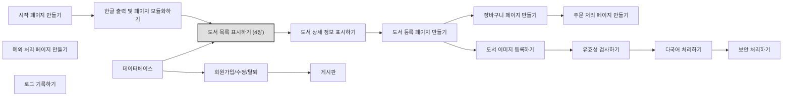

# 📘 5주차 — 액션태그

> [!NOTE]
> **📚 출처** — Chapter 04 액션 태그: 도서 목록 표시하기 기반 강의자료 (슬라이드 60장)
> PDF 내용만 정리함 (실습 환경 맞춤·외부 보충 없음)

## 🎯 학습 목표
*슬라이드 p.4*

- 액션 태그의 개념과 특징을 이해함
- 액션 태그 구성 요소의 사용법을 익힘
- 액션 태그를 이용하여 북마켓의 도서 목록을 출력함

## 🗺️ 목차
*슬라이드 p.3 (5번의 하위 항목은 p.27·30·37·42 슬라이드 제목)*

1. 액션 태그의 개요
2. forward 액션 태그
3. include 액션 태그
4. param 액션 태그
5. 자바빈즈 액션 태그
   - 5-1. 자바빈즈의 개요
   - 5-2. useBean 액션 태그로 자바빈즈 사용하기
   - 5-3. setProperty 액션 태그로 프로퍼티의 값 저장하기
   - 5-4. getProperty 액션 태그로 프로퍼티의 값 가져오기
6. [북마켓] 도서 목록 표시하기

---

## 1️⃣ 액션 태그의 개요
*슬라이드 p.5–7*

### 액션 태그
*슬라이드 p.6*

- 서버나 클라이언트에게 어떤 행동을 하도록 명령하는 태그임
- JSP 페이지에서 페이지와 페이지 사이를 제어함
- 다른 페이지의 실행 결과 내용을 현재 페이지에 포함함
- 자바 빈즈(JavaBeans) 등의 다양한 기능을 제공함
- XML 형식 `<jsp: … />`를 사용함

### 액션 태그의 종류
*슬라이드 p.7*

**표 4-1 액션 태그의 종류**

| 액션 태그 | 형식 | 설명 |
|---|---|---|
| forward | `<jsp:forward … />` | 다른 페이지로의 이동과 같은 페이지 흐름을 제어한다. |
| include | `<jsp:include … />` | 외부 페이지의 내용을 포함하거나 페이지를 모듈화한다. |
| useBean | `<jsp:useBean … />` | JSP 페이지에 자바빈즈를 설정한다. |
| setProperty | `<jsp:setProperty … />` | 자바빈즈의 프로퍼티 값을 설정한다. |
| getProperty | `<jsp:getProperty … />` | 자바빈즈의 프로퍼티 값을 얻어온다. |
| param | `<jsp:param … />` | `<jsp:forward>`, `<jsp:include>`, `<jsp:plugin>` 태그에 인자를 추가한다. |
| plugin | `<jsp:plugin … />` | 웹 브라우저에 자바 애플릿을 실행한다. 자바 플러그인에 대한 OBJECT 또는 EMBED 태그를 만드는 브라우저별 코드를 생성한다. |
| element | `<jsp:element … />` | 동적 XML 요소를 설정한다. |
| attribute | `<jsp:attribute … />` | 동적으로 정의된 XML 요소의 속성을 설정한다. |
| body | `<jsp:body … />` | 동적으로 정의된 XML 요소의 몸체를 설정한다. |
| text | `<jsp:text … />` | JSP 페이지 및 문서에서 템플릿 텍스트를 작성한다. |

---

## 2️⃣ forward 액션 태그
*슬라이드 p.8–12*

- 현재 JSP 페이지에서 다른 페이지로 이동하는 태그임
- JSP 컨테이너는 현재 JSP 페이지에서 forward 액션 태그를 만나는 경우
  - 그 전까지 출력 버퍼에 저장되어 있던 내용을 모두 삭제함
  - forward 액션 태그에 설정된 페이지로 프로그램의 제어가 이동됨

```jsp
<jsp:forward page="파일명" />
또는
<jsp:forward page="파일명">   </jsp:forward>
```
- **코드 포인트**: 첫 줄의 `/>`에 "반드시 끝나는 태그가 있어야 함" 말풍선이 붙어 있음

- page 속성 값
  - 현재 JSP 페이지에서 이동할 페이지의 외부 파일명임
  - 외부 파일은 현재 JSP 페이지와 같은 디렉터리에 있으면 파일명만 설정하고, 그렇지 않으면 전체 URL(또는 상대 경로)을 설정해야 함

### forward 액션 태그 사용 예
*슬라이드 p.10*

📄 `first.jsp`
```jsp
<%@ page contentType="text/html; charset=utf-8" %>
<html>
<head>
<title>Action Tag</title>
</head>
<body>
    <h3>이 파일은 first.jsp입니다.</h3>
    <jsp:forward page="second.jsp" />
    <p> ===first.jsp의 페이지=====
</body>
</html>
```

📄 `second.jsp`
```jsp
<%@ page contentType="text/html; charset=utf-8" %>
<html>
<head>
<title>Action Tag</title>
</head>
<body>
    <h3>이 파일은 second.jsp입니다.</h3>
    Today is : <%=new java.util.Date() %>
</body>
</html>
```
- **실행 결과**: "이 파일은 second.jsp입니다." / "Today is : Tue Aug 22 17:54:07 KST 2023"

### forward 액션 태그의 페이지 흐름 처리 과정
*슬라이드 p.11*

**그림 4-1 forward 액션 태그의 페이지 흐름 처리 과정**

1. ① 웹 브라우저 → first.jsp : HTTP 요청
2. ② first.jsp 안에서 first.jsp 코드(…)를 따라 `<jsp:forward page="second.jsp">`까지 내려감
3. ③ first.jsp → second.jsp 로 넘어감
4. ④ second.jsp 안에서 second.jsp 코드(…)를 따라 내려감
5. ⑤ second.jsp → 웹 브라우저 : HTTP 응답

### 🧪 [예제 4-1] forward 액션 태그로 현재 날짜와 시각을 출력하는 페이지로 이동하기
*슬라이드 p.12*

📄 `JSPBook/src/main/webapp/ch04/forward.jsp`
```jsp
<%@ page contentType="text/html; charset=utf-8" %>
<html>
<head>
<title>Action Tag</title>
</head>
<body>
    <h2>forward 액션 태그</h2>
    <jsp:forward page="forward_date.jsp" />
    <p> ------------------------------
</body>
</html>
```

📄 `JSPBook/src/main/webapp/ch04/forward_date.jsp`
```jsp
<%@ page contentType="text/html; charset=utf-8" %>
<html>
<head>
<title>Action Tag</title>
</head>
<body>
    <p> 오늘의 날짜 및 시간
    <p> <%=(new java.util.Date()).toLocaleString() %>
</body>
</html>
```
※ 슬라이드 표기 그대로 (코드는 "시간", 실행 화면은 "시각")

- **실행 결과**: `/ch04/forward.jsp` → "오늘의 날짜 및 시각" / "2023. 8. 22. 오후 5:57:06"
- **코드 포인트**: 슬라이드에서 `<jsp:forward page="forward_date.jsp" />` 줄이 강조(파란색) 표시됨

---

## 3️⃣ include 액션 태그
*슬라이드 p.13–18*

- 현재 JSP 페이지의 특정 영역에 외부 파일의 내용을 포함하는 태그임
  - 현재 JSP 페이지에 포함할 수 있는 외부 파일: HTML, JSP, 서블릿 페이지 등

```jsp
<jsp:include page="파일명" flush="false" />
```

- page 속성 값
  - 현재 JSP 페이지 내에 포함할 내용을 가진 외부 파일명임
  - 외부 파일은 현재 JSP 페이지와 같은 디렉터리에 있으면 파일명만 설정하고, 그렇지 않으면 전체 URL(또는 상대 경로)을 설정해야 함
- flush 속성 값
  - 설정한 외부 파일로 제어가 이동할 때 현재 JSP 페이지가 지금까지 출력 버퍼에 저장한 결과를 처리함(기본 값: false)
  - true로 설정하면 외부 파일로 제어가 이동할 때 현재 JSP 페이지가 지금까지 출력 버퍼에 저장된 내용을 웹 브라우저에 출력하고 출력 버퍼를 비움

### include 액션 태그 사용 예
*슬라이드 p.15*

📄 `first.jsp`
```jsp
<%@ page contentType="text/html; charset=utf-8" %>
<html>
<head>
<title>Action Tag</title>
</head>
<body>
    <h3>이 파일은 first.jsp입니다.</h3>
    <jsp:include page="second.jsp" flush="false" />
    <p>Jakarta Server Page</p>
</body>
</html>
```

📄 `second.jsp`
```jsp
<%@ page contentType="text/html; charset=utf-8" %>
<html>
<head>
<title>Action Tag</title>
</head>
<body>
    <h3>이 파일은 second.jsp입니다.</h3>
    Today is : <%=new java.util.Date() %>
</body>
</html>
```
- **실행 결과**: "이 파일은 first.jsp입니다." / "이 파일은 second.jsp입니다." / "Today is : Thu Sep 07 10:51:39 KST 2023" / "Jakarta Server Page"

### include 액션 태그의 처리 과정
*슬라이드 p.16*

**그림 4-2 include 액션 태그의 처리 과정**

1. ① 웹 브라우저 → first.jsp : HTTP 요청
2. ② first.jsp 안에서 first.jsp 코드(…)를 따라 `<jsp:include page="second.jsp" flush="false">`까지 내려감
3. ③ first.jsp → second.jsp 로 넘어감
4. ④ second.jsp 안에서 second.jsp 코드(…)를 따라 내려감
5. ⑤ second.jsp → first.jsp 로 돌아옴
6. ⑥ first.jsp 안에서 include 태그 아래 코드(…)를 따라 내려감
7. ⑦ first.jsp → 웹 브라우저 : HTTP 응답

### include 액션 태그와 include 디렉티브 태그의 차이
*슬라이드 p.17*

| 구분 | include 액션 태그 | include 디렉티브 태그 |
|---|---|---|
| 처리 시간 | 요청 시 자원을 포함한다. | 번역 시 자원을 포함한다. |
| 기능 | 별도의 파일로 요청 처리 흐름을 이동한다. | 현재 페이지에 삽입한다. |
| 데이터 전달 방법 | request 기본 내장 객체나 param 액션 태그를 이용하여 파라미터를 전달한다. | 페이지 내의 변수를 선언한 후 변수에 값을 저장한다. |
| 용도 | 화면 레이아웃의 일부분을 모듈화할 때 주로 사용한다. | 다수의 JSP 웹 페이지에서 공통으로 사용되는 코드나 저작권과 같은 문장을 포함하는 경우에 사용한다. |
| 기타 | 동적 페이지에 사용한다. | 정적 페이지에 사용한다. |

### 🧪 [예제 4-2] include 액션 태그에 현재 날짜와 시각을 출력하는 페이지 포함하기
*슬라이드 p.18*

📄 `JSPBook/src/main/webapp/ch04/include.jsp`
```jsp
<%@ page contentType="text/html; charset=utf-8" %>
<html>
<head>
<title>Action Tag</title>
</head>
<body>
    <h2>include 액션 태그</h2>
    <jsp:include page="include_date.jsp" flush="true" />
    <p> ------------------------------
</body>
</html>
```

📄 `JSPBook/src/main/webapp/ch04/include_date.jsp`
```jsp
<%@ page contentType="text/html; charset=utf-8" %>
<html>
<head>
<title>Action Tag</title>
</head>
<body>
    <p> 오늘의 날짜 및 시각
    <p> <%=(new java.util.Date()).toLocaleString() %>
</body>
</html>
```
※ 슬라이드 표기 그대로 (코드는 "시각", 실행 화면은 "시간")

- **실행 결과**: `/ch04/include.jsp` → "include 액션 태그" / "오늘의 날짜 및 시간" / "2023. 8. 22. 오후 5:57:51" / "------------------------------"
- **코드 포인트**: 슬라이드에서 `<jsp:include page="include_date.jsp" flush="true" />` 줄이 강조(파란색) 표시됨

---

## 4️⃣ param 액션 태그
*슬라이드 p.19–25*

- 현재 JSP 페이지에서 다른 페이지에 정보를 전달하는 태그임
- 단독으로 사용되지 못하며 `<jsp:forward>` 또는 `<jsp:include>` 태그의 내부에 사용함
- 다른 페이지에 여러 개의 정보를 전송해야 할 때는 다중의 param 액션 태그를 사용함

```jsp
<jsp:forward page="파일명">
    <jsp:param name="매개변수명1" value="매개변수값1 "/>
    [<jsp:param name="매개변수명2" value="매개변수값2 "/> … ]
</jsp:forward>
```
※ 슬라이드 표기 그대로 (값 뒤 공백 포함)

### jsp:param 액션 태그 사용 예
*슬라이드 p.21*

📄 `first.jsp`
```jsp
<%@ page contentType="text/html; charset=utf-8" %>
<html>
<head>
<title>Action Tag</title>
</head>
<body>
    <h3>이 파일은 first.jsp입니다.</h3>
    <jsp:include page="second.jsp">
        <jsp:param name="date" value="<%=new java.util.Date() %>" />
    </jsp:include>
    <p>Jakarta Server Page</p>
</body>
</html>
```

📄 `second.jsp`
```jsp
<%@ page contentType="text/html; charset=utf-8" %>
<html>
<head>
<title>Action Tag</title>
</head>
<body>
    Today is : <%=request.getParameter("date") %>
</body>
</html>
```
- **실행 결과**: "이 파일은 first.jsp입니다." / "Today is : Mon Aug 21 10:02:51 KST 2023" / "Jakarta Server Page"

### 🧪 [예제 4-3] forward 액션 태그와 param 액션 태그에 아이디와 이름 전달하기
*슬라이드 p.22–23*

📄 `JSPBook/src/main/webapp/ch04/param01.jsp`
```jsp
<%@ page contentType="text/html; charset=utf-8" %>
<html>
<head>
<title>Action Tag</title>
</head>
<body>
    <h3>param 액션 태그</h3>
    <jsp:forward page="param01_data.jsp">
        <jsp:param name="id" value="admin" />
        <jsp:param name="name" value='<%=java.net.URLEncoder.encode("관리자") %>' />
    </jsp:forward>
    <p> Jakarta Server Page
</body>
</html>
```

📄 `JSPBook/src/main/webapp/ch04/param01_data.jsp`
```jsp
<%@ page contentType="text/html; charset=utf-8" %>
<html>
<head>
<title>Action Tag</title>
</head>
<body>
    <p> 아이디 : <%=request.getParameter("id") %>
        <%
            String name=request.getParameter("name");
        %>
    <p> 이 름 : <%=java.net.URLDecoder.decode(name) %>
</body>
</html>
```
- **실행 결과**: `/ch04/param01.jsp` → "아이디 : admin" / "이 름 : 관리자"
- **코드 포인트**: 슬라이드에서 param01.jsp의 `<jsp:param …>` 두 줄(id, name)이 강조(파란색) 표시됨

### 🧪 [예제 4-4] include 액션 태그와 param 액션 태그에 제목과 현재 날짜 전달하기
*슬라이드 p.24–25*

📄 `JSPBook/src/main/webapp/ch04/param02.jsp`
```jsp
<%@ page contentType="text/html; charset=utf-8" %>
<html>
<head>
<title>Action Tag</title>
</head>
<body>
    <h3>param 액션 태그</h3>
    <jsp:include page="param02_data.jsp">
        <jsp:param name="title" value='<%=java.net.URLEncoder.encode("오늘의 날짜와 시각") %>' />
        <jsp:param name="date" value="<%=java.util.Calendar.getInstance().getTime() %>" />
    </jsp:include>
</body>
</html>
```

📄 `JSPBook/src/main/webapp/ch04/param02_data.jsp`
```jsp
<%@ page contentType="text/html; charset=utf-8" %>
<html>
<head>
<title>Action Tag</title>
</head>
<body>
    <%
        String title=request.getParameter("title");
    %>
    <h3><%=java.net.URLDecoder.decode(title) %></h3>
    Today is :<%=request.getParameter("date") %>
</body>
</html>
```
- **실행 결과**: `/ch04/param02.jsp` → "param 액션 태그" / "오늘의 날짜와 시각" / "Today is :Tue Aug 22 17:59:40 KST 2023"
- **코드 포인트**: 슬라이드에서 param02.jsp의 `<jsp:param …>` 두 줄(title, date)이 강조(파란색) 표시됨

---

## 5️⃣ 자바빈즈 액션 태그
*슬라이드 p.26–45*

### 5-1. 자바빈즈의 개요
*슬라이드 p.27–29*

- 동적 콘텐츠 개발을 위해 자바 코드를 사용하여 자바 클래스로 로직을 작성하는 방법임
- JSP 페이지에서 화면을 표현하기 위한 계산식이나 자료의 처리를 담당하는 자바코드를 따로 분리하여 작성하는 것임
- JSP 페이지가 HTML과 같이 쉽고 간단한 코드만으로 구성됨

**그림 4-3 JSP와 자바빈즈의 흐름**

1. ① 웹 브라우저 → jsp : 요청
2. ② jsp ↔ 자바빈즈
3. ③ 자바빈즈 ↔ 데이터베이스
4. ④ jsp → 웹 브라우저 : 응답

#### 자바빈즈를 작성할 때 규칙
*슬라이드 p.28*

- 자바 클래스는 java.io.Serializable 인터페이스를 구현해야 함
- 인수가 없는 기본 생성자가 있어야 함
- 모든 멤버 변수인 프로퍼티는 private 접근 지정자로 설정해야 함
- 모든 멤버 변수인 프로퍼티는 getter/setter( ) 메소드가 존재해야 함
  - getter( ) 메소드 : 멤버 변수에 저장된 값을 가져올 수 있는 메소드
  - setter( ) 메소드 : 멤버 변수에 값을 저장할 수 있는 메소드

#### 자바빈즈 작성 예
*슬라이드 p.29*

```java
package com.dto;
import java.io.Serializable;
public class MemberBean implements java.io.Serializable {
    private int id;
    private String name;
    public MemberBean() {
    }
    public int getId() {
        return id;
    }
    public void setId(int id) {
        this.id=id;
    }
    public String getName() {
        return name;
    }
    public void setName(String name) {
        this.name=name;
    }
}
```
- **코드 포인트**:
  - ① `implements` 뒤의 `java.io.Serializable` 부분에 표시됨 (설명 문구 없음)
  - ② 기본 생성자 — `public MemberBean() { }`
  - ③ 멤버 변수(프로퍼티) 정의 — `private int id;`, `private String name;`
  - ④ Getter/Setter( ) 메소드 — `getId()`, `setId()`, `getName()`, `setName()`

### 5-2. useBean 액션 태그로 자바빈즈 사용하기
*슬라이드 p.30–36*

- JSP 페이지에서 자바빈즈를 사용하기 위해 실제 자바 클래스를 선언하고 초기화하는 태그임
- id 속성과 scope 속성을 바탕으로 자바빈즈의 객체를 검색함
- 객체가 발견되지 않으면 빈 객체를 생성함

```jsp
<jsp:useBean id="자바빈즈 식별이름" class="자바빈즈 이름" scope="범위" />
```

**표 4-2 useBean 액션 태그의 속성**

| 속성 | 설명 |
|---|---|
| id | 자바빈즈를 식별하기 위한 이름이다. |
| class | 패키지 이름을 포함한 자바빈즈 이름이다. 자바빈즈는 인수가 없는 기존 생성자가 있어야 하며 추상 클래스를 사용할 수 없다. |
| scope | 자바빈즈가 저장되는 영역을 설정한다. page(기본값), request, session, application 중 하나의 값을 사용한다. |

※ 슬라이드 표기 그대로 ("기존 생성자")

#### useBean 액션 태그 사용 예
*슬라이드 p.31*

```jsp
<jsp:useBean id="member" class="com.dto.MemberBean" scope="page" />
```

- 동일한 내용의 자바 코드

```java
MemberBean member=(MemberBean) request.getAttribute("member");
if (member==null) {
    member=new MemberBean();
    request.setAttribute("member", member);
}
```

#### 🧪 [예제 4-5] useBean 액션 태그에 Date 클래스를 사용하여 현재 날짜와 시각 출력하기
*슬라이드 p.32*

📄 `JSPBook/src/main/webapp/ch04/useBean01.jsp`
```jsp
<%@ page contentType="text/html; charset=utf-8" %>
<html>
<head>
<title>Action Tag</title>
</head>
<body>
    <jsp:useBean id="date" class="java.util.Date" />
    <p> <%
            out.print("오늘의 날짜 및 시각");
        %>
    <p> <%=date %>
</body>
</html>
```
- **실행 결과**: `/ch04/useBean01.jsp` → "오늘의 날짜 및 시각" / "Tue Aug 22 18:00:34 KST 2023"
- **코드 포인트**: 슬라이드에서 `<jsp:useBean id="date" class="java.util.Date" />` 줄이 강조(파란색) 표시됨

#### 🧪 [예제 4-6] 자바빈즈 Calculator를 생성하고 useBean 액션 태그에 Calculator 클래스를 사용하여 숫자 출력하기
*슬라이드 p.33*

📄 `JSPBook/src/main/java/ch04/com/dao/Calculator.java`
```java
package ch04.com.dao;

public class Calculator {
    public int process(int n) {
        return n * n * n;
    }
}
```

📄 `JSPBook/src/main/webapp/ch04/useBean02.jsp`
```jsp
<%@ page contentType="text/html; charset=utf-8" %>
<html>
<head>
<title>Action Tag</title>
</head>
<body>
    <jsp:useBean id="bean" class="ch04.com.dao.Calculator" />
    <%
        int m=bean.process(5);
        out.print("5의 3제곱 : " + m);
    %>
</body>
</html>
```
- **실행 결과**: `/ch04/useBean02.jsp` → "5의 3제곱 : 125"
- **코드 포인트**: 슬라이드에서 `<jsp:useBean id="bean" class="ch04.com.dao.Calculator" />` 줄이 강조(파란색) 표시됨

#### 🧪 [예제 4-7] 자바빈즈 Person을 생성하고 useBean 액션 태그에 Person 클래스를 사용하여 아이디와 이름 출력하기
*슬라이드 p.34–35*

📄 `JSPBook/src/main/java/ch04/com/dao/Person.java`
```java
package ch04.com.dao;

public class Person {
    private int id=20230821;
    private String name="홍길순";

    public Person() {

    }

    public int getId() {
        return id;
    }

    public void setId(int id) {
        this.id=id;
    }

    public String getName() {
        return name;
    }

    public void setName(String name) {
        this.name=name;
    }
}
```

📄 `JSPBook/src/main/webapp/ch04/useBean03.jsp`
```jsp
<%@ page contentType="text/html; charset=utf-8" %>
<html>
<head>
<title>Action Tag</title>
</head>
<body>
    <jsp:useBean id="person" class="ch04.com.dao.Person" scope="request" />
    <p> 아이디 : <%=person.getId() %>
    <p> 이 름 : <%=person.getName() %>
</body>
</html>
```
- **실행 결과**: `/ch04/useBean03.jsp` → "아이디 : 20230821" / "이 름 : 홍길순"
- **코드 포인트**: 슬라이드에서 `<jsp:useBean id="person" … scope="request" />` 줄과 `person.getId()`, `person.getName()`이 강조(파란색) 표시됨

#### 🧪 [예제 4-8] useBean 액션 태그에 [예제 4-7]에서 생성한 자바빈즈 Person으로 아이디와 이름을 설정하여 출력하기
*슬라이드 p.36*

📄 `JSPBook/src/main/webapp/ch04/useBean04.jsp`
```jsp
<%@ page contentType="text/html; charset=utf-8" %>
<html>
<head>
<title>Action Tag</title>
</head>
<body>
    <jsp:useBean id="person" class="ch04.com.dao.Person" scope="request" />
    <p> 아이디 : <%=person.getId() %>
    <p> 이 름 : <%=person.getName() %>
    <%
        person.setId(20230824);
        person.setName("홍길동");
    %>
    <jsp:include page="useBean03.jsp" />
</body>
</html>
```
- **실행 결과**: `/ch04/useBean04.jsp` → "아이디 : 20230821" / "이 름 : 홍길순" / "아이디 : 20230824" / "이 름 : 홍길동"
- **코드 포인트**: 슬라이드에서 `<jsp:useBean id="person" … scope="request" />` 줄과 `person.getId()`, `person.getName()`이 강조(파란색) 표시됨

### 5-3. setProperty 액션 태그로 프로퍼티의 값 저장하기
*슬라이드 p.37–41*

- useBean 액션 태그와 함께 자바빈즈의 setter( ) 메소드에 접근하여 자바빈즈의 멤버 변수인 프로퍼티의 값을 저장하는 태그임

```jsp
<jsp:setProperty name="자바빈즈 식별이름" property="프로퍼티 이름" value="값" />
```

- 폼 페이지로부터 전달되는 요청 파라미터의 값을 직접 저장하거나 자바빈즈의 프로퍼티로 변경하여 값을 저장할 수 있음
- 모든 자바빈즈 프로퍼티 이름과 동일하게 요청 파라미터를 설정할 수 있음

**표 4-3 setProperty 액션 태그의 속성**

| 속성 | 설명 |
|---|---|
| name | useBean 태그에 id 속성 값으로 설정된 자바빈즈를 식별하기 위한 이름이다. |
| property | 자바빈즈의 프로퍼티 이름이다. 만약 프로퍼티 이름에 '\*'를 사용하면 모든 요청 파라미터가 자바빈즈 프로퍼티의 Setter( ) 메소드에 전달됨을 의미한다. |
| value | 변경할 자바빈즈의 프로퍼티 값이다. 만약 프로퍼티 값이 null이거나 존재하지 않는 요청 파라미터인 경우에는 SetProperty 액션 태그가 무시된다. |
| param | 자바빈즈의 프로퍼티 값을 전달하는 요청 파라미터의 이름이다. param과 value를 동시에 모두 사용할 수 없으며 하나를 선택하여 사용하는 것은 가능하다. |

#### setProperty 액션 태그 사용 예
*슬라이드 p.38*

```jsp
<jsp:setProperty name="member" property="id" value="admin" />
```

- 자바빈즈의 프로퍼티 값 출력 예

```jsp
<% out.println("아이디 : "+member.getId()); %>
```

#### setProperty 액션 태그의 다양한 예
*슬라이드 p.39–40*

- 요청 파라미터 이름과 자바빈즈의 프로퍼티 이름이 일치하는 경우

```jsp
//폼 페이지
<form action="memberProcess.jsp" method="post">
    <input name="id" value="admin" />
</form>
```
```jsp
//jsp 페이지
<jsp:setProperty name="member" property="id" />
```

- 요청 파라미터 이름과 자바빈즈의 프로퍼티 이름이 일치하지 않는 경우

```jsp
//폼 페이지
<form action="memberProcess.jsp" method="post">
    <input name="userId" value="admin" />
</form>
```
```jsp
//jsp 페이지
<jsp:setProperty name="member" property="id" param="userId" />
```

- 요청 파라미터 이름과 자바빈즈의 프로퍼티 이름이 모두 일치하는 경우

```jsp
//폼 페이지
<form action="memberProcess.jsp" method="post">
    <input name="id" value="admin" />
    <input name="name" value="관리자" />
</form>
```
```jsp
//jsp 페이지
<jsp:setProperty name="member" property="*" />
```

#### 🧪 [예제 4-9] setProperty 액션 태그에 자바빈즈 Person으로 아이디와 이름을 설정하여 출력하기
*슬라이드 p.41*

📄 `JSPBook/src/main/webapp/ch04/setProperty.jsp`
```jsp
<%@ page contentType="text/html; charset=utf-8" %>
<html>
<head>
<title>Action Tag</title>
</head>
<body>
<jsp:useBean id="person" class="ch04.com.dao.Person" scope="request" />
<jsp:setProperty name="person" property="id" value="20230824" />
<jsp:setProperty name="person" property="name" value="홍길동" />
<p> 아이디 : <% out.println(person.getId()); %>
<p> 이 름 : <% out.println(person.getName()); %>
</body>
</html>
```
- **실행 결과**: `/ch04/setProperty.jsp` → "아이디 : 20230824" / "이 름 : 홍길동"
- **코드 포인트**: 슬라이드에서 `<jsp:setProperty …>` 두 줄(id, name)이 강조(파란색) 표시됨

### 5-4. getProperty 액션 태그로 프로퍼티의 값 가져오기
*슬라이드 p.42–45*

- useBean 액션 태그와 함께 자바빈즈의 getter( ) 메소드에 접근하여 자바빈즈의 멤버 변수인 프로퍼티의 값을 가져오는 태그임

```jsp
<jsp:getProperty name="자바빈즈 식별이름" property="프로퍼티 이름" />
```

**표 4-4 getProperty 액션 태그의 속성**

| 속성 | 설명 |
|---|---|
| name | useBean 태그에 id 속성 값으로 설정된 자바빈즈를 식별하기 위한 이름이다. |
| property | 자바빈즈의 프로퍼티 이름이다. 만약 프로퍼티 이름에 '\*'를 사용하면 모든 요청 파라미터가 자바빈즈 프로퍼티의 Getter( ) 메소드에 전달됨을 의미한다. |

#### getProperty 액션 태그 사용 예
*슬라이드 p.43*

```jsp
<jsp:getProperty name="member" property="name" />
```

- 자바빈즈의 프로퍼티 값 출력 예

```jsp
<% out.println(member.getName()); %>
```

#### 🧪 [예제 4-10] getProperty 액션 태그에 자바빈즈 Person을 이용하여 아이디와 이름을 가져와 출력하기
*슬라이드 p.44*

📄 `JSPBook/src/main/webapp/ch04/getProperty01.jsp`
```jsp
<%@ page contentType="text/html; charset=utf-8" %>
<html>
<head>
<title>Action Tag</title>
</head>
<body>
    <jsp:useBean id="person" class="ch04.com.dao.Person" scope="request" />
    <p> 아이디 : <jsp:getProperty name="person" property="id" />
    <p> 이 름 : <jsp:getProperty name="person" property="name" />
</body>
</html>
```
- **실행 결과**: `/ch04/getProperty01.jsp` → "아이디 : 20230821" / "이 름 : 홍길순"
- **코드 포인트**: 슬라이드에서 `<jsp:getProperty …>`가 들어간 두 줄이 강조(파란색) 표시됨

#### 🧪 [예제 4-11] getProperty 액션 태그에 자바빈즈 Person을 이용하여 아이디와 이름을 전달받아 출력하기
*슬라이드 p.45*

📄 `JSPBook/src/main/webapp/ch04/getProperty02.jsp`
```jsp
<%@ page contentType="text/html; charset=utf-8" %>
<html>
<head>
<title>Action Tag</title>
</head>
<body>
    <jsp:useBean id="person" class="ch04.com.dao.Person"></jsp:useBean>
    <jsp:setProperty name="person" property="id" value="20230824" />
    <jsp:setProperty name="person" property="name" value="홍길동" />
    <p> 아이디 : <jsp:getProperty property="id" name="person" />
    <p> 이 름 : <jsp:getProperty property="name" name="person" />
</body>
</html>
```
- **실행 결과**: `/ch04/getProperty02.jsp` → "아이디 : 20230824" / "이 름 : 홍길동"
- **코드 포인트**: 슬라이드에서 `<jsp:getProperty property=… name="person" />`가 들어간 두 줄이 강조(파란색) 표시됨

---

## 6️⃣ [북마켓] 도서 목록 표시하기
*슬라이드 p.46–59*

### 프로젝트 로드맵
*슬라이드 p.47*

**그림 4-4 도서 목록 표시하기**



- 4장 표시가 붙은 단계는 "도서 목록 표시하기"임
- "예외 처리 페이지 만들기", "로그 기록하기"는 화살표 연결 없이 따로 표시됨

### 프로젝트 실행 결과
*슬라이드 p.48*

**그림 4-5 완성된 북마켓의 도서 목록**

- **실행 결과**: `localhost:8080/BookMarket/books.jsp` (탭 제목 "도서 목록")
  - 상단 "Home", 제목 영역 "도서목록" / "BookList"
  - 도서 3권을 3열로 표시: "C# 프로그래밍 / 우재남 / 한빛아카데미 | 27000원 / 설명 앞부분... / 27000원", "자바마스터 / 송미영 / 한빛아카데미 | 30000원 / 설명 앞부분... / 30000원", "파이썬 프로그래밍 / 최성철 / 한빛아카데미 | 30000원 / 설명 앞부분... / 30000원"
  - 하단 "© BookMarket"

### 🧪 [예제 4-12] 도서 목록 표시하기
*슬라이드 p.49–59*

#### [도서 클래스 만들기]
*슬라이드 p.49–54*

**1. 도서 클래스 생성하기 · 2. 멤버 변수 선언하기** (p.49)

📄 `BookMarket/src/main/java/dto/Book.java`
```java
package dto;

import java.io.Serializable;

public class Book implements Serializable {

    private static final long serialVersionUID=-4274700572038677000L;

    private String bookId;       //도서 ID
    private String name;         //도서명
    private int unitPrice;       //가격
    private String author;       //저자
    private String description;  //설명
    private String publisher;    //출판사
    private String category;     //분류
    private long unitsInStock;   //재고개수
    private String releaseDate;  //출판일(월/년)
    private String condition;    //신제품 or 구제품 or 리퍼브제품
}
```

**3. 기본 생성자 작성하기** (p.50)

📄 `BookMarket/src/main/java/dto/Book.java`
```java
package dto;

import java.io.Serializable;

public class Book implements Serializable {
    …(생략)…
    public Book() {
        super();
    }

    public Book(String bookId, String name, Integer unitPrice) {
        this.bookId=bookId;
        this.name=name;
        this.unitPrice=unitPrice;
    }
}
```

**4. 모든 멤버 변수의 Setter/Getter() 메소드 작성하기** (p.51–54, p.52는 p.51과 같은 슬라이드)

📄 `BookMarket/src/main/java/dto/Book.java`
```java
package dto;

import java.io.Serializable;

public class Book implements Serializable{
    …(생략)…
    public String getBookId() { return bookId; }

    public void setBookId(String bookId) {
        this.bookId=bookId;
    }

    public String getName() { return name; }

    public void setName(String name) {
        this.name=name;
    }

    public int getUnitPrice() { return unitPrice; }

    public void setUnitPrice(int unitPrice) {
        this.unitPrice=unitPrice;
    }

    public String getAuthor() { return author; }

    public void setAuthor(String author) {
        this.author=author;
    }

    public String getDescription() { return description; }

    public void setDescription(String description) {
        this.description=description;
    }

    public String getPublisher() { return publisher; }

    public void setPublisher(String publisher) {
        this.publisher=publisher;
    }

    public String getCategory() { return category; }

    public void setCategory(String category) {
        this.category=category;
    }

    public long getUnitsInStock() { return unitsInStock; }

    public void setUnitsInStock(long unitsInStock) {
        this.unitsInStock=unitsInStock;
    }

    public String getReleaseDate() { return releaseDate; }

    public void setReleaseDate(String releaseDate) {
        this.releaseDate=releaseDate;
    }

    public String getCondition() { return condition; }

    public void setCondition(String condition) {
        this.condition=condition;
    }
}
```

#### [자바빈즈로 사용할 도서 데이터 접근 클래스 만들기]
*슬라이드 p.55–57*

**5. 모든 멤버 변수의 Setter/Getter() 메소드 작성하기 · 6. 멤버 변수와 기본 생성자 만들기** (p.55–56)

※ 5단계 제목은 슬라이드 표기 그대로

📄 `BookMarket/src/main/java/dao/BookRepository.java`
```java
package dao;

import java.util.ArrayList;
import dto.Book;

public class BookRepository {

    private ArrayList<Book> listOfBooks=new ArrayList<Book>();

    public BookRepository() {
        Book book1= new Book("ISBN1234","C# 프로그래밍", 27000);
        book1.setAuthor("우재남");
        book1.setDescription("C#을 처음 접하는 독자를 대상으로 일대일 수업처럼 자세히 설명한 책이다. 꼭 알아야 할 핵심 개념은 기본 예제로 최대한 쉽게 설명했으며, 중요한 내용은 응용 예제, 퀴즈, 셀프 스터디, 예제 모음으로 한번 더 복습할 수 있다.");
        book1.setPublisher("한빛아카데미");
        book1.setCategory("IT모바일");
        book1.setUnitsInStock(1000);
        book1.setReleaseDate("2022/10/06");

        Book book2 = new Book("ISBN1235", "자바마스터", 30000);
        book2.setAuthor("송미영");
        book2.setDescription("자바를 처음 배우는 학생을 위해 자바의 기본 개념과 실습 예제를 그림을 이용하여 쉽게 설명합니다. 자바의 이론적 개념→기본 예제→프로젝트 순으로 단계별 학습이 가능하며, 각 챕터의 프로젝트를 실습하면서 온라인 서점을 완성할 수 있도록 구성하였습니다.");
        book2.setPublisher("한빛아카데미");
        book2.setCategory("IT모바일");
        book2.setUnitsInStock(1000);
        book2.setReleaseDate("2023/01/01");

        Book book3 = new Book("ISBN1236", "파이썬 프로그래밍",  30000);
        book3.setAuthor("최성철");
        book3.setDescription("파이썬으로 프로그래밍을 시작하는 입문자가 쉽게 이해할 수 있도록 기본 개념을 상세하게 설명하며, 다양한 예제를 제시합니다. 또한 프로그래밍의 기초 원리를 이해하면서 파이썬으로 데이터를 처리하는 기법도 배웁니다.");
        book3.setPublisher("한빛아카데미");
        book3.setCategory("IT모바일");
        book3.setUnitsInStock(1000);
        book3.setReleaseDate("2023/01/01");

        listOfBooks.add(book1);
        listOfBooks.add(book2);
        listOfBooks.add(book3);
    }
}
```

**7. 도서 목록을 가져오는 메소드 만들기** (p.57)

📄 `BookMarket/src/main/java/dao/BookRepository.java`
```java
package dao;
…(생략)…
public class BookRepository {
    …(생략)…
    public ArrayList<Book> getAllBooks() {
        return listOfBooks;
    }
}
```

#### [도서 목록 표시하기]
*슬라이드 p.58–59*

**8. 도서 목록 출력 웹 페이지 만들기** (p.58–59)

📄 `BookMarket/src/main/webapp/books.jsp`
```jsp
<%@ page contentType="text/html; charset=utf-8" %>
<%@ page import="java.util.ArrayList" %>
<%@ page import="dto.Book" %>
<jsp:useBean id="bookDAO" class="dao.BookRepository" scope="session" />
<html>
<head>
<link href="https://cdn.jsdelivr.net/npm/bootstrap@5.3.0-alpha1/dist/css/bootstrap.min.css" rel="stylesheet">

<title>도서 목록</title>
</head>
<body>
<div class="container py-4">
  <%@ include file="menu.jsp" %>

  <div class="p-5 mb-4 bg-body-tertiary rounded-3">
    <div class="container-fluid py-5">
      <h1 class="display-5 fw-bold">도서목록</h1>
      <p class="col-md-8 fs-4">BookList</p>
    </div>
  </div>
  <%
      ArrayList<Book> listOfBooks=bookDAO.getAllBooks();
  %>

  <div class="row align-items-md-stretch   text-center">
    <%
       for (int i=0; i < listOfBooks.size(); i++) {
          Book book=listOfBooks.get(i);
    %>
    <div class="col-md-4">
        <div class="h-100 p-2">
          <h5><b><%=book.getName() %></b></h5>
          <p> <%=book.getAuthor() %>
          <br><%=book.getPublisher() %> | 35<%=book.getUnitPrice() %>원
          <p> 37<%=book.getDescription().substring(0,60) %>...
          <p> <%=book.getUnitPrice() %>원
        </div>
    </div>
    <%
      }
    %>
  </div>
  <%@ include file="footer.jsp" %>
</div>
</body>
</html>
```
※ 슬라이드 표기 그대로 (`| 35<%=`, `37<%=`)

- **실행 결과**: 슬라이드 p.48 그림 4-5 참고

#### 합친 전체 코드 (1~7단계)

- 슬라이드의 단계별 코드를 순서대로 합친 것임. `…(생략)…` 자리는 앞 단계 코드로 채움

📄 `BookMarket/src/main/java/dto/Book.java` (1~4단계)
```java
package dto;

import java.io.Serializable;

public class Book implements Serializable {

    private static final long serialVersionUID=-4274700572038677000L;

    private String bookId;       //도서 ID
    private String name;         //도서명
    private int unitPrice;       //가격
    private String author;       //저자
    private String description;  //설명
    private String publisher;    //출판사
    private String category;     //분류
    private long unitsInStock;   //재고개수
    private String releaseDate;  //출판일(월/년)
    private String condition;    //신제품 or 구제품 or 리퍼브제품

    public Book() {
        super();
    }

    public Book(String bookId, String name, Integer unitPrice) {
        this.bookId=bookId;
        this.name=name;
        this.unitPrice=unitPrice;
    }

    public String getBookId() { return bookId; }

    public void setBookId(String bookId) {
        this.bookId=bookId;
    }

    public String getName() { return name; }

    public void setName(String name) {
        this.name=name;
    }

    public int getUnitPrice() { return unitPrice; }

    public void setUnitPrice(int unitPrice) {
        this.unitPrice=unitPrice;
    }

    public String getAuthor() { return author; }

    public void setAuthor(String author) {
        this.author=author;
    }

    public String getDescription() { return description; }

    public void setDescription(String description) {
        this.description=description;
    }

    public String getPublisher() { return publisher; }

    public void setPublisher(String publisher) {
        this.publisher=publisher;
    }

    public String getCategory() { return category; }

    public void setCategory(String category) {
        this.category=category;
    }

    public long getUnitsInStock() { return unitsInStock; }

    public void setUnitsInStock(long unitsInStock) {
        this.unitsInStock=unitsInStock;
    }

    public String getReleaseDate() { return releaseDate; }

    public void setReleaseDate(String releaseDate) {
        this.releaseDate=releaseDate;
    }

    public String getCondition() { return condition; }

    public void setCondition(String condition) {
        this.condition=condition;
    }
}
```

📄 `BookMarket/src/main/java/dao/BookRepository.java` (5~7단계)
```java
package dao;

import java.util.ArrayList;
import dto.Book;

public class BookRepository {

    private ArrayList<Book> listOfBooks=new ArrayList<Book>();

    public BookRepository() {
        Book book1= new Book("ISBN1234","C# 프로그래밍", 27000);
        book1.setAuthor("우재남");
        book1.setDescription("C#을 처음 접하는 독자를 대상으로 일대일 수업처럼 자세히 설명한 책이다. 꼭 알아야 할 핵심 개념은 기본 예제로 최대한 쉽게 설명했으며, 중요한 내용은 응용 예제, 퀴즈, 셀프 스터디, 예제 모음으로 한번 더 복습할 수 있다.");
        book1.setPublisher("한빛아카데미");
        book1.setCategory("IT모바일");
        book1.setUnitsInStock(1000);
        book1.setReleaseDate("2022/10/06");

        Book book2 = new Book("ISBN1235", "자바마스터", 30000);
        book2.setAuthor("송미영");
        book2.setDescription("자바를 처음 배우는 학생을 위해 자바의 기본 개념과 실습 예제를 그림을 이용하여 쉽게 설명합니다. 자바의 이론적 개념→기본 예제→프로젝트 순으로 단계별 학습이 가능하며, 각 챕터의 프로젝트를 실습하면서 온라인 서점을 완성할 수 있도록 구성하였습니다.");
        book2.setPublisher("한빛아카데미");
        book2.setCategory("IT모바일");
        book2.setUnitsInStock(1000);
        book2.setReleaseDate("2023/01/01");

        Book book3 = new Book("ISBN1236", "파이썬 프로그래밍",  30000);
        book3.setAuthor("최성철");
        book3.setDescription("파이썬으로 프로그래밍을 시작하는 입문자가 쉽게 이해할 수 있도록 기본 개념을 상세하게 설명하며, 다양한 예제를 제시합니다. 또한 프로그래밍의 기초 원리를 이해하면서 파이썬으로 데이터를 처리하는 기법도 배웁니다.");
        book3.setPublisher("한빛아카데미");
        book3.setCategory("IT모바일");
        book3.setUnitsInStock(1000);
        book3.setReleaseDate("2023/01/01");

        listOfBooks.add(book1);
        listOfBooks.add(book2);
        listOfBooks.add(book3);
    }

    public ArrayList<Book> getAllBooks() {
        return listOfBooks;
    }
}
```

---

## 🧠 핵심 요약

- **액션 태그**: 서버나 클라이언트에게 어떤 행동을 하도록 명령하는 태그임. XML 형식 `<jsp: … />`를 쓰고, 페이지 사이 제어·다른 페이지 실행 결과 포함·자바빈즈 기능을 제공함 (표 4-1: forward, include, useBean, setProperty, getProperty, param, plugin, element, attribute, body, text)
- **forward**: 다른 페이지로 이동하는 태그임. 만나는 순간 그 전까지 출력 버퍼 내용을 모두 삭제하고 page 속성의 페이지로 제어가 이동함. 그림 4-1에서 HTTP 응답은 second.jsp에서 웹 브라우저로 나감. 반드시 끝나는 태그가 있어야 함
- **include**: 현재 페이지의 특정 영역에 외부 파일(HTML, JSP, 서블릿 페이지 등)의 내용을 포함하는 태그임. 그림 4-2에서 second.jsp를 거친 뒤 first.jsp로 돌아와 나머지 코드를 따라 내려간 다음 응답함. flush 기본값은 false, true면 출력 버퍼 내용을 웹 브라우저에 출력하고 버퍼를 비움
- **include 액션 태그 vs include 디렉티브 태그**: 요청 시 vs 번역 시 자원 포함, 별도 파일로 요청 처리 흐름 이동 vs 현재 페이지에 삽입, request·param으로 파라미터 전달 vs 페이지 내 변수에 값 저장, 화면 레이아웃 일부 모듈화 vs 공통 코드·저작권 문장 포함, 동적 페이지 vs 정적 페이지
- **param**: 다른 페이지에 정보를 전달하는 태그임. `<jsp:forward>`·`<jsp:include>` 내부에서만 쓰고, 받는 페이지는 `request.getParameter()`로 값을 꺼냄. 예제 4-3·4-4의 한글 값은 `java.net.URLEncoder.encode()`로 보내고 `java.net.URLDecoder.decode()`로 출력함
- **자바빈즈**: 화면 표현을 위한 계산식·자료 처리 자바 코드를 자바 클래스로 분리하는 방법임 → JSP 페이지는 HTML처럼 쉽고 간단한 코드만으로 구성됨. 작성 규칙은 Serializable 구현, 인수 없는 기본 생성자, private 프로퍼티, getter/setter( ) 메소드
- **자바빈즈 액션 태그 3종**

| 액션 태그 | 역할 | 속성 |
|---|---|---|
| useBean | 자바빈즈 클래스를 선언·초기화함 (id·scope로 객체 검색, 없으면 생성) | id, class(패키지 포함 이름), scope(page 기본값 / request / session / application) |
| setProperty | setter( ) 메소드로 프로퍼티 값을 저장함 | name, property(`*`면 모든 요청 파라미터 전달), value, param (param·value 동시 사용 불가) |
| getProperty | getter( ) 메소드로 프로퍼티 값을 가져옴 | name, property |

- **[북마켓] 도서 목록**: `dto.Book`(도서 정보 프로퍼티·생성자·Setter/Getter) → `dao.BookRepository`(`ArrayList<Book>`에 도서 3권 저장, `getAllBooks()`) → `books.jsp`(`<jsp:useBean id="bookDAO" class="dao.BookRepository" scope="session" />`로 선언하고 `getAllBooks()` 결과를 for문으로 출력)

---

## ✍️ 시험 대비 체크포인트

- **Q.** 액션 태그는 어떤 형식으로 작성하나? → **A.** XML 형식 `<jsp: … />`를 사용함
- **Q.** JSP 컨테이너가 현재 페이지에서 forward 액션 태그를 만나면 어떻게 처리하나? → **A.** 그 전까지 출력 버퍼에 저장된 내용을 모두 삭제하고, forward 액션 태그에 설정된 페이지로 프로그램의 제어를 이동함
- **Q.** forward·include 액션 태그의 page 속성에 외부 파일을 지정하는 규칙은? → **A.** 현재 JSP 페이지와 같은 디렉터리에 있으면 파일명만, 그렇지 않으면 전체 URL(또는 상대 경로)을 설정함
- **Q.** include 액션 태그로 현재 JSP 페이지에 포함할 수 있는 외부 파일은? → **A.** HTML, JSP, 서블릿 페이지 등
- **Q.** include 액션 태그의 flush 속성 기본값과 true로 설정했을 때의 동작은? → **A.** 기본값은 false임. true면 외부 파일로 제어가 이동할 때 지금까지 출력 버퍼에 저장된 내용을 웹 브라우저에 출력하고 출력 버퍼를 비움
- **Q.** include 액션 태그와 include 디렉티브 태그의 차이는? → **A.** 액션 태그는 요청 시 자원을 포함하고 request 기본 내장 객체나 param 액션 태그로 파라미터를 전달하며 동적 페이지에 사용함. 디렉티브 태그는 번역 시 자원을 포함하고 페이지 내 변수에 값을 저장하며 정적 페이지에 사용함
- **Q.** param 액션 태그는 어디에서 사용하나? → **A.** 단독으로 사용할 수 없고 `<jsp:forward>` 또는 `<jsp:include>` 태그 내부에서 사용함. 여러 정보를 보낼 때는 param 액션 태그를 여러 개 사용함
- **Q.** [예제 4-3]에서 한글 이름 "관리자"를 전달하고 출력하는 방법은? → **A.** 보내는 쪽에서 `java.net.URLEncoder.encode("관리자")`로 값을 넣고, 받는 쪽에서 `request.getParameter("name")`으로 받은 뒤 `java.net.URLDecoder.decode(name)`으로 출력함
- **Q.** 자바빈즈를 작성할 때의 규칙 4가지는? → **A.** `java.io.Serializable` 인터페이스 구현, 인수가 없는 기본 생성자, 모든 프로퍼티를 private으로 설정, 모든 프로퍼티에 getter/setter( ) 메소드
- **Q.** useBean 액션 태그는 자바빈즈 객체를 어떻게 준비하나? → **A.** id 속성과 scope 속성을 바탕으로 객체를 검색하고, 발견되지 않으면 빈 객체를 생성함
- **Q.** useBean 액션 태그의 scope 속성에 쓸 수 있는 값과 기본값은? → **A.** page(기본값), request, session, application 중 하나
- **Q.** setProperty 액션 태그에서 `property="*"`는 무슨 뜻인가? → **A.** 모든 요청 파라미터가 자바빈즈 프로퍼티의 Setter( ) 메소드에 전달된다는 뜻임. 요청 파라미터 이름과 프로퍼티 이름이 모두 일치하는 경우의 예로 나옴
- **Q.** 요청 파라미터 이름(userId)과 프로퍼티 이름(id)이 다를 때 setProperty는 어떻게 쓰나? → **A.** `<jsp:setProperty name="member" property="id" param="userId" />`처럼 param 속성에 요청 파라미터 이름을 지정함. param과 value는 동시에 사용할 수 없음
- **Q.** setProperty 액션 태그가 무시되는 경우는? → **A.** 프로퍼티 값이 null이거나 존재하지 않는 요청 파라미터인 경우
- **Q.** 북마켓 books.jsp는 도서 목록을 어떻게 가져와 출력하나? → **A.** `<jsp:useBean id="bookDAO" class="dao.BookRepository" scope="session" />`으로 자바빈즈를 선언하고, `bookDAO.getAllBooks()`로 받은 `ArrayList<Book>`을 for문으로 돌며 도서명·저자·출판사·가격·설명 앞부분(`substring(0,60)`)을 출력함
