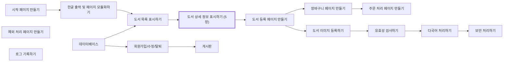

# 📘 6주차 — 내장 객체

> [!NOTE]
> **📚 출처** — 한빛아카데미 Chapter 05 「내장 객체: 도서 상세 정보 표시하기」 기반 강의자료 (슬라이드 52장)
> PDF 내용만 정리함 (실습 환경 맞춤·외부 보충 없음)

## 🎯 학습 목표
*슬라이드 p.4*

- 내장 객체의 개념과 특징을 이해함
- 내장 객체 구성 요소의 사용법을 익힘
- 내장 객체를 이용하여 북마켓의 도서 상세 정보를 출력함

## 🗺️ 목차
*슬라이드 p.3*

1. 내장 객체의 개요
2. request 내장 객체
   - 요청 파라미터 관련 메소드
   - 요청 HTTP 헤더 관련 메소드
   - 웹 브라우저/서버 관련 메소드
3. response 내장 객체
   - 페이지 이동 관련 메소드
   - 응답 HTTP 헤더 관련 메소드
   - 응답 콘텐츠 관련 메소드
4. out 내장 객체
5. [북마켓] 도서 상세 정보 표시하기

---

## 1️⃣ 내장 객체의 개요
*슬라이드 p.5–9*

### 내장 객체(implicit object)
*슬라이드 p.6*

- JSP 페이지에서 사용할 수 있도록 JSP 컨테이너에 미리 정의된 객체
- JSP 페이지가 서블릿 프로그램으로 번역될 때 JSP 컨테이너가 자동으로 내장 객체를 멤버 변수, 메소드 매개변수 등의 각종 참조 변수(객체)로 포함
- JSP 페이지에 별도의 import 문 없이 자유롭게 사용 가능함
- 스크립틀릿 태그나 표현문 태그에 선언을 하거나 객체를 생성하지 않고도 직접 호출하여 사용 가능함

### 내장 객체의 종류
*슬라이드 p.7*

**표 5-1 내장 객체의 종류**

| 내장 객체 | 반환 유형 | 설명 |
|---|---|---|
| `request` | `javax.servlet.http.HttpServletRequest` | 웹 브라우저의 HTTP 요청 정보를 저장한다. |
| `response` | `javax.servlet.http.HttpServletResponse` | 웹 브라우저의 HTTP 요청에 대한 응답 정보를 저장한다. |
| `out` | `javax.servlet.jsp.jsp.jspWriter` | JSP 페이지에 출력할 내용을 담고 있는 출력 스트림이다. |
| `session` | `javax.servlet.http.HttpSession` | 웹 브라우저의 정보를 유지하기 위한 세션 정보를 저장한다(13장 참고). |
| `application` | `javax.servlet.ServletContext` | 웹 애플리케이션의 콘텍스트 정보를 저장한다. |
| `pageContext` | `javax.servlet.jsp.PageContext` | JSP 페이지의 정보를 저장한다. |
| `page` | `java.lang.Object` | JSP 페이지를 구현한 자바 클래스로 JSP 페이지 자체를 나타낸다. |
| `config` | `javax.servlet.ServletConfig` | JSP 페이지의 설정 정보를 저장한다. |
| `exception` | `java.lang.Throwable` | JSP 페이지의 예외 발생을 처리한다(11장 참고). |

※ 슬라이드 표기 그대로 (`out` 행의 반환 유형)

### 내장 객체와 `_jspService()` 메소드
*슬라이드 p.8*

- 내장 객체는 서블릿 프로그램에서 모두 `_jspService()` 메소드 내부에 있음

📄 `scripting_jsp.java`
```java
…(생략)…
public final class scripting_jsp extends org.apache.jasper.runtime.HttpJspBase
implements org.apache.jasper.runtime.JspSourceDependent, org.apache.jasper.
runtime.JspSourceImports {
…(생략)…
public void _jspService(final jakarta.servlet.http.HttpServletRequest request,
final jakarta.servlet.http.HttpServletResponse response) throws
java.io.IOException, jakarta.servlet.ServletException {
…(생략)…
    final jakarta.servlet.jsp.PageContext pageContext;
    jakarta.servlet.http.HttpSession session=null;
    final jakarta.servlet.ServletContext application;
    final jakarta.servlet.ServletConfig config;
    jakarta.servlet.jsp.JspWriter out=null;
    final java.lang.Object page=this;
    jakarta.servlet.jsp.JspWriter _jspx_out=null;
    jakarta.servlet.jsp.PageContext _jspx_page_context=null;
    …(생략)…
    }
}
```
- **코드 포인트**:
  - `request` — 매개변수로 선언된 request 내장 객체
  - `response` — 매개변수로 선언된 response 내장 객체
  - `pageContext`, `session`, `application`, `config`, `out`, `page` — 미리 선언된 기타 내장 객체

### 속성 처리 메소드의 종류
*슬라이드 p.9*

**표 5-2 속성 처리 메소드의 종류**

| 메소드 | 반환 유형 | 설명 |
|---|---|---|
| `setAttribute(String name, Object value)` | `void` | 해당 내장 객체의 속성 이름이 name인 속성 값을 value로 저장한다. |
| `getAttribute(String name)` | `Object` | 해당 내장 객체의 속성 이름이 name인 속성 값을 가져온다. |
| `removeAttribute(String name)` | `void` | 해당 내장 객체의 속성 이름이 name인 속성을 삭제한다. |
| `getAttributeNames()` | `java.util.Enumeration` | 해당 내장 객체의 모든 속성 이름을 가져온다(단, pageContext 내장 객체는 이 메소드를 제공하지 않는다). |

---

## 2️⃣ request 내장 객체
*슬라이드 p.10–23*

### 2-1. 요청 파라미터 관련 메소드
*슬라이드 p.11–15*

#### request 내장 객체
*슬라이드 p.11*

- JSP 페이지에서 가장 많이 사용되는 기본 내장 객체
- 웹 브라우저에서 서버의 JSP 페이지로 전달하는 정보 저장
  - 폼 페이지로부터 입력된 데이터를 전달하는 요청 파라미터 값을 JSP 페이지로 가져옴
- JSP 컨테이너는 웹 브라우저에서 서버로 전달되는 정보를 처리하기 위해 `javax.servlet.http.HttpServletRequest` 객체 타입의 request 내장 객체를 사용하여 사용자의 요구 사항을 얻어냄

#### 요청 파라미터
*슬라이드 p.12*

- 사용자가 폼 페이지에 데이터를 입력한 후 서버에 전송할 때 전달되는 폼 페이지의 입력된 정보 형태
- `<name=value>` 형식으로 웹 브라우저에서 서버의 JSP 페이지로 전송됨

**표 5-3 요청 파라미터 관련 메소드의 종류**

| 요청 파라미터 관련 메소드 | 반환 유형 | 설명 |
|---|---|---|
| `getParameter(String name)` | `String` | 요청 파라미터 이름이 name인 값을 전달받는다. 요청 파라미터 값이 없으면 null을 반환한다. |
| `getParameterValues(String name)` | `String[]` | 모든 요청 파라미터 이름이 name인 값을 배열 형태로 전달받는다. 요청 파라미터 값이 없으면 null을 반환한다. |
| `getParameterNames()` | `java.util.Enumeration` | 모든 요청 파라미터의 이름과 값을 Enumeration 객체 타입으로 전달받는다. |
| `getParameterMap()` | `java.util.Map` | 모든 요청 파라미터의 이름과 값을 Map 객체 타입으로 전달받는다[Map 객체 타입은 (요청 파라미터 이름, 값) 형식으로 구성된다]. |

#### 사용 예: 요청 파라미터 값 출력하기
*슬라이드 p.13*

📄 `request.jsp`
```jsp
<%@ page contentType="text/html; charset=utf-8" %>
<html>
<head>
<title>Implicit Objects</title>
</head>
<body>
    <form action="process.jsp" method="post">
        <p>
            이 름 : <input type="text" name="name">
            <input type="submit" value="전송">
    </form>
</body>
</html>
```
- **실행 결과**: `이 름 :` 입력란(홍길순 입력)과 `전송` 버튼

📄 `process.jsp`
```jsp
<%@ page contentType="text/html; charset=utf-8" %>
<html>
<head>
<title>Implicit Objects</title>
</head>
<body>
    <%
        request.setCharacterEncoding("utf-8");
        String name=request.getParameter("name");
    %>
    <p> 이 름 :<%=name %>
</body>
</html>
```
- **실행 결과**: `이 름 :홍길순`
- **코드 포인트**: `request.setCharacterEncoding("utf-8");` — 폼에서 한글 입력을 정상적으로 처리하려면 반드시 필요함

#### 🧪 [예제 5-1] request 내장 객체로 폼 페이지로부터 아이디와 비밀번호를 전송받아 출력하기
*슬라이드 p.14–15*

📄 `JSPBook/src/main/webapp/ch05/request01.jsp`
```jsp
<%@ page contentType="text/html; charset=utf-8" %>
<html>
<head>
<title>Implicit Objects</title>
</head>
<body>
    <form action="request01_process.jsp" method="post">
        <p> 아 이 디 : <input type="text" name="id">
        <p> 비밀번호 : <input type="text" name="passwd">
        <p> <input type="submit" value="전송" />
    </form>
</body>
</html>
```

📄 `JSPBook/src/main/webapp/ch05/request01_process.jsp`
```jsp
<%@ page contentType="text/html; charset=utf-8" %>
<html>
<head>
<title>Implicit Objects</title>
</head>
<body>
    <%
        request.setCharacterEncoding("utf-8");
        String userid=request.getParameter("id");
        String password=request.getParameter("passwd");
    %>
    <p> 아이디 : <%=userid %>
    <p> 비밀번호 : <%=password %>
</body>
</html>
```
- **실행 결과**:
  - `/ch05/request01.jsp` — `아 이 디 :`·`비밀번호 :` 입력란과 `전송` 버튼
  - `/ch05/request01_process.jsp` — `아이디 : 관리자`, `비밀번호 : 1234`
- **코드 포인트**: 슬라이드에서 `request.getParameter("id")`, `request.getParameter("passwd")` 부분을 강조 표시함

### 2-2. 요청 HTTP 헤더 관련 메소드
*슬라이드 p.16–18*

#### 요청 HTTP 헤더
*슬라이드 p.16*

- 웹 브라우저는 HTTP 헤더에 부가적인 정보를 담아 서버로 전송함

**표 5-4 요청 HTTP 헤더 관련 메소드의 종류**

| 요청 HTTP 헤더 관련 메소드 | 반환 유형 | 설명 |
|---|---|---|
| `getHeader(String name)` | `String` | 설정한 name의 헤더 값을 가져온다. |
| `getHeaders(String name)` | `Enumeration` | 설정한 name의 헤더 목록 값을 가져온다. |
| `getHeaderNames()` | `Enumeration` | 모든 헤더 이름을 가져온다. |
| `getIntHeader(String name)` | `int` | 설정한 name의 헤더 값을 정수로 가져온다. |
| `getDateHeader(String name)` | `long` | 설정한 name의 헤더 값을 시간 값으로 가져온다. |
| `getCookies()` | `javax.servlet.http.Cookie` | 모든 쿠키 값을 가져온다. |

#### 사용 예: 요청 HTTP 헤더 정보 값 출력하기
*슬라이드 p.17*

```jsp
<%@ page contentType="text/html; charset=utf-8" %>
<html>
<head>
<title>Implicit Objects</title>
</head>
<body>
    <%
        String hostValue=request.getHeader("host");
        String alValue=request.getHeader("accept-language");

        out.print("호스트명 : " + hostValue + "<br>");
        out.print("설정된 언어 : " + alValue + "<br>");
    %>
</body>
</html>
```
- **실행 결과**: `호스트명 : localhost:8080` / `설정된 언어 : ko-KR`

#### 🧪 [예제 5-2] request 내장 객체로 모든 HTTP 헤더 정보 값 출력하기
*슬라이드 p.18*

📄 `JSPBook/src/main/webapp/ch05/request02.jsp`
```jsp
<%@ page import="java.util.Enumeration" %>
<html>
<head>
<title>Implicit Objects</title>
</head>
<body>
    <%
        Enumeration en=request.getHeaderNames();
        while (en.hasMoreElements()) {
            String headerName=(String) en.nextElement();
            String headerValue=request.getHeader(headerName);
    %>
    <%=headerName %> : <%=headerValue %><br>
    <%
        }
    %>
</body>
</html>
```
- **실행 결과**: `http://localhost:8080/JSPBook/ch05/request02.jsp`
  ```text
  accept : image/gif, image/jpeg, image/pjpeg, application/x-ms-application, application/xaml+xml, application/x-ms-xbap, */*
  accept-language : ko-KR
  cache-control : no-cache
  ua-cpu : AMD64
  accept-encoding : gzip, deflate
  user-agent : Mozilla/5.0 (Windows NT 10.0; Win64; x64; Trident/7.0; rv:11.0) like Gecko
  host : localhost:8080
  connection : Keep-Alive
  cookie : JSESSIONID=2AEC536B6ACD3B4A06DD61CDD52D20F3
  ```
- **코드 포인트**: 슬라이드에서 `request.getHeaderNames()`, `request.getHeader(headerName)` 부분을 강조 표시함

### 2-3. 웹 브라우저/서버 관련 메소드
*슬라이드 p.19–23*

#### 웹 브라우저/서버 관련 메소드의 종류
*슬라이드 p.19*

**표 5-5 웹 브라우저/서버 관련 메소드의 종류**

| 웹브라우저/서버 관련 메소드 | 반환 유형 | 설명 |
|---|---|---|
| `getRemoteAddr()` | `String` | 웹 브라우저의 IP 주소를 가져온다. |
| `getContentLength()` | `long` | 웹 브라우저의 요청 파라미터 길이를 가져온다. |
| `getCharacterEncoding()` | `String` | 웹 브라우저의 문자 인코딩을 가져온다. |
| `getContentType()` | `String` | 웹 브라우저의 콘텐츠 유형을 가져온다. |
| `getProtocol()` | `String` | 웹 브라우저의 요청 프로토콜을 가져온다. |
| `getMethod()` | `String` | 웹 브라우저의 HTTP 요청 메소드(GET, POST)를 가져온다. |
| `getRequestURI()` | `String` | 웹 브라우저가 요청한 URI 경로를 가져온다. |
| `getContextPath()` | `String` | 현재 JSP 페이지의 웹 애플리케이션 콘텍스트 경로를 가져온다. |
| `getServerName()` | `String` | 서버 이름을 가져온다. |
| `getServerPort()` | `int` | 실행 중인 서버 포트 번호를 가져온다. |
| `getQueryString()` | `String` | 웹 브라우저의 전체 요청 파라미터 문자열[물음표(?) 다음 URL에 할당된 문자열]을 가져온다. |

#### 사용 예: 웹 브라우저/서버 정보 출력하기
*슬라이드 p.20–21*

📄 `request.jsp`
```jsp
<%@ page contentType="text/html; charset=utf-8" %>
<html>
<head>
<title>Implicit Objects</title>
</head>
<body>
    <form action="process.jsp" method="post">
        <p> 이 름 : <input type="text" name="name">
            <input type="submit" value="전송">
    </form>
</body>
</html>
```
- **실행 결과**: `이 름 :` 입력란(관리자 입력)과 `전송` 버튼

📄 `process.jsp`
```jsp
<%@ page contentType="text/html; charset=utf-8" %>
<html>
<head>
<title>Implicit Objects</title>
</head>
<body>
    <%
        request.setCharacterEncoding("utf-8");
        String name=request.getParameter("name");
    %>
    <p>
        이 름 : <%=name %><br>
        요청 정보 길이 : <%=request.getContentLength() %><br>
        클라이언트 전송 방식 : <%=request.getMethod() %><br>
        요청 URI : <%=request.getRequestURI() %><br>
        서버 이름 : <%=request.getServerName() %><br>
        서버 포트 : <%=request.getServerPort() %><br>
</body>
</html>
```
- **실행 결과**: `이 름 : 관리자` / `요청 정보 길이 : 32` / `클라이언트 전송 방식 : POST` / `요청 URI : /JSPBook/ch05/process.jsp` / `서버 이름 : localhost` / `서버 포트 : 8080`

#### 🧪 [예제 5-3] request 내장 객체로 모든 웹 브라우저 및 서버 정보 값 출력하기
*슬라이드 p.22*

📄 `JSPBook/src/main/webapp/ch05/request03.jsp`
```jsp
<%@ page contentType="text/html; charset=utf-8" %>
<html>
<head>
    <title>Implicit Objects</title>
</head>
<body>
    <p>클라이언트 IP : <%=request.getRemoteAddr() %></p>
    <p>요청 정보 길이 : <%=request.getContentLength() %></p>
    <p>요청 정보 인코딩 : <%=request.getCharacterEncoding() %></p>
    <p>요청 정보 콘텐츠 유형 : <%=request.getContentType() %></p>
    <p>요청 정보 프로토콜 : <%=request.getProtocol() %></p>
    <p>요청 정보 전송방식 : <%=request.getMethod() %></p>
    <p>요청 URI : <%=request.getRequestURI() %></p>
    <p>콘텍스트 경로 : <%=request.getContextPath() %></p>
    <p>서버이름 : <%=request.getServerName() %></p>
    <p>서버포트 : <%=request.getServerPort() %></p>
    <p>쿼리문 : <%=request.getQueryString() %></p>
</body>
</html>
```
- **실행 결과**: `/ch05/request03.jsp`
  ```text
  클라이언트 IP : 0:0:0:0:0:0:0:1
  요청 정보 길이 : -1
  요청 정보 인코딩 : UTF-8
  요청 정보 콘텐츠 유형 : null
  요청 정보 프로토콜 : HTTP/1.1
  요청 정보 전송방식 : GET
  요청 URI : /JSPBook/ch05/request03.jsp
  콘텍스트 경로 : /JSPBook
  서버이름 : localhost
  서버포트 : 8080
  쿼리문 : null
  ```
- **코드 포인트**: 슬라이드에서 `request.getRemoteAddr()`부터 `request.getQueryString()`까지 각 표현문 안의 메소드 호출 부분을 강조 표시함

#### 속성을 공유할 수 있는 유효 범위
*슬라이드 p.23*

| 영역 | 내장 객체 | 속성의 유효 범위 |
|---|---|---|
| `page` | `pageContext` | 해당 페이지가 클라이언트에게 서비스를 제공하는 동안 유효하다. |
| `request` | `request` | 클라이언트의 요청이 처리되는 동안 유효하다. |
| `session` | `session` | 세션이 유지되는 동안 유효하다. |
| `application` | `application` | 웹 애플리케이션이 실행되고 있는 동안 유효하다. |

---

## 3️⃣ response 내장 객체
*슬라이드 p.24–36*

### 3-1. 페이지 이동 관련 메소드
*슬라이드 p.25–30*

#### response 내장 객체
*슬라이드 p.25*

- 사용자의 요청을 처리한 결과를 서버에서 웹 브라우저로 전달하는 정보를 저장하고 서버는 응답 헤더와 요청 처리 결과 데이터를 웹 브라우저로 보냄
- JSP 컨테이너는 서버에서 웹 브라우저로 응답하는 정보를 처리하기 위해 `javax.servlet.http.HttpServletResponse` 객체 타입의 response 내장 객체를 사용하여 사용자의 요청에 응답

#### 페이지 이동
*슬라이드 p.26*

- 페이지 이동(= 리다이렉션(redirection))
  - 사용자가 새로운 페이지를 요청할 때와 같이 페이지를 강제로 이동하는 것
- 서버는 웹 브라우저에 다른 페이지로 강제 이동하도록 response 내장 객체의 리다이렉션 메소드를 제공함
- 페이지 이동 시에는 문자 인코딩을 알맞게 설정해야 함

**표 5-6 페이지 이동 관련 메소드의 종류**

| 페이지 이동 관련 메소드 | 반환 유형 | 설명 |
|---|---|---|
| `sendRedirect(String url)` | `void` | 설정한 URL 페이지로 강제 이동한다. |

#### 사용 예: 페이지 이동하기
*슬라이드 p.27*

📄 `response.jsp`
```jsp
<html>
<head>
<title>Implicit Objects</title>
</head>
<body>
    <%
        response.sendRedirect("http://www.google.com");
    %>
</body>
</html>
```
- **실행 결과**: Google 첫 화면(Google 로고, 검색창, `Google 검색`·`I'm Feeling Lucky` 버튼)이 표시됨

#### 🧪 [예제 5-4] response 내장 객체로 페이지 이동하기
*슬라이드 p.28–30*

📄 `JSPBook/src/main/webapp/ch05/response01.jsp`
```jsp
<%@ page contentType="text/html; charset=utf-8" %>
<html>
<head>
<title>Implicit Objects</title>
</head>
<body>
    <form action="response01_process.jsp" method="post">
        <p> 아 이 디 : <input type="text" name="id">
        <p> 비밀번호 : <input type="text" name="passwd">
        <p> <input type="submit" value="전송">
    </form>
</body>
</html>
```
- **실행 결과**: `/ch05/response01.jsp` — `아 이 디 :`·`비밀번호 :` 입력란과 `전송` 버튼

📄 `JSPBook/src/main/webapp/ch05/response01_process.jsp`
```jsp
<%@ page contentType="text/html; charset=utf-8" %>
<html>
<head>
<title>Implicit Objects</title>
</head>
<body>
    <%
        request.setCharacterEncoding("utf-8");
        String userid=request.getParameter("id");
        String password=request.getParameter("passwd");

        if (userid.equals("관리자") && password.equals("1234")) {
            response.sendRedirect("response01_success.jsp");
        } else {
            response.sendRedirect("response01_failed.jsp");
        }
    %>
</body>
</html>
```
- **코드 포인트**: 슬라이드에서 `response.sendRedirect("response01_success.jsp");`, `response.sendRedirect("response01_failed.jsp");` 부분을 강조 표시함

- 사용자의 아이디(=관리자)와 비밀번호(=1234)가 일치할 때 실행하는 페이지와 일치하지 않을 때 실행하는 페이지 (p.30)

📄 `JSPBook/src/main/webapp/ch05/response01_success.jsp`
```jsp
<%@ page contentType="text/html; charset=utf-8" %>
<html>
<head>
<title>Implicit Objects</title>
</head>
<body>
    로그인을 성공했습니다!!
</body>
</html>
```
- **실행 결과**: `/ch05/response01_success.jsp` — `로그인을 성공했습니다!!`

📄 `JSPBook/src/main/webapp/ch05/response01_failed.jsp`
```jsp
<%@ page contentType="text/html; charset=utf-8" %>
<html>
<head>
<title>Implicit Objects</title>
</head>
<body>
    <p> 로그인을 실패했습니다.
    <p> <a href="./response01.jsp"> 로그인 가기</a>
</body>
</html>
```
- **실행 결과**: `/ch05/response01_failed.jsp` — `로그인을 실패했습니다.`, `로그인 가기` 링크

### 3-2. 응답 HTTP 헤더 관련 메소드
*슬라이드 p.31–33*

#### 응답 HTTP 헤더 관련 메소드
*슬라이드 p.31*

- 서버가 웹 브라우저에 응답하는 정보에 헤더를 추가하는 기능을 제공함
- 헤더 정보에는 주로 서버에 대한 정보가 저장되어 있음

**표 5-7 응답 HTTP 헤더 관련 메소드의 종류**

| 응답 HTTP 헤더 관련 메소드 | 반환 유형 | 설명 |
|---|---|---|
| `addCookie(Cookie cookie)` | `void` | 쿠키를 추가한다. |
| `addDateHeader(String name, long date)` | `void` | 설정한 헤더 이름 name에 날짜/시간을 추가한다. |
| `addHeader(String name, String value)` | `void` | 설정한 헤더 이름 name에 value를 추가한다. |
| `addIntHeader(String name, int value)` | `void` | 설정한 헤더 이름 name에 정수 값 value를 추가한다. |
| `setDateHeader(String name, long date)` | `void` | 설정한 헤더 이름 name에 날짜/시간을 설정한다. |
| `setHeader(String name, String value)` | `void` | 설정한 헤더 이름 name에 문자열 값 value를 설정한다. |
| `setIntHeader(String name, int value)` | `void` | 설정한 헤더 이름 name에 정수 값 value를 설정한다. |
| `containsHeader(String name)` | `boolean` | 설정한 헤더 이름 name이 HTTP 헤더에 포함되었는지 여부를 확인한다. 포함하고 있는 경우 true를 반환하고, 그렇지 않은 경우 false를 반환한다. |
| `getHeader(String name)` | `String` | 설정한 헤더 이름 name 값을 가져온다. |

#### 사용 예: 응답 HTTP 헤더에 정보 추가하기
*슬라이드 p.32*

```jsp
<html>
<head>
<title>Implicit Objects</title>
</head>
<body>
    <%
        response.setHeader("Cache-control", "use_cache");
        response.addHeader("contentType", "text/html; charset=utf-8");
        response.setDateHeader("date", 1L);
    %>
    Cache-control : <%=response.getHeader("Cache-control") %><br>
    contentType : <%=response.getHeader("contentType") %><br>
    date : <%=response.getHeader("date") %>
</body>
</html>
```
- **실행 결과**: `Cache-control : use_cache` / `contentType : text/html; charset =utf-8` / `date : Thu, 01 Jan 1970 00:00:00 GMT`
  - ※ 슬라이드 표기 그대로 (`charset =utf-8`)

#### 🧪 [예제 5-5] response 내장 객체로 5초마다 JSP 페이지 갱신하기
*슬라이드 p.33*

📄 `JSPBook/src/main/webapp/ch05/response02.jsp`
```jsp
<%@ page contentType="text/html; charset=utf-8" %>
<html>
<head>
<title>Implicit Objects</title>
</head>
<body>
    <p> 이 페이지는 5초마다 새로고침 됩니다.
        <%
            response.setIntHeader("Refresh", 5);
        %>
    <p> <%=(new java.util.Date()) %>
</body>
</html>
```
- **실행 결과**: `http://localhost:8080/JSPBook/…`(주소창 뒷부분 잘림) — `이 페이지는 5초마다 새로고침 됩니다.`, `Tue Aug 22 18:19:47 KST 2023`
- **코드 포인트**: 슬라이드에서 `response.setIntHeader("Refresh", 5);` 부분을 강조 표시함

### 3-3. 응답 콘텐츠 관련 메소드
*슬라이드 p.34–36*

#### 응답 콘텐츠 관련 메소드
*슬라이드 p.34*

- response 내장 객체는 웹 브라우저로 응답하기 위해 MIME 유형, 문자 인코딩, 오류 메시지, 상태 코드 등을 설정하고 가져오는 응답 콘텐츠 관련 메소드 제공

**표 5-8 응답 콘텐츠 관련 메소드의 종류**

| 응답 콘텐츠 관련 메소드 | 반환 유형 | 설명 |
|---|---|---|
| `setContentType(String type)` | `void` | 웹 브라우저에 응답할 MIME 유형을 설정한다. |
| `getContentType()` | `String` | 웹 브라우저에 응답할 MIME 유형을 가져온다. |
| `setCharacterEncoding(String charset)` | `void` | 웹 브라우저에 응답할 문자 인코딩을 설정한다. |
| `getCharacterEncoding()` | `String` | 웹 브라우저에 응답할 문자 인코딩을 가져온다. |
| `sendError(int status_code, String message)` | `void` | 웹 브라우저에 응답할 오류(코드 및 오류 메시지)를 설정한다. |
| `setStatus(int statuscode)` | `void` | 웹 브라우저에 응답할 HTTP 코드를 설정한다. |

#### 사용 예: 응답 콘텐츠 설정하기
*슬라이드 p.35*

```jsp
<%@ page contentType="text/html; charset=utf-8" %>
<html>
<head>
<title>Implicit Objects</title>
</head>
<body>
    <%
        response.setCharacterEncoding("utf-8");
        response.setContentType("text/html; charset=utf-8");
    %>
    <p> 문자 인코딩 : <%=response.getCharacterEncoding() %>
    <p> 콘텐츠 유형 : <%=response.getContentType() %>
</body>
</html>
```
- **실행 결과**: `문자 인코딩 : utf-8` / `콘텐츠 유형 : text/html;charset=utf-8`

#### 🧪 [예제 5-6] response 내장 객체로 오류 응답 코드와 오류 메시지 보내기
*슬라이드 p.36*

📄 `JSPBook/src/main/webapp/ch05/response03.jsp`
```jsp
<%@ page contentType="text/html; charset=utf-8" %>
<html>
<head>
<title>Implicit Objects</title>
</head>
<body>
    <%
        response.sendError(404, "요청 페이지를 찾을 수 없습니다");
    %>
</body>
</html>
```
- **실행 결과**: `/JSPBook/ch05/response03.jsp` — 탭 제목·본문 제목 `HTTP 상태 404 – 찾을 수 없음`
  - 타입: 상태 보고
  - 메시지: 요청 페이지를 찾을 수 없습니다
  - 설명: Origin 서버가 대상 리소스를 위한 현재의 representation을 찾지 못했거나, 그것이 존재하는지를 밝히려 하지 않습니다.
  - 하단: `Apache Tomcat/10.1.12`
- **코드 포인트**: 슬라이드에서 `response.sendError(404, "요청 페이지를 찾을 수 없습니다");` 부분을 강조 표시함

---

## 4️⃣ out 내장 객체
*슬라이드 p.37–43*

### out 내장 객체
*슬라이드 p.38*

- 웹 브라우저에 데이터를 전송하는 출력 스트림 객체
- JSP 컨테이너는 JSP 페이지에 사용되는 모든 표현문 태그와 HTML, 일반 텍스트 등을 out 내장 객체를 통해 웹 브라우저에 그대로 전달함
- 스크립틀릿 태그에 사용하여 단순히 값을 출력하는 표현문 태그(`<%= …%>`)와 같은 결과를 얻을 수 있음

### out 내장 객체 메소드의 종류
*슬라이드 p.39*

**표 5-9 out 내장 객체 메소드의 종류**

| out 내장 객체 메소드 | 반환 유형 | 설명 |
|---|---|---|
| `print(String str)` | `void` | 설정된 str 값을 웹 브라우저에 출력한다. |
| `println(String str)` | `void` | 설정된 str 값을 웹 브라우저에 출력한다. 이때 줄 바꿈(`\r\n` 또는 `\n`)이 적용되지 않는다. |
| `newLine()` | `void` | 줄바꿈(`\r\n` 또는 `\n`)을 출력한다. |
| `getBufferSize()` | `int` | 현재 출력 버퍼의 크기를 가져온다. |
| `getRemaining()` | `int` | 현재 남아 있는 출력 버퍼의 크기를 가져온다. |
| `clear()` | `void` | 현재 출력 버퍼에 저장되어 있는 내용을 웹 브라우저에 전송하지 않고 비운다. 만약 버퍼가 이미 플러시되었다면 IOException이 발생한다. |
| `clearBuffer()` | `void` | 현재 출력 버퍼에 저장되어 있는 내용을 웹 브라우저에 전송하지 않고 비운다. 만약 버퍼가 이미 플러시되었다면 IOException이 발생하지 않는다. |
| `flush()` | `void` | 현재 출력 버퍼에 저장되어 있는 내용을 웹 브라우저에 전송하고 비운다. |
| `isAutoFlush()` | `boolean` | 출력 버퍼가 채워졌을 때의 처리를 결정한다. 자동으로 플러시하는 경우 true를 반환하고, 그렇지 않은 경우 false를 반환한다. |

### out 내장 객체 사용 예
*슬라이드 p.40*

```jsp
<%@ page contentType="text/html; charset=utf-8" %>
<html>
<head>
<title>Implicit Objects</title>
</head>
<body>
    <%
        out.println("Hello!");
        out.println("Jakarta Server Pages 입니다.");
    %>
</body>
</html>
```
- **실행 결과**: `Hello! Jakarta Server Pages 입니다.` (한 줄로 표시)

```jsp
<%@ page contentType="text/html; charset=utf-8" %>
<html>
<head>
<title>Implicit Objects</title>
</head>
<body>
    <%
        out.println("Hello!" + "<br>");
        out.println("Jakarta Server Pages 입니다.");
    %>
</body>
</html>
```
- **실행 결과**: `Hello!` / `Jakarta Server Pages 입니다.` (두 줄로 표시)

### 🧪 [예제 5-6] out 내장 객체로 오늘의 날짜 및 시각 출력하기
*슬라이드 p.41*

※ 슬라이드 표기 그대로 (예제 번호)

📄 `JSPBook/src/main/webapp/ch05/out01.jsp`
```jsp
<%@ page contentType="text/html; charset=utf-8" %>
<html>
<head>
<title>Implicit Objects</title>
</head>
<body>
    <%
        out.println("오늘의 날짜 및 시각 " + "<br>");
        out.println(java.util.Calendar.getInstance().getTime());
    %>
</body>
</html>
```
- **실행 결과**: `…/ch05/out01.jsp` — `오늘의 날짜 및 시각`, `Tue Aug 22 18:22:45 KST 2023`
- **코드 포인트**: 슬라이드에서 두 `out.println()` 문을 강조 표시함

### 🧪 [예제 5-7] out 내장 객체로 폼 페이지에서 아이디와 비밀번호를 전송받아 출력하기
*슬라이드 p.42–43*

📄 `JSPBook/src/main/webapp/ch05/out02.jsp`
```jsp
<%@ page contentType="text/html; charset=utf-8" %>
<html>
<head>
<title>Implicit Objects</title>
</head>
<body>
    <form action="out02_process.jsp" method="post">
        <p> 아 이 디 : <input type="text" name="id">
        <p> 비밀번호 : <input type="text" name="passwd">
        <p> <input type="submit" value="전송" />
    </form>
</body>
</html>
```
- **실행 결과**: `/ch05/out02.jsp` — `아 이 디 :` 입력란(관리자 입력), `비밀번호 :` 입력란(1234 입력), `전송` 버튼

📄 `JSPBook/src/main/webapp/ch05/out02_process.jsp`
```jsp
<%@ page contentType="text/html; charset=utf-8" %>
<html>
<head>
<title>Implicit Objects</title>
</head>
<body>
    <%
        request.setCharacterEncoding("utf-8");
        String userid=request.getParameter("id");
        String password=request.getParameter("passwd");
    %>
    <p> 아 이 디 :<% out.println(userid); %>
    <p> 비밀번호 :<% out.println(password); %>
</body>
</html>
```
- **실행 결과**: `/ch05/out02_process.jsp` — `아 이 디 : 관리자`, `비밀번호 : 1234`
- **코드 포인트**: 슬라이드에서 `out.println(userid);`, `out.println(password);` 부분을 강조 표시함

---

## 5️⃣ [북마켓] 도서 상세 정보 표시하기
*슬라이드 p.44–51*

### 프로젝트 로드맵
*슬라이드 p.45*

**그림 5-1 도서 상세 정보 표시하기**

- 시작 페이지 만들기 → 한글 출력 및 페이지 모듈화하기 → 도서 목록 표시하기
- 데이터베이스 → 도서 목록 표시하기 (위쪽 화살표)
- 데이터베이스 → 회원가입/수정/탈퇴 → 게시판
- 도서 목록 표시하기 → **도서 상세 정보 표시하기** (`5장` 표시, 회색 강조) → 도서 등록 페이지 만들기 → 장바구니 페이지 만들기 → 주문 처리 페이지 만들기
- 도서 등록 페이지 만들기 → 도서 이미지 등록하기 → 유효성 검사하기 → 다국어 처리하기 → 보안 처리하기
- 화살표 연결 없이 배치: 예외 처리 페이지 만들기, 로그 기록하기



### 프로젝트 실행 결과
*슬라이드 p.46*

**그림 5-2 완성된 북마켓 도서 상세 정보**

- **실행 결과(도서 목록)**: 탭 `도서 목록`, 주소 `localhost:8080/BookMarket/books.jsp`
  - 상단 `Home` 메뉴, 제목 영역 `도서목록` / `BookList`
  - 도서 3권: `C# 프로그래밍` (우재남, 한빛아카데미 | 27000원) / `자바마스터` (송미영, 한빛아카데미 | 30000원) / `파이썬 프로그래밍` (최성철, 한빛아카데미 | 30000원)
  - 각 도서 아래에 설명 일부(말줄임), 가격, `상세 정보 »` 버튼 / 하단 `© BookMarket`
- **실행 결과(도서 정보)**: 탭 `도서 정보`, 주소 `localhost:8080/BookMarket/book.jsp?id=ISBN1235`
  - 상단 `Home` 메뉴, 제목 영역 `도서정보` / `BookInfo`
  - `자바마스터` — 자바를 처음 배우는 학생을 위해 자바의 기본 개념과 실습 예제를 그림을 이용하여 쉽게 설명합니다. 자바의 이론적 개념→기본 예제→프로젝트 순으로 단계별 학습이 가능하며, 각 챕터의 프로젝트를 실습하면서 온라인 서점을 완성할 수 있도록 구성하였습니다.
  - `도서코드 : ISBN1235`(배지) / `저자 : 송미영` / `출판사 : 한빛아카데미` / `출판일 : 2023/01/01` / `분류 : IT모바일` / `재고수 : 1000` / `30000원`
  - `도서주문 »`·`도서목록 »` 버튼 / 하단 `© BookMarket`

### 🧪 [예제 5-9] 도서 상세 정보 표시하기
*슬라이드 p.47–50*

#### 1. 도서 상세 정보를 가져오는 메소드 만들기
*슬라이드 p.47*

📄 `BookMarket/src/main/java/dao/BookRepository.java`
```java
package dao;
…(생략)…
public class BookRepository {
    …(생략)…
    public Book getBookById(String bookId) {
        Book bookById=null;

        for (int i=0; i < listOfBooks.size(); i++) {
            Book book=listOfBooks.get(i);
            if (book!=null && book.getBookId()!=null && book.getBookId().equals(bookId)) {
                bookById=book;
                break;
            }
        }
        return bookById;
    }
}
```
- **코드 포인트**: 슬라이드에서 `getBookById(String bookId)` 메소드 전체를 강조 표시함

#### 2. 도서 상세 정보 버튼 만들기
*슬라이드 p.48*

📄 `BookMarket/src/main/webapp/books.jsp`
```jsp
<%@ page contentType="text/html; charset=utf-8" %>
    …(생략)…
            <p> <%=book.getUnitPrice() %>원
            <p> <a href="./book.jsp?id=<%=book.getBookId() %>" class="btn btn-secondary" role="button"> 상세 정보 &raquo;></a>
        </div>
    …(생략)…
```
※ 슬라이드 표기 그대로
- **코드 포인트**: 슬라이드에서 `<p> <a href="./book.jsp?id=<%=book.getBookId() %>"`로 시작하는 상세 정보 버튼 행을 강조 표시함

#### 3. 도서 상세 정보 페이지 만들기
*슬라이드 p.49–50*

📄 `BookMarket/src/main/webapp/book.jsp`
```jsp
<%@ page contentType="text/html; charset=utf-8" %>
<%@ page import="dto.Book" %>
<jsp:useBean id="bookDAO" class="dao.BookRepository" scope="session" />

<html>
<head>
<link href="https://cdn.jsdelivr.net/npm/bootstrap@5.3.0-alpha1/dist/css/bootstrap.min.css" rel="stylesheet">

<title>도서 정보</title>
</head>
<body>
<div class="container py-4">
   <%@ include file="menu.jsp" %>

  <div class="p-5 mb-4 bg-body-tertiary rounded-3">
    <div class="container-fluid py-5">
      <h1 class="display-5 fw-bold">도서정보</h1>
      <p class="col-md-8 fs-4">BookInfo</p>
    </div>
  </div>

  <%
      String id=request.getParameter("id");
      Book book=bookDAO.getBookById(id);
  %>
   <div class="row align-items-md-stretch">
                <div class="col-md-12">
                     <h3><b><%=book.getName() %></b></h3>
                     <p> <%=book.getDescription() %>
                     <p> <b>도서코드 : </b><span class="badge text-bg-danger"><%=book.getBookId() %></span>
                     <p> <b>저자</b> : <%=book.getAuthor() %>
                     <p> <b>출판사</b> : <%=book.getPublisher() %>
                     <p> <b>출판일</b> : <%=book.getReleaseDate() %>
                     <p> <b>분류</b> : <%=book.getCategory() %>
                     <p> <b>재고수</b> : <%=book.getUnitsInStock() %>
                     <h4><%=book.getUnitPrice() %>원</h4>
                     <p> <a href="#" class="btn btn-info"> 도서주문 &raquo;</a>
                     <a href="./books.jsp" class="btn btn-secondary"> 도서목록 &raquo;</a>
                </div>
   </div>
  <jsp:include page="footer.jsp" />
</div>
</body>
</html>
```

### 🧪 [예제 5-10] 시작 페이지의 접속 시각 자동 갱신하기
*슬라이드 p.51*

📄 `BookMarket/src/main/webapp/welcome.jsp`
```jsp
<%@ page contentType="text/html; charset=utf-8" %>
    …(생략)…
                response.setIntHeader("Refresh", 5);
                Date day=new java.util.Date();
                String am_pm;
    …(생략)…
```
- **코드 포인트**: 슬라이드에서 `response.setIntHeader("Refresh", 5);` 부분을 강조 표시함

---

## 🧠 핵심 요약

- **내장 객체(implicit object)**: JSP 컨테이너에 미리 정의된 객체. JSP 페이지가 서블릿 프로그램으로 번역될 때 참조 변수로 자동 포함되므로 import 문·선언·객체 생성 없이 직접 호출해 사용함 (p.6)
- **내장 객체 9가지**(표 5-1): `request`, `response`, `out`, `session`, `application`, `pageContext`, `page`, `config`, `exception`
- **서블릿 코드 속 위치**: 모두 `_jspService()` 메소드 내부에 있음. `request`·`response`는 매개변수로 선언되고 `pageContext`·`session`·`application`·`config`·`out`·`page`는 미리 선언됨 (p.8)
- **속성 처리 메소드**(표 5-2): `setAttribute()`, `getAttribute()`, `removeAttribute()`, `getAttributeNames()` — `pageContext`는 `getAttributeNames()`를 제공하지 않음
- **속성 유효 범위**(p.23): page(`pageContext`) — 페이지가 서비스를 제공하는 동안 / request — 요청이 처리되는 동안 / session — 세션이 유지되는 동안 / application — 웹 애플리케이션이 실행되는 동안
- **request 내장 객체**: 웹 브라우저에서 서버의 JSP 페이지로 전달하는 정보를 저장하는, 가장 많이 사용되는 기본 내장 객체 (p.11)
  - 요청 파라미터(`<name=value>` 형식): `getParameter()`, `getParameterValues()`, `getParameterNames()`, `getParameterMap()` (표 5-3)
  - 폼의 한글 입력 처리: `request.setCharacterEncoding("utf-8")`이 반드시 필요함 (p.13)
  - 요청 HTTP 헤더: `getHeader()`, `getHeaders()`, `getHeaderNames()`, `getIntHeader()`, `getDateHeader()`, `getCookies()` (표 5-4)
  - 웹 브라우저/서버 정보: `getRemoteAddr()`, `getContentLength()`, `getCharacterEncoding()`, `getContentType()`, `getProtocol()`, `getMethod()`, `getRequestURI()`, `getContextPath()`, `getServerName()`, `getServerPort()`, `getQueryString()` (표 5-5)
- **response 내장 객체**: 요청 처리 결과를 웹 브라우저로 전달하는 정보를 저장하고, 응답 헤더와 처리 결과 데이터를 웹 브라우저로 보냄 (p.25)
  - 페이지 이동(리다이렉션): `sendRedirect(String url)` — 이동 시 문자 인코딩을 알맞게 설정해야 함 (p.26, 표 5-6)
  - 응답 HTTP 헤더: `addCookie()`, `addDateHeader()`, `addHeader()`, `addIntHeader()`, `setDateHeader()`, `setHeader()`, `setIntHeader()`, `containsHeader()`, `getHeader()` (표 5-7) — `setIntHeader("Refresh", 5)`로 5초마다 페이지 갱신 ([예제 5-5])
  - 응답 콘텐츠: `setContentType()`, `getContentType()`, `setCharacterEncoding()`, `getCharacterEncoding()`, `sendError()`, `setStatus()` (표 5-8) — `sendError(404, …)`로 오류 코드와 오류 메시지 응답 (p.36)
- **out 내장 객체**: 웹 브라우저에 데이터를 전송하는 출력 스트림 객체. 스크립틀릿 태그 안에서 표현문 태그(`<%= …%>`)와 같은 결과를 얻을 수 있음 (p.38)
  - `println()`은 줄 바꿈이 적용되지 않음(표 5-9). p.40 예에서는 `"<br>"`을 함께 출력했을 때 두 줄로 표시됨
  - `clear()`·`clearBuffer()`: 둘 다 버퍼를 전송하지 않고 비움. 이미 플러시된 경우 `clear()`만 IOException 발생 (표 5-9)
- **[북마켓] 도서 상세 정보**([예제 5-9]): `BookRepository`에 `getBookById(String bookId)` 추가 → `books.jsp`에 `./book.jsp?id=<%=book.getBookId() %>`로 가는 `상세 정보 »` 버튼 추가 → `book.jsp`에서 `request.getParameter("id")`로 받은 id로 `bookDAO.getBookById(id)`를 호출해 도서 정보 출력
- **[북마켓] 접속 시각 자동 갱신**([예제 5-10]): `welcome.jsp`에 `response.setIntHeader("Refresh", 5);` 추가

## ✍️ 시험 대비 체크포인트

- **Q.** 내장 객체(implicit object)란? → **A.** JSP 페이지에서 사용할 수 있도록 JSP 컨테이너에 미리 정의된 객체. 별도의 import 문 없이, 선언이나 객체 생성 없이 직접 호출하여 사용 가능함
- **Q.** JSP 페이지가 서블릿 프로그램으로 번역되면 내장 객체는 어디에 있는가? → **A.** 모두 `_jspService()` 메소드 내부에 있음 (`request`·`response`는 매개변수, 나머지는 미리 선언된 변수)
- **Q.** 속성 처리 메소드 중 `pageContext` 내장 객체가 제공하지 않는 메소드는? → **A.** `getAttributeNames()`
- **Q.** 속성을 공유할 수 있는 4가지 영역과 각 영역의 내장 객체는? → **A.** page – `pageContext`, request – `request`, session – `session`, application – `application`
- **Q.** `getParameter(String name)`은 요청 파라미터 값이 없으면 무엇을 반환하는가? → **A.** null
- **Q.** 이름이 name인 모든 요청 파라미터 값을 배열 형태로 전달받는 메소드는? → **A.** `getParameterValues(String name)` (반환 유형 `String[]`)
- **Q.** 폼에서 한글 입력을 정상적으로 처리하려면 반드시 필요한 코드는? → **A.** `request.setCharacterEncoding("utf-8");`
- **Q.** [예제 5-2]에서 모든 HTTP 헤더 정보를 출력하는 방법은? → **A.** `request.getHeaderNames()`로 `Enumeration`을 얻고 `while (en.hasMoreElements())`로 헤더 이름을 하나씩 꺼내 `request.getHeader(headerName)`으로 값을 출력함
- **Q.** 웹 브라우저의 IP 주소, 요청 URI, 웹 애플리케이션 콘텍스트 경로를 가져오는 메소드는? → **A.** `getRemoteAddr()`, `getRequestURI()`, `getContextPath()`
- **Q.** 페이지 이동(리다이렉션)이란? 사용하는 response 메소드는? → **A.** 사용자가 새로운 페이지를 요청할 때와 같이 페이지를 강제로 이동하는 것. `sendRedirect(String url)` 사용
- **Q.** JSP 페이지를 5초마다 새로 고치는 코드는? → **A.** `response.setIntHeader("Refresh", 5);`
- **Q.** 웹 브라우저에 오류 코드와 오류 메시지를 보내는 메소드는? → **A.** `sendError(int status_code, String message)` — 예: `response.sendError(404, "요청 페이지를 찾을 수 없습니다");`
- **Q.** out 내장 객체의 `println()`으로 출력하면 웹 브라우저에서 줄 바꿈이 적용되는가? → **A.** 적용되지 않음(표 5-9). p.40 예에서는 `"<br>"`을 함께 출력했을 때 두 줄로 표시됨
- **Q.** `clear()`와 `clearBuffer()`의 차이는? → **A.** 둘 다 출력 버퍼 내용을 웹 브라우저에 전송하지 않고 비움. 버퍼가 이미 플러시되었다면 `clear()`는 IOException이 발생하고 `clearBuffer()`는 발생하지 않음
- **Q.** [북마켓] `book.jsp`는 표시할 도서를 어떻게 찾는가? → **A.** `request.getParameter("id")`로 도서 아이디를 받아 `bookDAO.getBookById(id)`로 Book 객체를 가져옴 (`bookDAO`는 `<jsp:useBean>`으로 선언한 `dao.BookRepository`, scope는 session)
