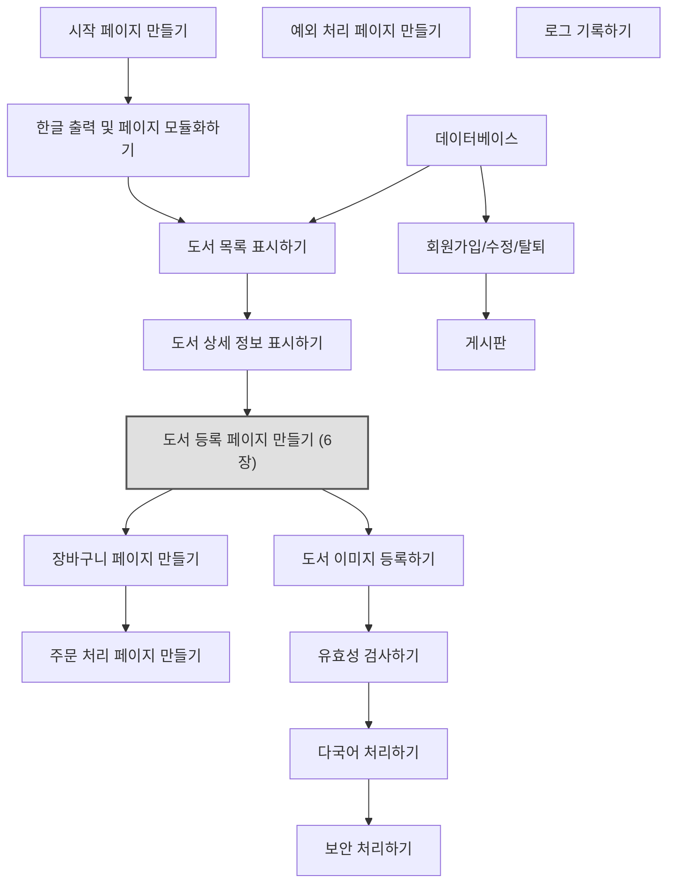

# 📘 7주차 — 폼 태그

> [!NOTE]
> **📚 출처** — Chapter 06 폼 태그: 도서 등록 페이지 만들기 기반 강의자료 (슬라이드 52장)
> PDF 내용만 정리함 (실습 환경 맞춤·외부 보충 없음)

## 🎯 학습 목표
*슬라이드 p.4*

- 폼의 개념과 특징을 이해함
- 폼 태그 구성 요소의 사용법을 익힘
- 폼 데이터를 처리하는 방법을 이해함
- 폼 태그를 이용하여 북마켓의 도서 등록 페이지를 출력함

## 🗺️ 목차
*슬라이드 p.3*

1. 폼 처리의 개요 (p.5–7)
2. form 태그 (p.8–12)
3. input 태그 (p.13–17)
4. select 태그 (p.18–23)
5. textarea 태그 (p.24–27)
6. 폼 데이터 처리 (p.28–39)
7. [북마켓] 도서 등록 페이지 만들기 (p.40–51)

---

## 1️⃣ 폼 처리의 개요
*슬라이드 p.5–7*

### 폼(form)
*슬라이드 p.6*

- 사용자가 웹 브라우저를 통해 입력된 모든 데이터를 한 번에 웹 서버로 전송하는 양식임
  - 전송한 데이터는 웹 서버가 처리하고 처리 결과에 따라 다른 웹 페이지를 보여줌
- 사용자와 웹 애플리케이션이 상호 작용하는 중요한 기술 중 하나임
- 사용자가 어떤 내용을 원하는지, 사용자의 요구 사항이 무엇인지 파악할 때 가장 많이 사용하는 웹 애플리케이션의 필수적인 요소임

### 폼을 구성하는 태그의 종류
*슬라이드 p.6*

**표 6-1 폼을 구성하는 태그의 종류**

| 태그 | 설명 |
|---|---|
| `form` | 폼을 정의하는 태그로 최상위 태그이다. |
| `input` | 사용자가 입력할 수 있는 태그이다. |
| `select` | 항목을 선택할 수 있는 태그이다. |
| `textarea` | 여러 줄을 입력할 수 있는 태그이다. |

### 폼 데이터 처리 과정
*슬라이드 p.7*

**그림 6-1 폼 데이터 처리 과정**

| 순서 | 위치·방향 | 내용 |
|---|---|---|
| ① | 웹 브라우저 | 폼 데이터 입력 |
| ② | 웹 브라우저 → 웹 서버 | 폼 데이터 |
| ③ | 웹 서버 → JSP 컨테이너 | 폼 데이터 |
| ④ | JSP 컨테이너 | 폼 데이터 처리 |
| ⑤ | JSP 컨테이너 → 웹 서버 | 응답 웹 페이지 |
| ⑥ | 웹 서버 → 웹 브라우저 | 응답 웹 페이지 |
| ⑦ | 웹 브라우저 | 웹 페이지 출력 |

---

## 2️⃣ form 태그
*슬라이드 p.8–12*

### form 태그
*슬라이드 p.9*

- 사용자가 다양한 정보를 입력하고 서로 전달할 때 사용하는 태그임
- 단독으로 쓰이지 않고 사용자가 다양한 정보를 입력하는 양식을 포함하는 최상위 태그임

```html
<form 속성1="값1" [속성2="값2" …]>
 // 다양한 입력 양식 태그(<input>, <select>, <textarea>)
</form>
```

- 속성을 이용하여 폼 데이터를 전송할 때 어디로 보낼지, 어떤 방식으로 보낼지 설정함
- form 태그의 모든 속성은 필수가 아니라 선택적으로 사용함

**표 6-2 form 태그의 속성**

| 속성 | 설명 |
|---|---|
| `action` | 폼 데이터를 받아 처리하는 웹 페이지의 URL을 설정한다. |
| `method` | 폼 데이터가 전송되는 HTTP 방식을 설정한다. |
| `name` | 폼을 식별하기 위한 이름을 설정한다. |
| `target` | 폼 처리 결과의 응답을 실행할 프레임을 설정한다. |
| `enctype` | 폼을 전송하는 콘텐츠 MIME 유형을 설정한다. |
| `accept-charset` | 폼 전송에 사용할 문자 인코딩을 설정한다. |

### form 태그 사용 예
*슬라이드 p.10–11 (같은 슬라이드 2장)*

```html
<html>
<head>
<title>Form Processing</title>
</head>
<body>
    <form action="http://localhost:8080/ch06/process.jsp" method="get"
            name="login" accept-charset="utf-8">
        …(생략)…
    </form>
</body>
</html>
```

### GET 방식과 POST 방식의 차이
*슬라이드 p.12*

> [!NOTE]
> **NOTE GET 방식과 POST 방식의 차이**
> - URL 끝에 데이터를 붙여 보내는 GET 방식은 데이터가 외부에 노출되어 보안에 취약함 → 개인 정보 등을 보호해야 할 때는 POST 방식을 사용해야 함
> - GET 방식은 지정된 리소스에서 데이터를 요청할 때, 즉 읽을 때 사용함
> - POST 방식은 지정된 리소스에서 데이터를 처리할 때, 즉 쓰고, 수정하고, 삭제할 때 사용함
> - 보안이 필요하지 않으면서 지정된 리소스에서 자원을 읽는 경우 GET 방식을, 그렇지 않은 경우 POST 방식을 사용하면 됨
>
> | 구분 | GET 방식 | POST 방식 |
> |---|---|---|
> | 전송 형태 | 이름과 값의 형태로 URL에 포함되어 전송 | HTTP 헤더 속에 감춰서 전송 |
> | 전송량 | 제한적(4,096B) | 제한 없음 |
> | 속도 | 빠름 | 느림 |
> | 보안 | 없음 | 있음 |

---

## 3️⃣ input 태그
*슬라이드 p.13–17*

### input 태그
*슬라이드 p.14*

- 사용자가 텍스트 입력이나 선택 등을 다양하게 할 수 있도록 공간을 만드는 태그임
- 종료 태그 없이 단독으로 사용할 수 있음

```html
<input 속성1="값1" [속성2="값2" …]>
```

### input 태그의 기본 속성
*슬라이드 p.14*

**표 6-3 input 태그의 기본 속성**

| 속성 | 속성 값 | 설명 |
|---|---|---|
| `type` | `text` | 기본값으로 한 줄의 텍스트를 입력할 때 사용한다. |
| | `radio` | 라디오 버튼으로 열거된 것 중 하나만 선택할 때 사용한다. |
| | `checkbox` | 체크 박스로 열거된 것 중 다중 선택을 할 때 사용한다. |
| | `password` | 암호를 입력할 때 사용한다. |
| | `hidden` | 보이지 않게 숨겨서 값을 전송할 때 사용한다. |
| | `file` | 파일 업로드를 위한 파일을 선택할 때 사용한다. |
| | `button` | 버튼 모양을 출력할 때 사용한다. |
| | `reset` | 폼에 입력된 값을 모두 초기화할 때 사용한다. |
| | `submit` | 폼에 입력된 값을 모두 서버에 전송할 때 사용한다. |
| `name` | 텍스트 | 입력 양식을 식별하는 이름을 설정한다. |
| `value` | 텍스트 | 입력 양식의 초깃값을 설정한다. |

### input 태그 사용 예
*슬라이드 p.15*

```jsp
<%@ page contentType="text/html; charset=utf-8" %>
<html>
<head>
<title>Form Processing</title>
</head>
<body>
    <form action="#" method="get">
        <p> 아 이 디: <input type="text" name="id">
        <p> 비밀번호: <input type="password" name="passwd">
        <p> <input type="submit" value="전송">
    </form>
</body>
</html>
```

- **실행 결과**: 아 이 디: `admin` 입력 / 비밀번호: `••••`(가려진 입력) / [전송] 버튼

### input 태그의 기본 속성 외에 사용되는 속성
*슬라이드 p.16*

> [!NOTE]
> **NOTE input 태그의 기본 속성 외에 사용되는 속성**
>
> | 속성 | 속성 값 | 설명 |
> |---|---|---|
> | `readonly` | | 입력 양식을 읽기 전용으로 설정한다. |
> | `maxlength` | 숫자 | 입력 양식의 최대 입력 글자 수를 설정한다. type = “text”인 경우에만 사용한다. |
> | `size` | 숫자 | 입력 양식의 너비를 설정한다. type = “text”인 경우에만 사용한다. |
> | `disabled` | | 해당 입력 양식을 비활성화로 설정한다. 모든 폼 구성 태그에 사용한다. |
> | `checked` | | 기본값을 선택할 때 설정한다. type = “checkbox” 또는 type = “radio”인 경우에만 사용한다. |
>
> **HTML5의 추가된 속성**
>
> | 속성 | 속성 값 | 설명 |
> |---|---|---|
> | `required` | | 입력 양식을 필수 태그로 설정한다. 필수 태그를 입력하지 않고 `<submit>` 버튼을 누르면 오류 메시지가 웹 브라우저에 출력된다. |
> | `autofocus` | | 웹 페이지가 로딩되자마자 해당 입력 양식의 포커스를 설정한다. |
> | `placeholder` | 텍스트 | 입력 양식의 힌트를 설정한다. |
> | `pattern` | regexp | 정규 표현식을 사용하여 특정 범위 내의 유효한 값을 입력받을 때 사용한다. |

### 🧪 [예제 6-1] form 태그와 input 태그로 간단한 회원 가입 양식 만들기
*슬라이드 p.17*

📄 `JSPBook/src/main/webapp/ch06/form01.jsp`
```jsp
<%@ page contentType="text/html; charset=utf-8" %>
<html>
<head>
<title>Form Processing</title>
</head>
<body>
    <h3>회원 가입</h3>
    <form action="#" name="member" method="post">
        <p> 아이디 : <input type="text" name="id"> <input type="button" value="아이디 중복 검사">
        <p> 비밀번호 : <input type="password" name="passwd">
        <p> 이름 : <input type="text" name="name">
        <p> 연락처 : <input type="text" maxlength="4" size="4" name="phone1">
          - <input type="text" maxlength="4" size="4" name="phone2"> -
            <input type="text" maxlength="4" size="4" name="phone3">
        <p> 성별 : <input type="radio" name="sex" value="남성" checked>남성
            <input type="radio" name="sex" value="여성">여성
        <p> 취미 : 독서<input type="checkbox" name="hobby1" checked>
            운동<input type="checkbox" name="hobby2">
            영화<input type="checkbox" name="hobby3">
        <p> <input type="submit" value="가입하기">
            <input type="reset" value="다시쓰기">
    </form>
</body>
</html>
```

- **실행 결과**: `Form Processing` 탭, 주소 `…st:8080/JSPBook/ch06/form01.jsp`(주소창 앞부분 잘림) / 제목 "회원가입" / 아이디 : [입력란] [아이디 중복검사] / 비밀번호 : [입력란] / 이름 : [입력란] / 연락처 : [ ]-[ ]-[ ] / 성별 : ◉남성 ○여성 / 취미 : 독서☑ 운동☐ 영화☐ / [가입하기] [다시쓰기]
- **코드 포인트**: 슬라이드에서 파란색으로 강조된 부분 — `<form>` 시작·종료 태그와 각 `<input>` 태그(`text`, `button`, `password`, `radio`, `checkbox`, `submit`, `reset`)

---

## 4️⃣ select 태그
*슬라이드 p.18–23*

### select 태그
*슬라이드 p.19*

- 여러 개의 항목이 나타나는 목록 상자에서 항목을 선택하는 태그임
- 시작 태그와 종료 태그가 있으며, 리스트 박스에 여러 항목을 추가 삽입하기 위해 반드시 option 태그를 포함해야 함

```html
<select 속성1="값1" [속성2="값2" …]>
    <option 속성1="값" [속성1]> 항목1</option>
    <option 속성2="값" [속성2]> 항목2</option>
    …(생략)…
</select>
```

### select 태그와 option 태그의 속성
*슬라이드 p.20*

**표 6-4 select 태그의 속성**

| 속성 | 속성 값 | 설명 |
|---|---|---|
| `name` | 텍스트 | 목록 상자의 이름을 설정한다. |
| `size` | 숫자 | 한 번에 표시할 항목의 개수를 설정한다. |
| `multiple` | | 다중 선택이 가능하도록 한다. <kbd>Ctrl</kbd>을 눌러 목록 상자의 항목을 다중 선택한다. |

**표 6-5 option 태그의 속성**

| 속성 | 속성 값 | 설명 |
|---|---|---|
| `value` | 텍스트 | 항목의 값을 설정한다. |
| `selected` | | 해당 항목을 초깃값으로 선택한다. |
| `disabled` | | 항목을 비활성화한다. |

### select 태그 사용 예
*슬라이드 p.21–22 (같은 슬라이드 2장)*

```jsp
<%@ page contentType="text/html; charset=utf-8" %>
<html>
<head>
<title>Form Processing</title>
</head>
<body>
    <form action="#" method="get">
        <p> <select name="city" size="3">
                <option value="서울시">서울특별시</option>
                <option value="경기도">경기도</option>
                <option value="인천시">인천광역시</option>
                <option value="충청도">충청도</option>
                <option value="전라도">전라도</option>
                <option value="경상도">경상도</option>
            </select>
        <p> <input type="submit" value="전송">
    </form>
</body>
</html>
```

- **실행 결과**: 목록 상자에 서울특별시·경기도·인천광역시 3개 항목이 보이고 위아래 스크롤 화살표 표시 / [전송] 버튼

### 🧪 [예제 6-2] select 태그로 [예제 6-1] 회원 가입 양식의 연락처 수정하기
*슬라이드 p.23*

📄 `JSPBook/src/main/webapp/ch06/form02.jsp`
```jsp
<%@ page contentType="text/html; charset=utf-8" %>
    …(생략)…
        <p> 연락처 : <select name="phone1">
                <option value="010">010</option>
                <option value="011">011</option>
                <option value="016">016</option>
                <option value="017">017</option>
                <option value="019">019</option>
            </select> - <input type="text" maxlength="4" size="4" name="phone2"> - <input type="text" maxlength="4" size="4" name="phone3">
    …(생략)…
```

- **실행 결과**: `Form Processing` 탭, 주소 `…st:8080/JSPBook/ch06/form02.jsp`(주소창 앞부분 잘림) / 회원가입 양식에서 연락처가 [010 ▾] - [ ] - [ ]로 표시(첫 칸이 드롭다운) / 아이디·비밀번호·이름·성별(◉남성 ○여성)·취미(독서☑ 운동☐ 영화☐)·[가입하기] [다시쓰기]는 그대로
- **코드 포인트**: 슬라이드에서 파란색으로 강조된 부분 — 연락처 줄 전체(`<select name="phone1">`, `<option>` 5개, `</select>` 뒤 `<input>` 2개)

---

## 5️⃣ textarea 태그
*슬라이드 p.24–27*

### textarea 태그
*슬라이드 p.25*

- 여러 줄의 텍스트를 입력할 수 있는 태그임
- 기본 값은 `<textarea>`와 `</textarea>` 태그 사이에 설정함
- 입력 폼 안에 사용된 태그와 띄어쓰기가 그대로 출력됨

```html
<textarea cols="너비 값" rows="높이 값">
…(생략)…
</textarea>
```

**표 6-6 textarea 태그의 속성**

| 속성 | 속성 값 | 설명 |
|---|---|---|
| `name` | 텍스트 | 이름을 설정한다. |
| `cols` | 숫자 | 입력할 텍스트 영역의 너비(열 크기)를 설정한다. |
| `rows` | 숫자 | 입력할 텍스트 영역의 높이(행 크기)를 설정한다. |
| `wrap` | `off` | 줄 바꿈을 설정한다.<br>wrap=“off”: 줄 바꿈을 하지 않고 문장을 입력할 때 수평 스크롤바가 생기고 옆으로 계속 문장이 입력된다. |
| | `soft` | wrap=“soft”: <kbd>Enter</kbd>를 누르지 않아도 텍스트라인 끝에서 자동으로 행이 바뀐다. |
| | `hard` | wrap=“hard”: soft 상태와 비슷하며 실제 내용을 서버에 전송할 때 캐리지 리턴 문자를 전달한다. |

### textarea 태그 사용 예
*슬라이드 p.26*

```jsp
<%@ page contentType="text/html; charset=utf-8" %>
<html>
<head>
<title>Form Processing</title>
</head>
<body>
    <form action="#" method="get">
        <textarea name="comment" cols="30" rows="3"></textarea>
        <p> <input type="submit" value="전송" />
            <input type="reset" value="취소" />
    </form>
</body>
</html>
```

- **실행 결과**: 빈 텍스트 영역(오른쪽에 스크롤 화살표) / [전송] [취소] 버튼

### 🧪 [예제 6-3] textarea 태그로 [예제 6-2]의 회원 가입 양식에 가입 인사 추가하기
*슬라이드 p.27*

📄 `JSPBook/src/main/webapp/ch06/form03.jsp`
```jsp
<%@ page contentType="text/html; charset=utf-8" %>
    …(생략)…
        <p> 취미 : 독서<input type="checkbox" name="hobby1" checked>
            운동<input type="checkbox" name="hobby2">
            영화<input type="checkbox" name="hobby3">
        <p> <textarea name="comment" cols="30" rows="3" placeholder="가입 인사를 입력해주세요"></textarea>
    …(생략)…
```

- **실행 결과**: `Form Processing` 탭, 주소 `localhost:8080/JSPBook/ch06/form03.jsp` / 회원가입 양식(연락처 [010 ▾]) 중 취미 아래에 텍스트 영역이 추가되고 안내 문구 "가입인사를 입력해 주세요"가 흐리게 표시 / [가입하기] [다시쓰기]
- **코드 포인트**: 슬라이드에서 파란색으로 강조된 부분 — `<textarea name="comment" cols="30" rows="3" placeholder="가입 인사를 입력해주세요"></textarea>`

---

## 6️⃣ 폼 데이터 처리
*슬라이드 p.28–39*

### 요청 파라미터의 값 받기
*슬라이드 p.29*

- request 내장 객체는 웹 브라우저가 서버로 보낸 요청에 대한 다양한 정보를 담고 있음
- 따라서 `getParameter( )` 메소드를 이용하여 요청 파라미터의 값을 얻을 수 있음

```java
String 변수=request.getParameter("요청 파라미터 이름");
```

### 체크 박스의 데이터를 전달받는 예
*슬라이드 p.30*

📄 `index.jsp`
```jsp
<%@ page contentType="text/html; charset=utf-8" %>
<html>
<head>
<title>Form Processing</title>
</head>
<body>
    <form action="process.jsp" method="POST">
        <p> 독서<input type="checkbox" name="reading">
            운동<input type="checkbox" name="exercise">
            영화<input type="checkbox" name="movie">
        <p> <input type="submit" value="전송">
    </form>
</body>
</html>
```

📄 `process.jsp`
```jsp
<%@ page contentType="text/html; charset=utf-8" %>
<html>
<head>
<title>Form Processing</title>
</head>
<body>
    <p> 독서 : <%=request.getParameter("reading") %>
    <p> 운동 : <%=request.getParameter("exercise") %>
    <p> 영화 : <%=request.getParameter("movie") %>
</body>
</html>
```

- **실행 결과**:
  1. index.jsp 화면 — 독서☑ 운동☐ 영화☑ / [전송]
  2. process.jsp 화면 — 독서 : on / 운동 : null / 영화 : on

### 🧪 [예제 6-4] [예제 6-3]의 회원 가입 양식에서 폼 데이터 전송받기
*슬라이드 p.31–32*

📄 `JSPBook/src/main/webapp/ch06/form04.jsp`
```jsp
<%@ page contentType="text/html; charset=utf-8" %>
…(생략)…
    <form action="form04_process.jsp" name="member" method="post">
        …(생략)…
```

📄 `JSPBook/src/main/webapp/ch06/form04_process.jsp`
```jsp
<%@ page contentType="text/html; charset=utf-8" %>
<html>
<head>
<title>Form Processing</title>
</head>
<body>
    <%
        request.setCharacterEncoding("UTf-8");

        String id=request.getParameter("id");
        String passwd=request.getParameter("passwd");
        String name=request.getParameter("name");
        String phone1=request.getParameter("phone1");
        String phone2=request.getParameter("phone2");
        String phone3=request.getParameter("phone3");
        String sex=request.getParameter("sex");
        String hobby1=request.getParameter("hobby1");
        String hobby2=request.getParameter("hobby2");
        String hobby3=request.getParameter("hobby3");
        String comment=request.getParameter("comment");
    %>
    <p> 아이디 : <%=id %>
    <p> 비밀번호 : <%=passwd %>
    <p> 이름 : <%=name %>
    <p> 연락처 : <%=phone1 %>-<%=phone2 %>-<%=phone3 %>
    <p> 성별 : <%=sex %>
    <p> 취미 : <%=hobby1 %> <%=hobby2 %> <%=hobby3 %>
    <p> 가입 인사 : <%=comment %>
</body>
</html>
```
※ 슬라이드 표기 그대로: `"UTf-8"`

- **실행 결과**:
  1. 입력 화면 — `Form Processing` 탭, 주소 `localhost:8080/JSPBook/ch06/form04.jsp` / 아이디 `admin`, 비밀번호 `••••`, 이름 `홍길순`, 연락처 [010 ▾]-`1234`-`5678`, 성별 ○남성 ◉여성, 취미 독서☑ 운동☐ 영화☐, 텍스트 영역 `안녕하세요. 홍길순 가입합니다.`
  2. 처리 결과 — `Form Processing` 탭, 주소 `/ch06/form04_process.jsp`(주소창 앞부분 잘림) / 아이디 : admin / 비밀번호 : 1234 / 이름 : 홍길순 / 연락처 : 010-1234-5678 / 성별 : 남성(캡처 그대로) / 취미 : on null null / 가입인사 : 안녕하세요. 홍길순 가입합니다.
- **코드 포인트**: 슬라이드에서 파란색으로 강조된 부분 — form04.jsp의 `<form action="form04_process.jsp" name="member" method="post">`, form04_process.jsp의 `String id=request.getParameter("id");`부터 `String comment=request.getParameter("comment");`까지 11줄

### 🧪 [예제 6-5] [예제 6-4]의 회원 가입 양식에서 폼 데이터 전송받기
*슬라이드 p.33–35*

📄 `JSPBook/src/main/webapp/ch06/form05.jsp`
```jsp
<%@ page contentType="text/html; charset=utf-8" %>
…(생략)…
    <form action="form05_process.jsp" name="member" method="post">
…(생략)…
        <p> 취미 : 독서<input type="checkbox" name="hobby" value="독서" checked>
            운동<input type="checkbox" name="hobby" value="운동">
            영화<input type="checkbox" name="hobby" value="영화">
        <p> <textarea name="comment" cols="30" rows="3" placeholder="가입 인사를 입력해주세요"></textarea>
…(생략)…
```

📄 `JSPBook/src/main/webapp/ch06/form05_process.jsp`
```jsp
<%@ page contentType="text/html; charset=utf-8" %>
<html>
<head>
<title>Form Processing</title>
</head>
<body>
    <%
        request.setCharacterEncoding("UTF-8");

        String id=request.getParameter("id");
        String passwd=request.getParameter("passwd");
        String name=request.getParameter("name");
        String phone1=request.getParameter("phone1");
        String phone2=request.getParameter("phone2");
        String phone3=request.getParameter("phone3");
        String sex=request.getParameter("sex");
        String[] hobby=request.getParameterValues("hobby");
        String comment=request.getParameter("comment");
    %>
    <p> 아이디 : <%=id %>
    <p> 비밀번호 : <%=passwd %>
    <p> 이름 : <%=name %>
    <p> 연락처 : <%=phone1 %>-<%=phone2 %>-<%=phone3 %>
    <p> 성별 : <%=sex %>

    <p> 취미 : <%
            if (hobby !=null) {
                for (int i=0; i < hobby.length; i++) {
                    out.println(" " + hobby[i]);
                }
            }
        %>
    <p> 가입 인사 : <%=comment %>
</body>
</html>
```

- **실행 결과**: `Form Processing` 탭, 주소 `/ch06/form05_process.jsp`(주소창 앞부분 잘림) / 아이디 : admin / 비밀번호 : 홍길순 / 이름 : 1234 (비밀번호·이름 값은 캡처 그대로) / 연락처 : 010-1234-5678 / 성별 : 여성 / 취미 : 독서 영화 / 가입인사 : 안녕하세요. 홍길순 가입합니다.
- **코드 포인트**: 슬라이드에서 파란색으로 강조된 부분 — form05.jsp의 `<form action="form05_process.jsp" name="member" method="post">`와 `name="hobby"`·`value`를 지정한 체크 박스 3개, form05_process.jsp의 `String[] hobby=request.getParameterValues("hobby");`와 취미 출력 부분(`<%` ~ `%>`의 if·for 문)

### 요청 파라미터의 전체 값 받기
*슬라이드 p.36*

- `getParamete()` 메소드를 이용하면 폼 페이지가 서버로 보낸 요청 파라미터 값을 얻을 수 있음 (※ 슬라이드 표기 그대로)
- 이때 일괄 처리 메소드를 이용하면 요청 파라미터를 설정하지 않아도 모든 값을 전달받을 수 있음
- 또한 텍스트 박스, 라디오 버튼, 드롭다운 박스와 같은 다양한 유형에 대해 한 번에 폼 데이터를 전달받을 수 있음

**표 6-7 폼 데이터의 일괄 처리 메소드**

| 메소드 | 형식 | 설명 |
|---|---|---|
| `getParameterNames()` | `java.util.Enumeration` | 모든 입력 양식의 요청 파라미터 이름을 순서에 상관없이 Enumeration(열거형) 형태로 전달받는다. |
| `hasMoreElements()` | `boolean` | Enumeration(열거형) 요소가 있으면 true를 반환하고, 그렇지 않으면 false를 반환한다. |
| `nextElement()` | E(Enumeration객체를 생성할 때의 타입) | Enumeration(열거형) 요소를 반환한다. |

### 체크 박스의 전체 데이터를 전달받는 예
*슬라이드 p.37*

📄 `process.jsp`
```jsp
<%@ page contentType="text/html; charset=utf-8" %>
<%@ page import="java.io.*, java.util.*" %>
<html>
<head>
<title>Form Processing</title>
</head>
<body>
    <table border="1">
        <tr>
            <th>요청 파라미터 이름</th>
            <th>요청 파라미터 값</th>
        </tr>
        <%
            Enumeration paramNames=request.getParameterNames();
            while (paramNames.hasMoreElements()) {
                String name=(String) paramNames.nextElement();
                out.print("<tr><td>" + name + " </td>\n");
                String paramValue=request.getParameter(name);
                out.println("<td> " + paramValue + "</td></tr>\n");
            }
        %>
    </table>
</body>
</html>
```

- **실행 결과**: 표 "요청 파라미터 이름 | 요청 파라미터 값" — reading | on / movie | on

### 🧪 [예제 6-6] [예제 6-4]의 회원 가입 양식에서 폼 데이터를 한 번에 전송받기
*슬라이드 p.38–39*

📄 `JSPBook/src/main/webapp/ch06/form06.jsp`
```jsp
<%@ page contentType="text/html; charset=utf-8" %>
…(생략)…
    <form action="form06_process.jsp" name="member" method="post">
…(생략)…
```

📄 `JSPBook/src/main/webapp/ch06/form06_process.jsp`
```jsp
<%@ page contentType="text/html; charset=utf-8" %>
<%@ page import="java.io.*, java.util.*" %>
<html>
<head>
<title>Form Processing</title>
</head>
<body>
    <table border="1">
        <tr>
            <th>요청 파라미터 이름</th>
            <th>요청 파라미터 값</th>
        </tr>
        <%
            request.setCharacterEncoding("UTF-8");

            Enumeration paramNames=request.getParameterNames();
            while (paramNames.hasMoreElements()) {
                String name=(String) paramNames.nextElement();
                out.print("<tr><td>" + name + " </td>\n");
                String paramValue=request.getParameter(name);
                out.println("<td> " + paramValue + "</td></tr>\n");
            }
        %>
    </table>
</body>
</html>
```

- **실행 결과**: `Form Processing` 탭, 주소 `localhost:8080/JSPBook/ch06/form06_process.jsp` / 표 "요청 파라미터 이름 | 요청 파라미터 값" — id | admin / passwd | 1234 / name | 홍길순 / phone | 010 (이름 칸 캡처 그대로) / phone2 | 1234 / phone3 | 5678 / sex | 여성 / hobby | 독서 / comment | 안녕하세요. 홍길순 가입합니다.
- **코드 포인트**: 슬라이드에서 파란색으로 강조된 부분 — form06.jsp의 `<form action="form06_process.jsp" name="member" method="post">`, form06_process.jsp의 `Enumeration paramNames=request.getParameterNames();`부터 while 문의 닫는 `}`까지

---

## 7️⃣ [북마켓] 도서 등록 페이지 만들기
*슬라이드 p.40–51*

### 프로젝트 로드맵
*슬라이드 p.41*

**그림 6-2 도서 등록 페이지 만들기**

- 시작 페이지 만들기 → 한글 출력 및 페이지 모듈화하기 → 도서 목록 표시하기 → 도서 상세 정보 표시하기 → **도서 등록 페이지 만들기**(‘6장’ 표시, 회색 박스) → 장바구니 페이지 만들기 → 주문 처리 페이지 만들기
- 도서 등록 페이지 만들기 → 도서 이미지 등록하기 → 유효성 검사하기 → 다국어 처리하기 → 보안 처리하기
- 데이터베이스 → 도서 목록 표시하기 / 데이터베이스 → 회원가입/수정/탈퇴 → 게시판
- 화살표 없이 따로 놓인 박스: 예외 처리 페이지 만들기, 로그 기록하기



### 프로젝트 실행 결과
*슬라이드 p.42*

**그림 6-3 완성된 북마켓 도서 등록 페이지**

- **실행 결과**:
  1. 왼쪽 화면 — `Home` 메뉴, 제목 영역 `도서 등록` / `Book Addition`, 그 아래 도서 정보 입력 양식(10개 항목, 마지막 항목은 라디오 버튼 3개)과 등록 버튼
  2. 오른쪽 화면 — `Home` 메뉴, 제목 영역 `도서목록` / `BookList`, 도서 카드 4개(제목이 C# 프로그래밍, 자바마스터, 파이썬 프로그래밍, R 데이터 분석 입문으로 흐릿하게 보임)와 카드마다 버튼
  - 캡처 해상도가 낮아 주소창·입력값·카드 세부 내용은 판독 불가

### 🧪 [예제 6-7] 도서 정보 등록 페이지 만들기
*슬라이드 p.43–46*

#### 1. 도서 상세 정보를 가져오는 메소드 만들기
※ 슬라이드 표기 그대로

📄 `BookMarket/src/main/webapp/addBook.jsp`
```jsp
<%@ page contentType="text/html; charset=utf-8" %>
<html>
<head>
<link href="https://cdn.jsdelivr.net/npm/bootstrap@5.3.0-alpha1/dist/css/bootstrap.min.css" rel="stylesheet">
<title>도서 등록</title>
</head>
<body>
<div class="container py-4">
  <%@ include file="menu.jsp" %>

  <div class="p-5 mb-4 bg-body-tertiary rounded-3">
    <div class="container-fluid py-5">
      <h1 class="display-5 fw-bold">도서 등록</h1>
      <p class="col-md-8 fs-4">Book Addition</p>
    </div>
  </div>

  <div class="row align-items-md-stretch">
    <form name="newBook" action="./processAddBook.jsp" method="post">
      <div class="mb-3 row">
        <label class="col-sm-2">도서코드</label>
        <div class="col-sm-3">
          <input type="text" name="bookId" class="form-control">
        </div>
      </div>
      <div class="mb-3 row">
        <label class="col-sm-2">도서명</label>
        <div class="col-sm-3">
          <input type="text" name="name" class="form-control">
        </div>
      </div>
      <div class="mb-3 row">
        <label class="col-sm-2">가격</label>
        <div class="col-sm-3">
          <input type="text" name="unitPrice" class="form-control">
        </div>
      </div>
      <div class="mb-3 row">
        <label class="col-sm-2">저자</label>
        <div class="col-sm-3">
          <input type="text" name="author" class="form-control">
        </div>
      </div>
      <div class="mb-3 row">
        <label class="col-sm-2">출판사</label>
        <div class="col-sm-3">
          <input type="text" name="publisher" class="form-control">
        </div>
      </div>
      <div class="mb-3 row">
        <label class="col-sm-2">출판일</label>
        <div class="col-sm-3">
          <input type="text" name="releaseDate" class="form-control">
        </div>
      </div>

      <div class="mb-3 row">
        <label class="col-sm-2">상세정보</label>
        <div class="col-sm-5">
          <textarea name="description" cols="50" rows="2" class="form-control" placeholder="100자 이상 적어주세요"></textarea>
        </div>
      </div>
      <div class="mb-3 row">
        <label class="col-sm-2">분류</label>
        <div class="col-sm-3">
          <input type="text" name="category" class="form-control">
        </div>
      </div>
      <div class="mb-3 row">
        <label class="col-sm-2">재고수</label>
        <div class="col-sm-3">
          <input type="text" name="unitsInStock" class="form-control">
        </div>
      </div>
      <div class="mb-3 row">
        <label class="col-sm-2">상태</label>
        <div class="col-sm-5">
          <input type="radio" name="condition" value="New"> 신규도서
          <input type="radio" name="condition" value="Old"> 중고도서
          <input type="radio" name="condition" value="EBook"> E-Book
        </div>
      </div>
      <div class="mb-3 row">
        <div class="col-sm-offset-2 col-sm-10">
          <input type="submit" class="btn btn-primary" value="등록">
        </div>
      </div>
    </form>
  </div>
  <jsp:include page="footer.jsp" />
</div>
</body>
</html>
```

### 🧪 [예제 6-8] 도서 정보 등록 데이터 처리하기
*슬라이드 p.47–51*

#### 1. 신규 도서 데이터를 저장하는 메소드 만들기
*슬라이드 p.47*

📄 `BookMarket/src/main/java/dao/BookRepository.java`
```java
package dao;
…(생략)…
public class BookRepository {

    private ArrayList<Book> listOfBooks=new ArrayList<Book>();
    private static BookRepository instance=new BookRepository();

    public static BookRepository getInstance() {
        return instance;
    }
    …(생략)…
    public void addBook(Book book) {
        listOfBooks.add(book);
    }
}
```

- **코드 포인트**: 슬라이드에서 파란색으로 강조된 부분 — `private static BookRepository instance=new BookRepository();`, `getInstance()` 메소드, `addBook(Book book)` 메소드

#### 2. 신규 도서 등록 처리 페이지 만들기
*슬라이드 p.48–49*

📄 `BookMarket/src/main/webapp/processAddBook.jsp`
```jsp
<%@ page contentType="text/html; charset=utf-8" %>
<%@ page import="dto.Book" %>
<%@ page import="dao.BookRepository" %>

<%
  request.setCharacterEncoding("UTF-8");

  String bookId=request.getParameter("bookId");
  String name=request.getParameter("name");
  String unitPrice=request.getParameter("unitPrice");
  String author=request.getParameter("author");
  String publisher=request.getParameter("publisher");
  String releaseDate=request.getParameter("releaseDate");
  String description=request.getParameter("description");
  String category=request.getParameter("category");
  String unitsInStock=request.getParameter("unitsInStock");
  String condition=request.getParameter("condition");

  Integer price;

  if (unitPrice.isEmpty())
     price=0;
  else
     price=Integer.valueOf(unitPrice);

  long stock;

  if (unitsInStock.isEmpty())
     stock=0;
  else
     stock=Long.valueOf(unitsInStock);

  BookRepository dao=BookRepository.getInstance();

  Book newBook=new Book();
  newBook.setBookId(bookId);
  newBook.setName(name);
  newBook.setUnitPrice(price);
  newBook.setAuthor(author);
  newBook.setPublisher(publisher);
  newBook.setPublisher(releaseDate);
  newBook.setDescription(description);
  newBook.setCategory(category);
  newBook.setUnitsInStock(stock);
  newBook.setCondition(condition);

  dao.addBook(newBook);

  response.sendRedirect("books.jsp");
%>
```
※ 슬라이드 표기 그대로: `newBook.setPublisher(releaseDate);`

#### 3. 도서 목록 페이지 수정하기
*슬라이드 p.50*

📄 `BookMarket/src/main/webapp/books.jsp`
```jsp
<%@ page contentType="text/html; charset=utf-8" %>
<%@ page import="java.util.ArrayList" %>
<%@ page import="dto.Book" %>
<%@ page import="dao.BookRepository" %>
…(생략)…
  <div class="p-5 mb-4 bg-body-tertiary rounded-3">
    <div class="container-fluid py-5">
      <h1 class="display-5 fw-bold">도서목록</h1>
      <p class="col-md-8 fs-4">BookList</p>
    </div>
  </div>
  <%
    BookRepository dao=BookRepository.getInstance();
    ArrayList<Book> listOfBooks=dao.getAllBooks();
  %>
  <div class="row align-items-md-stretch text-center">
…(생략)…
```

- **코드 포인트**: 슬라이드에서 파란색으로 강조된 부분 — `<%@ page import="dao.BookRepository" %>`, `BookRepository dao=BookRepository.getInstance();`, `ArrayList<Book> listOfBooks=dao.getAllBooks();`

#### 4. 도서 상세 정보 페이지 수정하기
*슬라이드 p.51*

📄 `BookMarket/src/main/webapp/book.jsp`
```jsp
<%@ page contentType="text/html; charset=utf-8" %>
<%@ page import="dto.Book" %>
<%@ page import="dao.BookRepository" %>
…(생략)…
  <%
    String id=request.getParameter("id");
    BookRepository dao=BookRepository.getInstance();
    Book book=dao.getBookById(id);
  %>
  <div class="row align-items-md-stretch">
    <div class="col-md-12">
…(생략)…
```

- **코드 포인트**: 슬라이드에서 파란색으로 강조된 부분 — `<%@ page import="dao.BookRepository" %>`, `BookRepository dao=BookRepository.getInstance();`, `Book book=dao.getBookById(id);`

---

## 🧠 핵심 요약

- **폼**: 사용자가 웹 브라우저를 통해 입력한 모든 데이터를 한 번에 웹 서버로 전송하는 양식임, 구성 태그는 `form`·`input`·`select`·`textarea` (표 6-1)
- **처리 과정**: 웹 브라우저에서 폼 데이터 입력 → 웹 서버 → JSP 컨테이너에서 처리 → 응답 웹 페이지 → 웹 브라우저에 출력 (그림 6-1)
- **form 태그**: 입력 양식을 포함하는 최상위 태그, 속성 `action`·`method`·`name`·`target`·`enctype`·`accept-charset`은 모두 선택적으로 사용 (표 6-2)
- **GET vs POST**: GET은 이름과 값의 형태로 URL에 포함되어 전송·제한적(4,096B)·빠름·보안 없음, POST는 HTTP 헤더 속에 감춰서 전송·제한 없음·느림·보안 있음
- **input 태그**: 종료 태그 없이 단독 사용, `type` 값 9가지(`text` 기본값, `radio`, `checkbox`, `password`, `hidden`, `file`, `button`, `reset`, `submit`)와 `name`·`value` (표 6-3)
  - 그 밖의 속성 `readonly`·`maxlength`·`size`·`disabled`·`checked`, HTML5에서 추가된 `required`·`autofocus`·`placeholder`·`pattern`
- **select 태그**: 목록 상자에서 항목 선택, 반드시 `option` 태그 포함, 속성 `name`·`size`·`multiple` / option 속성 `value`·`selected`·`disabled` (표 6-4, 6-5)
- **textarea 태그**: 여러 줄 텍스트 입력, 기본 값은 `<textarea>`와 `</textarea>` 사이에 설정, 속성 `name`·`cols`·`rows`·`wrap`(`off`·`soft`·`hard`) (표 6-6)
- **값 받기**: `request.getParameter("요청 파라미터 이름")`으로 요청 파라미터 값을 얻음, p.30 실행 결과에서 체크한 체크 박스는 `on`, 체크하지 않은 체크 박스는 `null` 출력
- **처리 페이지 흐름**: `<% %>` 안에서 `request.setCharacterEncoding()` 호출 후 `getParameter()`로 값을 받아 `<%= %>`로 출력 (예제 6-4)
- **같은 name의 체크 박스**: `value`를 지정하고 `request.getParameterValues("hobby")`로 `String[]`을 받아 null 검사 후 for 문으로 출력 (예제 6-5)
- **전체 값 받기**: `getParameterNames()`로 `Enumeration`을 받고 `hasMoreElements()`·`nextElement()`로 반복하며 `getParameter(name)`으로 값 출력 (표 6-7, 예제 6-6)
- **북마켓 도서 등록**: addBook.jsp의 `<form name="newBook" action="./processAddBook.jsp" method="post">`로 도서 정보 전송 → processAddBook.jsp에서 파라미터를 받아 가격·재고를 변환하고 `Book` 객체에 설정 → `dao.addBook(newBook)` → `response.sendRedirect("books.jsp")`
  - BookRepository.java에 `instance` 필드·`getInstance()`·신규 도서를 저장하는 `addBook()` 작성, books.jsp·book.jsp는 `BookRepository dao=BookRepository.getInstance();`를 쓰도록 수정 (예제 6-8)

## ✍️ 시험 대비 체크포인트

- **Q.** 폼을 구성하는 태그 4가지는? → **A.** `form`, `input`, `select`, `textarea`
- **Q.** form 태그에서 폼 데이터를 받아 처리하는 웹 페이지의 URL과 HTTP 전송 방식을 설정하는 속성은? → **A.** `action`, `method`
- **Q.** GET 방식과 POST 방식의 전송 형태 차이는? → **A.** GET은 이름과 값의 형태로 URL에 포함되어 전송, POST는 HTTP 헤더 속에 감춰서 전송
- **Q.** GET 방식의 전송량은? → **A.** 제한적(4,096B) (POST는 제한 없음)
- **Q.** 개인 정보 등을 보호해야 할 때 사용해야 하는 전송 방식은? → **A.** POST 방식 (GET 방식은 데이터가 외부에 노출되어 보안에 취약)
- **Q.** 종료 태그 없이 단독으로 사용할 수 있는 폼 태그는? → **A.** `input` 태그
- **Q.** input 태그 `type` 속성의 기본값은? → **A.** `text` (한 줄의 텍스트 입력)
- **Q.** 폼에 입력된 값을 모두 초기화하는 type 값과 서버에 전송하는 type 값은? → **A.** `reset`, `submit`
- **Q.** HTML5에서 추가된 input 속성 4가지는? → **A.** `required`, `autofocus`, `placeholder`, `pattern`
- **Q.** select 태그가 반드시 포함해야 하는 태그와, 다중 선택을 가능하게 하는 select 속성은? → **A.** `option` 태그, `multiple` (<kbd>Ctrl</kbd>을 눌러 다중 선택)
- **Q.** textarea 태그의 기본 값은 어디에 설정하는가? → **A.** `<textarea>`와 `</textarea>` 태그 사이
- **Q.** 요청 파라미터의 값을 얻는 request 내장 객체의 메소드는? → **A.** `getParameter()`
- **Q.** p.30 예제에서 체크하지 않은 체크 박스(운동)의 출력 값은? → **A.** `null` (체크한 독서·영화는 `on`)
- **Q.** 같은 name(`hobby`)을 가진 체크 박스들의 값을 한꺼번에 받는 코드는? → **A.** `String[] hobby=request.getParameterValues("hobby");`
- **Q.** 요청 파라미터를 설정하지 않고 모든 값을 받는 일괄 처리 메소드 3가지는? → **A.** `getParameterNames()`(java.util.Enumeration 반환), `hasMoreElements()`(boolean), `nextElement()`
